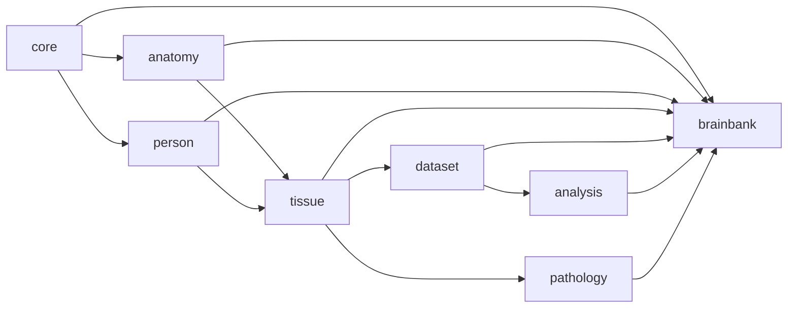

# brainbank-hippo-schema

LinkML schema for the **VA National Center for PTSD Brain Bank** data store.

This is a **prototype in plain LinkML** — it deliberately does *not* yet adopt the hippo
`SchemaPackage`/`DomainModule`/ReferenceLoader runtime, the value-set materialization pipeline, or
the versioned-bundle distribution layer described in the design docs. Those are isolated behind a
documented "hippo-readiness seam" (see [`DESIGN.md`](DESIGN.md) §7) so they can be adopted later as a
small, mechanical change rather than a rewrite.

> Status: **draft for review.** Design decisions are recorded in [`DESIGN.md`](DESIGN.md).

**[📖 Reference documentation](https://va-ncptsdbb-bioinformatics.github.io/brainbank-hippo-schema/)** — auto-generated from the schema, deployed to GitHub Pages.

## Layout

```
schema/        LinkML source modules (one concern per file)
examples/      example data instances validated in CI
evals/         discovery case set graded by Reel against a served copy of the schema
docs/          design + reference documents
DESIGN.md      the design brief and decision log
```

## Modules

A clean dependency DAG (lower layers never reference upper layers):



See [`docs/diagrams.md`](docs/diagrams.md) for the full entity-relation diagram and provenance spine.

| Module | Purpose |
|---|---|
| `core` | `NamedThing` base, `Association` base, `Activity` base (PROV-style process), `Protocol`, quantities/units |
| `anatomy` | `AnatomicalStructure` term class + Uberon-bound `AnatomicalSite` enum (FMA xref) |
| `person` | `Person` / `Donor`, `Cohort`, `Species` |
| `tissue` | `Sample`/`SolidSample`/`LiquidSample`, `Container`, `Location`, `Process` (`is_a Activity`) |
| `dataset` | `Dataset`/`Assay` (`is_a Activity`) + typed subclasses per assay family; `File`/`FileSet` physical layer |
| `analysis` | computational provenance — `WorkflowDefinition` (`is_a Protocol`: the pipeline recipe), `Analysis` (`is_a Activity`: an execution), `WorkflowRun` (`is_a Analysis`: an engine-driven run of a definition). See DESIGN.md §10 |
| `pathology` | **provisional / future work** — generic `Measurement` + `Diagnosis` placeholder |
| `brainbank` | `BrainBank` tree-root ingest container + lab extension layer: the ported brain-bank workflow (`BankFreshBrain`, `DissectFrozenBrain`, `SliceTissueToSlide`, … `is_a Process`) and its specimen subclasses (`CNSSection`, `Dura`, `CSF`, … `is_a Sample`). See DESIGN.md §9 |

## Quickstart

```bash
pip install linkml
make lint        # lint every module
make validate    # validate examples against the merged schema
make pydantic     # generate a Pydantic SDK (smoke test)
```

## Contributing

See [`CONTRIBUTING.md`](CONTRIBUTING.md) for schema conventions, import rules, linting guidance,
and how to add a new module or example.

See [`CHANGELOG.md`](CHANGELOG.md) for the version history.

## License / governance

VA-NCPTSDBB-Bioinformatics. Base modules are extended via `is_a`/`slot_usage`, never edited in place
(see `DESIGN.md` §7).
