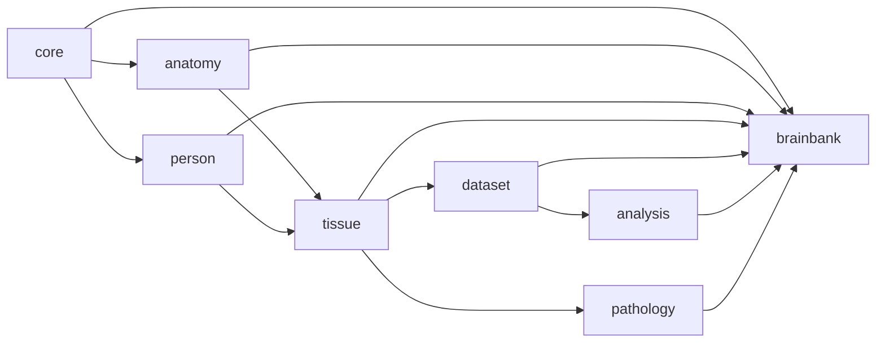
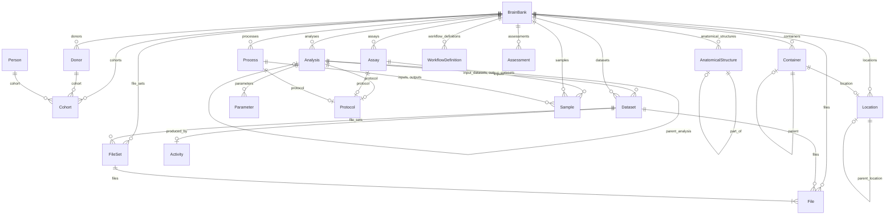
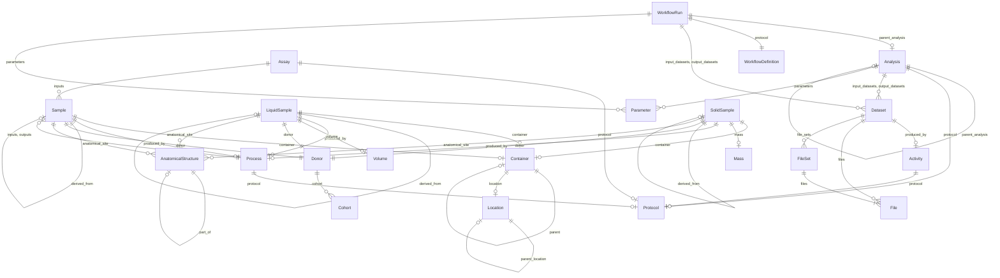

# Schema Diagrams

These diagrams are auto-generated from the schema using `gen-erdiagram` (LinkML).
Regenerate them with:

```bash
make diagrams
```

Source files (checked-in for quick rendering): `docs/schema-overview.mmd` and
`docs/provenance-spine.mmd`.

---

## Module dependency DAG

The schema is split into eight modules with a clean, acyclic import graph. Lower layers
never reference upper layers, which keeps each module independently compilable.



---

## Schema overview (entity-relation diagram)

All non-abstract concrete entities and their primary relationships, generated with
`gen-erdiagram --exclude-abstract-classes --exclude-attributes`.



---

## Computational provenance spine

The key provenance chain from a wet-lab sample through to derived data, showing the
`core.Activity` base and how `File`/`FileSet` sit under a `Dataset`.



**Reading guide:**
- `||--||` — exactly one (required)
- `||--|o` — zero or one (optional)
- `||--}o` — zero or many (optional list)
- `||--}|` — one or more (required list)
