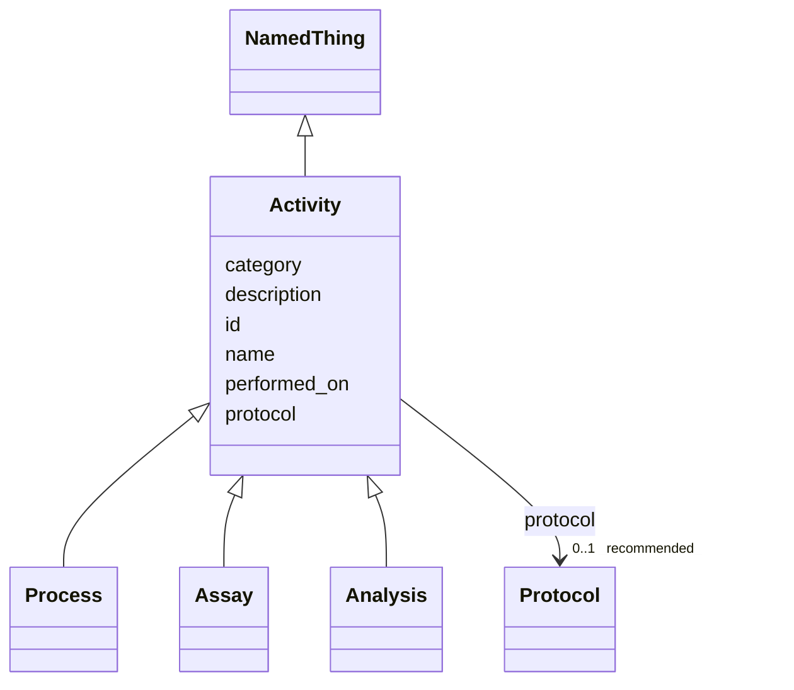

---
search:
  boost: 10.0
---

# Class: Activity 


_A PROV-style activity: something that occurs over time and acts on entities — specimen processing (tissue.Process), data acquisition (dataset.Assay), or computation (analysis.Analysis). Holds only what every activity shares; typed inputs/outputs live on the subclasses because their ranges differ (Sample vs Dataset)._


<div data-search-exclude markdown="1">


* __NOTE__: this is an abstract class and should not be instantiated directly


URI: [brainbank:Activity](https://w3id.org/VA-NCPTSDBB/brainbank/Activity)





## Inheritance
* [NamedThing](NamedThing.md)
    * **Activity**
        * [Process](Process.md)
        * [Assay](Assay.md)
        * [Analysis](Analysis.md)


## Slots

| Name | Cardinality and Range | Description | Inheritance |
| ---  | --- | --- | --- |
| [protocol](protocol.md) | 0..1 _recommended_ <br/> [Protocol](Protocol.md) | The SOP/method this activity followed | direct |
| [performed_on](performed_on.md) | 0..1 <br/> [Date](Date.md) | Date the activity was carried out | direct |
| [id](id.md) | 1 <br/> [Uriorcurie](Uriorcurie.md) | Technical identifier (UUID/CURIE); becomes hippo-managed later | [NamedThing](NamedThing.md) |
| [name](name.md) | 1 <br/> [String](String.md) | Human-readable label for the entity | [NamedThing](NamedThing.md) |
| [description](description.md) | 0..1 <br/> [String](String.md) | Free-text narrative description of the entity | [NamedThing](NamedThing.md) |
| [category](category.md) | 0..1 <br/> [String](String.md) | Names the concrete class of this instance | [NamedThing](NamedThing.md) |


## Usages

| used by | used in | type | used |
| ---  | --- | --- | --- |
| [Dataset](Dataset.md) | [produced_by](produced_by.md) | range | [Activity](Activity.md) |
| [SequenceDataset](SequenceDataset.md) | [produced_by](produced_by.md) | range | [Activity](Activity.md) |
| [RNASeqDataset](RNASeqDataset.md) | [produced_by](produced_by.md) | range | [Activity](Activity.md) |
| [GenomeVariantDataset](GenomeVariantDataset.md) | [produced_by](produced_by.md) | range | [Activity](Activity.md) |
| [ATACSeqDataset](ATACSeqDataset.md) | [produced_by](produced_by.md) | range | [Activity](Activity.md) |
| [ArrayDataset](ArrayDataset.md) | [produced_by](produced_by.md) | range | [Activity](Activity.md) |
| [GenotypingDataset](GenotypingDataset.md) | [produced_by](produced_by.md) | range | [Activity](Activity.md) |
| [MethylationDataset](MethylationDataset.md) | [produced_by](produced_by.md) | range | [Activity](Activity.md) |
| [ImageDataset](ImageDataset.md) | [produced_by](produced_by.md) | range | [Activity](Activity.md) |


## Identifier and Mapping Information


### Schema Source


* from schema: https://w3id.org/VA-NCPTSDBB/brainbank/brainbank


## Mappings

| Mapping Type | Mapped Value |
| ---  | ---  |
| self | brainbank:Activity |
| native | brainbank:Activity |
| exact | prov:Activity |


## LinkML Source

<!-- TODO: investigate https://stackoverflow.com/questions/37606292/how-to-create-tabbed-code-blocks-in-mkdocs-or-sphinx -->

### Direct

<details>
```yaml
name: Activity
description: 'A PROV-style activity: something that occurs over time and acts on entities
  — specimen processing (tissue.Process), data acquisition (dataset.Assay), or computation
  (analysis.Analysis). Holds only what every activity shares; typed inputs/outputs
  live on the subclasses because their ranges differ (Sample vs Dataset).'
from_schema: https://w3id.org/VA-NCPTSDBB/brainbank/brainbank
exact_mappings:
- prov:Activity
is_a: NamedThing
abstract: true
attributes:
  protocol:
    name: protocol
    description: The SOP/method this activity followed.
    from_schema: https://w3id.org/VA-NCPTSDBB/brainbank/core
    rank: 1000
    domain_of:
    - Activity
    range: Protocol
    recommended: true
  performed_on:
    name: performed_on
    description: Date the activity was carried out.
    from_schema: https://w3id.org/VA-NCPTSDBB/brainbank/core
    rank: 1000
    domain_of:
    - Activity
    range: date

```
</details>

### Induced

<details>
```yaml
name: Activity
description: 'A PROV-style activity: something that occurs over time and acts on entities
  — specimen processing (tissue.Process), data acquisition (dataset.Assay), or computation
  (analysis.Analysis). Holds only what every activity shares; typed inputs/outputs
  live on the subclasses because their ranges differ (Sample vs Dataset).'
from_schema: https://w3id.org/VA-NCPTSDBB/brainbank/brainbank
exact_mappings:
- prov:Activity
is_a: NamedThing
abstract: true
attributes:
  protocol:
    name: protocol
    description: The SOP/method this activity followed.
    from_schema: https://w3id.org/VA-NCPTSDBB/brainbank/core
    rank: 1000
    owner: Activity
    domain_of:
    - Activity
    range: Protocol
    recommended: true
  performed_on:
    name: performed_on
    description: Date the activity was carried out.
    from_schema: https://w3id.org/VA-NCPTSDBB/brainbank/core
    rank: 1000
    owner: Activity
    domain_of:
    - Activity
    range: date
  id:
    name: id
    description: Technical identifier (UUID/CURIE); becomes hippo-managed later.
    from_schema: https://w3id.org/VA-NCPTSDBB/brainbank/core
    rank: 1000
    identifier: true
    owner: Activity
    domain_of:
    - NamedThing
    range: uriorcurie
    required: true
  name:
    name: name
    description: Human-readable label for the entity.
    from_schema: https://w3id.org/VA-NCPTSDBB/brainbank/core
    rank: 1000
    owner: Activity
    domain_of:
    - NamedThing
    range: string
    required: true
  description:
    name: description
    description: Free-text narrative description of the entity.
    from_schema: https://w3id.org/VA-NCPTSDBB/brainbank/core
    rank: 1000
    owner: Activity
    domain_of:
    - NamedThing
    range: string
  category:
    name: category
    description: Names the concrete class of this instance. Lets polymorphic inlined
      collections (e.g. a `samples` list holding SolidSample/LiquidSample) instantiate
      the right subclass.
    from_schema: https://w3id.org/VA-NCPTSDBB/brainbank/core
    rank: 1000
    designates_type: true
    owner: Activity
    domain_of:
    - NamedThing
    range: string

```
</details></div>