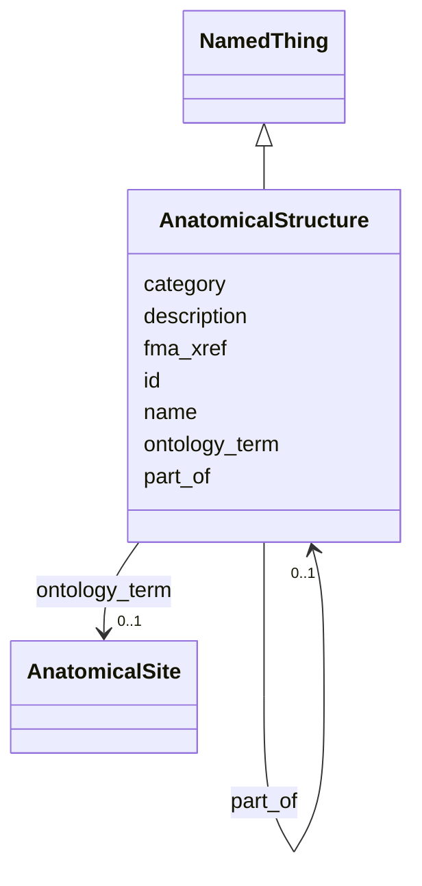

---
search:
  boost: 10.0
---

# Class: AnatomicalStructure 


_A curated anatomical term. `name` is the preferred label; `ontology_term` binds to Uberon; `fma_xref` records an FMA cross-reference when Uberon lacks a specific-enough term._


<div data-search-exclude markdown="1">


URI: [brainbank:AnatomicalStructure](https://w3id.org/VA-NCPTSDBB/brainbank/AnatomicalStructure)





## Inheritance
* [NamedThing](NamedThing.md)
    * **AnatomicalStructure**


## Slots

| Name | Cardinality and Range | Description | Inheritance |
| ---  | --- | --- | --- |
| [ontology_term](ontology_term.md) | 0..1 <br/> [AnatomicalSite](AnatomicalSite.md) | The bound Uberon term for this anatomical structure | direct |
| [fma_xref](fma_xref.md) | * <br/> [Uriorcurie](Uriorcurie.md) | FMA cross-reference(s), used when Uberon is not specific enough | direct |
| [part_of](part_of.md) | 0..1 <br/> [AnatomicalStructure](AnatomicalStructure.md) | The parent anatomical structure this structure is a part of (mereological rel... | direct |
| [id](id.md) | 1 <br/> [Uriorcurie](Uriorcurie.md) | Technical identifier (UUID/CURIE); becomes hippo-managed later | [NamedThing](NamedThing.md) |
| [name](name.md) | 1 <br/> [String](String.md) | Human-readable label for the entity | [NamedThing](NamedThing.md) |
| [description](description.md) | 0..1 <br/> [String](String.md) | Free-text narrative description of the entity | [NamedThing](NamedThing.md) |
| [category](category.md) | 0..1 <br/> [String](String.md) | Names the concrete class of this instance | [NamedThing](NamedThing.md) |


## Usages

| used by | used in | type | used |
| ---  | --- | --- | --- |
| [BrainBank](BrainBank.md) | [anatomical_structures](anatomical_structures.md) | range | [AnatomicalStructure](AnatomicalStructure.md) |
| [CNSSection](CNSSection.md) | [anatomical_site](anatomical_site.md) | range | [AnatomicalStructure](AnatomicalStructure.md) |
| [Cerebellum](Cerebellum.md) | [anatomical_site](anatomical_site.md) | range | [AnatomicalStructure](AnatomicalStructure.md) |
| [Cerebrum](Cerebrum.md) | [anatomical_site](anatomical_site.md) | range | [AnatomicalStructure](AnatomicalStructure.md) |
| [Hemisphere](Hemisphere.md) | [anatomical_site](anatomical_site.md) | range | [AnatomicalStructure](AnatomicalStructure.md) |
| [Medulla](Medulla.md) | [anatomical_site](anatomical_site.md) | range | [AnatomicalStructure](AnatomicalStructure.md) |
| [OlfactoryBulb](OlfactoryBulb.md) | [anatomical_site](anatomical_site.md) | range | [AnatomicalStructure](AnatomicalStructure.md) |
| [PinealGland](PinealGland.md) | [anatomical_site](anatomical_site.md) | range | [AnatomicalStructure](AnatomicalStructure.md) |
| [Pons](Pons.md) | [anatomical_site](anatomical_site.md) | range | [AnatomicalStructure](AnatomicalStructure.md) |
| [SubstantiaNigra](SubstantiaNigra.md) | [anatomical_site](anatomical_site.md) | range | [AnatomicalStructure](AnatomicalStructure.md) |
| [ChoroidPlexus](ChoroidPlexus.md) | [anatomical_site](anatomical_site.md) | range | [AnatomicalStructure](AnatomicalStructure.md) |
| [Pituitary](Pituitary.md) | [anatomical_site](anatomical_site.md) | range | [AnatomicalStructure](AnatomicalStructure.md) |
| [SpinalCord](SpinalCord.md) | [anatomical_site](anatomical_site.md) | range | [AnatomicalStructure](AnatomicalStructure.md) |
| [SpinalCordBlock](SpinalCordBlock.md) | [anatomical_site](anatomical_site.md) | range | [AnatomicalStructure](AnatomicalStructure.md) |
| [Brain](Brain.md) | [anatomical_site](anatomical_site.md) | range | [AnatomicalStructure](AnatomicalStructure.md) |
| [Dura](Dura.md) | [anatomical_site](anatomical_site.md) | range | [AnatomicalStructure](AnatomicalStructure.md) |
| [DuraBlock](DuraBlock.md) | [anatomical_site](anatomical_site.md) | range | [AnatomicalStructure](AnatomicalStructure.md) |
| [Skin](Skin.md) | [anatomical_site](anatomical_site.md) | range | [AnatomicalStructure](AnatomicalStructure.md) |
| [Muscle](Muscle.md) | [anatomical_site](anatomical_site.md) | range | [AnatomicalStructure](AnatomicalStructure.md) |
| [MuscleBlock](MuscleBlock.md) | [anatomical_site](anatomical_site.md) | range | [AnatomicalStructure](AnatomicalStructure.md) |
| [BloodVessel](BloodVessel.md) | [anatomical_site](anatomical_site.md) | range | [AnatomicalStructure](AnatomicalStructure.md) |
| [CSFPellet](CSFPellet.md) | [anatomical_site](anatomical_site.md) | range | [AnatomicalStructure](AnatomicalStructure.md) |
| [SpinalCordSlide](SpinalCordSlide.md) | [anatomical_site](anatomical_site.md) | range | [AnatomicalStructure](AnatomicalStructure.md) |
| [Section](Section.md) | [anatomical_site](anatomical_site.md) | range | [AnatomicalStructure](AnatomicalStructure.md) |
| [HorizontalSection](HorizontalSection.md) | [anatomical_site](anatomical_site.md) | range | [AnatomicalStructure](AnatomicalStructure.md) |
| [SagittalSection](SagittalSection.md) | [anatomical_site](anatomical_site.md) | range | [AnatomicalStructure](AnatomicalStructure.md) |
| [CoronalSection](CoronalSection.md) | [anatomical_site](anatomical_site.md) | range | [AnatomicalStructure](AnatomicalStructure.md) |
| [CSF](CSF.md) | [anatomical_site](anatomical_site.md) | range | [AnatomicalStructure](AnatomicalStructure.md) |
| [Blood](Blood.md) | [anatomical_site](anatomical_site.md) | range | [AnatomicalStructure](AnatomicalStructure.md) |
| [Cells](Cells.md) | [anatomical_site](anatomical_site.md) | range | [AnatomicalStructure](AnatomicalStructure.md) |
| [RNA](RNA.md) | [anatomical_site](anatomical_site.md) | range | [AnatomicalStructure](AnatomicalStructure.md) |
| [DNA](DNA.md) | [anatomical_site](anatomical_site.md) | range | [AnatomicalStructure](AnatomicalStructure.md) |
| [AnatomicalStructure](AnatomicalStructure.md) | [part_of](part_of.md) | range | [AnatomicalStructure](AnatomicalStructure.md) |
| [Sample](Sample.md) | [anatomical_site](anatomical_site.md) | range | [AnatomicalStructure](AnatomicalStructure.md) |
| [SolidSample](SolidSample.md) | [anatomical_site](anatomical_site.md) | range | [AnatomicalStructure](AnatomicalStructure.md) |
| [LiquidSample](LiquidSample.md) | [anatomical_site](anatomical_site.md) | range | [AnatomicalStructure](AnatomicalStructure.md) |


## Identifier and Mapping Information


### Schema Source


* from schema: https://w3id.org/VA-NCPTSDBB/brainbank/brainbank


## Mappings

| Mapping Type | Mapped Value |
| ---  | ---  |
| self | brainbank:AnatomicalStructure |
| native | brainbank:AnatomicalStructure |


## LinkML Source

<!-- TODO: investigate https://stackoverflow.com/questions/37606292/how-to-create-tabbed-code-blocks-in-mkdocs-or-sphinx -->

### Direct

<details>
```yaml
name: AnatomicalStructure
description: A curated anatomical term. `name` is the preferred label; `ontology_term`
  binds to Uberon; `fma_xref` records an FMA cross-reference when Uberon lacks a specific-enough
  term.
from_schema: https://w3id.org/VA-NCPTSDBB/brainbank/brainbank
is_a: NamedThing
attributes:
  ontology_term:
    name: ontology_term
    description: The bound Uberon term for this anatomical structure.
    from_schema: https://w3id.org/VA-NCPTSDBB/brainbank/anatomy
    rank: 1000
    domain_of:
    - AnatomicalStructure
    range: AnatomicalSite
  fma_xref:
    name: fma_xref
    description: FMA cross-reference(s), used when Uberon is not specific enough.
    from_schema: https://w3id.org/VA-NCPTSDBB/brainbank/anatomy
    rank: 1000
    domain_of:
    - AnatomicalStructure
    range: uriorcurie
    multivalued: true
  part_of:
    name: part_of
    description: The parent anatomical structure this structure is a part of (mereological
      relation).
    from_schema: https://w3id.org/VA-NCPTSDBB/brainbank/anatomy
    rank: 1000
    domain_of:
    - AnatomicalStructure
    range: AnatomicalStructure

```
</details>

### Induced

<details>
```yaml
name: AnatomicalStructure
description: A curated anatomical term. `name` is the preferred label; `ontology_term`
  binds to Uberon; `fma_xref` records an FMA cross-reference when Uberon lacks a specific-enough
  term.
from_schema: https://w3id.org/VA-NCPTSDBB/brainbank/brainbank
is_a: NamedThing
attributes:
  ontology_term:
    name: ontology_term
    description: The bound Uberon term for this anatomical structure.
    from_schema: https://w3id.org/VA-NCPTSDBB/brainbank/anatomy
    rank: 1000
    owner: AnatomicalStructure
    domain_of:
    - AnatomicalStructure
    range: AnatomicalSite
  fma_xref:
    name: fma_xref
    description: FMA cross-reference(s), used when Uberon is not specific enough.
    from_schema: https://w3id.org/VA-NCPTSDBB/brainbank/anatomy
    rank: 1000
    owner: AnatomicalStructure
    domain_of:
    - AnatomicalStructure
    range: uriorcurie
    multivalued: true
  part_of:
    name: part_of
    description: The parent anatomical structure this structure is a part of (mereological
      relation).
    from_schema: https://w3id.org/VA-NCPTSDBB/brainbank/anatomy
    rank: 1000
    owner: AnatomicalStructure
    domain_of:
    - AnatomicalStructure
    range: AnatomicalStructure
  id:
    name: id
    description: Technical identifier (UUID/CURIE); becomes hippo-managed later.
    from_schema: https://w3id.org/VA-NCPTSDBB/brainbank/core
    rank: 1000
    identifier: true
    owner: AnatomicalStructure
    domain_of:
    - NamedThing
    range: uriorcurie
    required: true
  name:
    name: name
    description: Human-readable label for the entity.
    from_schema: https://w3id.org/VA-NCPTSDBB/brainbank/core
    rank: 1000
    owner: AnatomicalStructure
    domain_of:
    - NamedThing
    range: string
    required: true
  description:
    name: description
    description: Free-text narrative description of the entity.
    from_schema: https://w3id.org/VA-NCPTSDBB/brainbank/core
    rank: 1000
    owner: AnatomicalStructure
    domain_of:
    - NamedThing
    range: string
  category:
    name: category
    description: Names the concrete class of this instance. Lets polymorphic inlined
      collections (e.g. a `samples` list holding SolidSample/LiquidSample) instantiate
      the right subclass.
    from_schema: https://w3id.org/VA-NCPTSDBB/brainbank/core
    rank: 1000
    designates_type: true
    owner: AnatomicalStructure
    domain_of:
    - NamedThing
    range: string

```
</details></div>