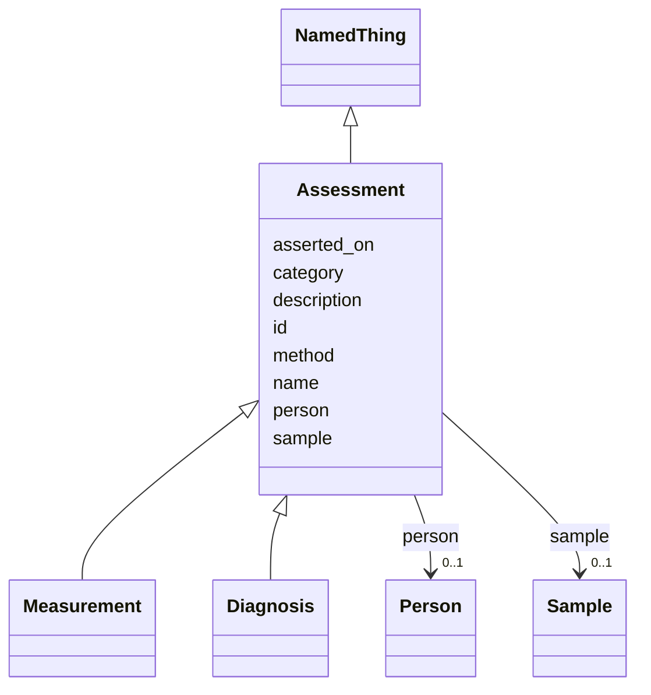

---
search:
  boost: 10.0
---

# Class: Assessment 


_A pathology assessment of a person or sample (a reified observation). PROVISIONAL._


<div data-search-exclude markdown="1">


* __NOTE__: this is an abstract class and should not be instantiated directly


URI: [brainbank:Assessment](https://w3id.org/VA-NCPTSDBB/brainbank/Assessment)





## Inheritance
* [NamedThing](NamedThing.md)
    * **Assessment**
        * [Measurement](Measurement.md)
        * [Diagnosis](Diagnosis.md)


## Slots

| Name | Cardinality and Range | Description | Inheritance |
| ---  | --- | --- | --- |
| [person](person.md) | 0..1 <br/> [Person](Person.md) | The person (donor) this assessment is about, if applicable | direct |
| [sample](sample.md) | 0..1 <br/> [Sample](Sample.md) | The tissue sample this assessment is about, if applicable | direct |
| [method](method.md) | 0..1 <br/> [String](String.md) | Method or protocol used to perform this assessment | direct |
| [asserted_on](asserted_on.md) | 0..1 <br/> [Date](Date.md) | Date on which this assessment was made or recorded | direct |
| [id](id.md) | 1 <br/> [Uriorcurie](Uriorcurie.md) | Technical identifier (UUID/CURIE); becomes hippo-managed later | [NamedThing](NamedThing.md) |
| [name](name.md) | 1 <br/> [String](String.md) | Human-readable label for the entity | [NamedThing](NamedThing.md) |
| [description](description.md) | 0..1 <br/> [String](String.md) | Free-text narrative description of the entity | [NamedThing](NamedThing.md) |
| [category](category.md) | 0..1 <br/> [String](String.md) | Names the concrete class of this instance | [NamedThing](NamedThing.md) |


## Usages

| used by | used in | type | used |
| ---  | --- | --- | --- |
| [BrainBank](BrainBank.md) | [assessments](assessments.md) | range | [Assessment](Assessment.md) |


## Identifier and Mapping Information


### Schema Source


* from schema: https://w3id.org/VA-NCPTSDBB/brainbank/brainbank


## Mappings

| Mapping Type | Mapped Value |
| ---  | ---  |
| self | brainbank:Assessment |
| native | brainbank:Assessment |


## LinkML Source

<!-- TODO: investigate https://stackoverflow.com/questions/37606292/how-to-create-tabbed-code-blocks-in-mkdocs-or-sphinx -->

### Direct

<details>
```yaml
name: Assessment
description: A pathology assessment of a person or sample (a reified observation).
  PROVISIONAL.
from_schema: https://w3id.org/VA-NCPTSDBB/brainbank/brainbank
is_a: NamedThing
abstract: true
attributes:
  person:
    name: person
    description: The person (donor) this assessment is about, if applicable.
    from_schema: https://w3id.org/VA-NCPTSDBB/brainbank/pathology
    rank: 1000
    domain_of:
    - Assessment
    range: Person
  sample:
    name: sample
    description: The tissue sample this assessment is about, if applicable.
    from_schema: https://w3id.org/VA-NCPTSDBB/brainbank/pathology
    rank: 1000
    domain_of:
    - Assessment
    range: Sample
  method:
    name: method
    description: Method or protocol used to perform this assessment.
    from_schema: https://w3id.org/VA-NCPTSDBB/brainbank/pathology
    domain_of:
    - Association
    - Assessment
  asserted_on:
    name: asserted_on
    description: Date on which this assessment was made or recorded.
    from_schema: https://w3id.org/VA-NCPTSDBB/brainbank/pathology
    domain_of:
    - Association
    - Assessment
    range: date

```
</details>

### Induced

<details>
```yaml
name: Assessment
description: A pathology assessment of a person or sample (a reified observation).
  PROVISIONAL.
from_schema: https://w3id.org/VA-NCPTSDBB/brainbank/brainbank
is_a: NamedThing
abstract: true
attributes:
  person:
    name: person
    description: The person (donor) this assessment is about, if applicable.
    from_schema: https://w3id.org/VA-NCPTSDBB/brainbank/pathology
    rank: 1000
    owner: Assessment
    domain_of:
    - Assessment
    range: Person
  sample:
    name: sample
    description: The tissue sample this assessment is about, if applicable.
    from_schema: https://w3id.org/VA-NCPTSDBB/brainbank/pathology
    rank: 1000
    owner: Assessment
    domain_of:
    - Assessment
    range: Sample
  method:
    name: method
    description: Method or protocol used to perform this assessment.
    from_schema: https://w3id.org/VA-NCPTSDBB/brainbank/pathology
    owner: Assessment
    domain_of:
    - Association
    - Assessment
    range: string
  asserted_on:
    name: asserted_on
    description: Date on which this assessment was made or recorded.
    from_schema: https://w3id.org/VA-NCPTSDBB/brainbank/pathology
    owner: Assessment
    domain_of:
    - Association
    - Assessment
    range: date
  id:
    name: id
    description: Technical identifier (UUID/CURIE); becomes hippo-managed later.
    from_schema: https://w3id.org/VA-NCPTSDBB/brainbank/core
    rank: 1000
    identifier: true
    owner: Assessment
    domain_of:
    - NamedThing
    range: uriorcurie
    required: true
  name:
    name: name
    description: Human-readable label for the entity.
    from_schema: https://w3id.org/VA-NCPTSDBB/brainbank/core
    rank: 1000
    owner: Assessment
    domain_of:
    - NamedThing
    range: string
    required: true
  description:
    name: description
    description: Free-text narrative description of the entity.
    from_schema: https://w3id.org/VA-NCPTSDBB/brainbank/core
    rank: 1000
    owner: Assessment
    domain_of:
    - NamedThing
    range: string
  category:
    name: category
    description: Names the concrete class of this instance. Lets polymorphic inlined
      collections (e.g. a `samples` list holding SolidSample/LiquidSample) instantiate
      the right subclass.
    from_schema: https://w3id.org/VA-NCPTSDBB/brainbank/core
    rank: 1000
    designates_type: true
    owner: Assessment
    domain_of:
    - NamedThing
    range: string

```
</details></div>