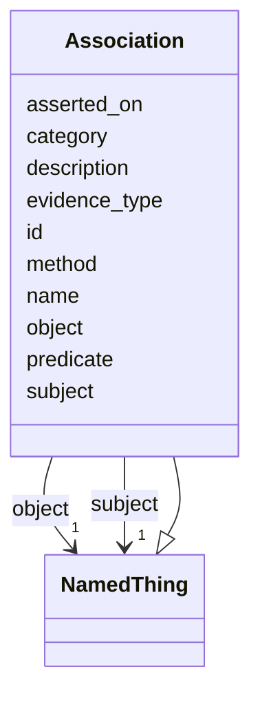

---
search:
  boost: 10.0
---

# Class: Association 


_Reified, Biolink-style relationship carrying scientific metadata only (never DB audit)._


<div data-search-exclude markdown="1">


* __NOTE__: this is an abstract class and should not be instantiated directly


URI: [brainbank:Association](https://w3id.org/VA-NCPTSDBB/brainbank/Association)





## Inheritance
* [NamedThing](NamedThing.md)
    * **Association**


## Slots

| Name | Cardinality and Range | Description | Inheritance |
| ---  | --- | --- | --- |
| [subject](subject.md) | 1 <br/> [NamedThing](NamedThing.md) | The entity playing the subject role in this relationship | direct |
| [predicate](predicate.md) | 0..1 <br/> [Uriorcurie](Uriorcurie.md) | Relation Ontology predicate, e | direct |
| [object](object.md) | 1 <br/> [NamedThing](NamedThing.md) | The entity playing the object role in this relationship | direct |
| [evidence_type](evidence_type.md) | 0..1 <br/> [String](String.md) | Type of evidence supporting this association (free text; formalize later) | direct |
| [method](method.md) | 0..1 <br/> [String](String.md) | Method or approach used to establish this association | direct |
| [asserted_on](asserted_on.md) | 0..1 <br/> [Date](Date.md) | Date on which this association was first asserted or recorded | direct |
| [id](id.md) | 1 <br/> [Uriorcurie](Uriorcurie.md) | Technical identifier (UUID/CURIE); becomes hippo-managed later | [NamedThing](NamedThing.md) |
| [name](name.md) | 1 <br/> [String](String.md) | Human-readable label for the entity | [NamedThing](NamedThing.md) |
| [description](description.md) | 0..1 <br/> [String](String.md) | Free-text narrative description of the entity | [NamedThing](NamedThing.md) |
| [category](category.md) | 0..1 <br/> [String](String.md) | Names the concrete class of this instance | [NamedThing](NamedThing.md) |


## Identifier and Mapping Information


### Schema Source


* from schema: https://w3id.org/VA-NCPTSDBB/brainbank/brainbank


## Mappings

| Mapping Type | Mapped Value |
| ---  | ---  |
| self | brainbank:Association |
| native | brainbank:Association |


## LinkML Source

<!-- TODO: investigate https://stackoverflow.com/questions/37606292/how-to-create-tabbed-code-blocks-in-mkdocs-or-sphinx -->

### Direct

<details>
```yaml
name: Association
description: Reified, Biolink-style relationship carrying scientific metadata only
  (never DB audit).
from_schema: https://w3id.org/VA-NCPTSDBB/brainbank/brainbank
is_a: NamedThing
abstract: true
attributes:
  subject:
    name: subject
    description: The entity playing the subject role in this relationship.
    from_schema: https://w3id.org/VA-NCPTSDBB/brainbank/core
    rank: 1000
    domain_of:
    - Association
    range: NamedThing
    required: true
  predicate:
    name: predicate
    description: Relation Ontology predicate, e.g. RO:0001000 'derives from'.
    from_schema: https://w3id.org/VA-NCPTSDBB/brainbank/core
    rank: 1000
    domain_of:
    - Association
    range: uriorcurie
  object:
    name: object
    description: The entity playing the object role in this relationship.
    from_schema: https://w3id.org/VA-NCPTSDBB/brainbank/core
    rank: 1000
    domain_of:
    - Association
    range: NamedThing
    required: true
  evidence_type:
    name: evidence_type
    description: Type of evidence supporting this association (free text; formalize
      later).
    from_schema: https://w3id.org/VA-NCPTSDBB/brainbank/core
    rank: 1000
    domain_of:
    - Association
  method:
    name: method
    description: Method or approach used to establish this association.
    from_schema: https://w3id.org/VA-NCPTSDBB/brainbank/core
    rank: 1000
    domain_of:
    - Association
    - Assessment
  asserted_on:
    name: asserted_on
    description: Date on which this association was first asserted or recorded.
    from_schema: https://w3id.org/VA-NCPTSDBB/brainbank/core
    rank: 1000
    domain_of:
    - Association
    - Assessment
    range: date

```
</details>

### Induced

<details>
```yaml
name: Association
description: Reified, Biolink-style relationship carrying scientific metadata only
  (never DB audit).
from_schema: https://w3id.org/VA-NCPTSDBB/brainbank/brainbank
is_a: NamedThing
abstract: true
attributes:
  subject:
    name: subject
    description: The entity playing the subject role in this relationship.
    from_schema: https://w3id.org/VA-NCPTSDBB/brainbank/core
    rank: 1000
    owner: Association
    domain_of:
    - Association
    range: NamedThing
    required: true
  predicate:
    name: predicate
    description: Relation Ontology predicate, e.g. RO:0001000 'derives from'.
    from_schema: https://w3id.org/VA-NCPTSDBB/brainbank/core
    rank: 1000
    owner: Association
    domain_of:
    - Association
    range: uriorcurie
  object:
    name: object
    description: The entity playing the object role in this relationship.
    from_schema: https://w3id.org/VA-NCPTSDBB/brainbank/core
    rank: 1000
    owner: Association
    domain_of:
    - Association
    range: NamedThing
    required: true
  evidence_type:
    name: evidence_type
    description: Type of evidence supporting this association (free text; formalize
      later).
    from_schema: https://w3id.org/VA-NCPTSDBB/brainbank/core
    rank: 1000
    owner: Association
    domain_of:
    - Association
    range: string
  method:
    name: method
    description: Method or approach used to establish this association.
    from_schema: https://w3id.org/VA-NCPTSDBB/brainbank/core
    rank: 1000
    owner: Association
    domain_of:
    - Association
    - Assessment
    range: string
  asserted_on:
    name: asserted_on
    description: Date on which this association was first asserted or recorded.
    from_schema: https://w3id.org/VA-NCPTSDBB/brainbank/core
    rank: 1000
    owner: Association
    domain_of:
    - Association
    - Assessment
    range: date
  id:
    name: id
    description: Technical identifier (UUID/CURIE); becomes hippo-managed later.
    from_schema: https://w3id.org/VA-NCPTSDBB/brainbank/core
    rank: 1000
    identifier: true
    owner: Association
    domain_of:
    - NamedThing
    range: uriorcurie
    required: true
  name:
    name: name
    description: Human-readable label for the entity.
    from_schema: https://w3id.org/VA-NCPTSDBB/brainbank/core
    rank: 1000
    owner: Association
    domain_of:
    - NamedThing
    range: string
    required: true
  description:
    name: description
    description: Free-text narrative description of the entity.
    from_schema: https://w3id.org/VA-NCPTSDBB/brainbank/core
    rank: 1000
    owner: Association
    domain_of:
    - NamedThing
    range: string
  category:
    name: category
    description: Names the concrete class of this instance. Lets polymorphic inlined
      collections (e.g. a `samples` list holding SolidSample/LiquidSample) instantiate
      the right subclass.
    from_schema: https://w3id.org/VA-NCPTSDBB/brainbank/core
    rank: 1000
    designates_type: true
    owner: Association
    domain_of:
    - NamedThing
    range: string

```
</details></div>