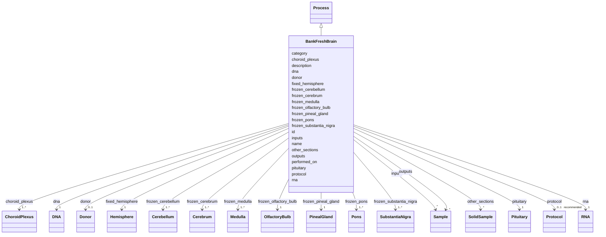

---
search:
  boost: 10.0
---

# Class: BankFreshBrain 


_Bank a fresh (unfixed) brain: fix one hemisphere and freeze the rest as named regions, extracting DNA/RNA. Ported from bank_brain_workflow:BankFreshBrain._


<div data-search-exclude markdown="1">


URI: [brainbank:BankFreshBrain](https://w3id.org/VA-NCPTSDBB/brainbank/BankFreshBrain)





## Inheritance
* [NamedThing](NamedThing.md)
    * [Activity](Activity.md)
        * [Process](Process.md)
            * **BankFreshBrain**


## Slots

| Name | Cardinality and Range | Description | Inheritance |
| ---  | --- | --- | --- |
| [donor](donor.md) | 0..1 <br/> [Donor](Donor.md) | The donor whose brain is being banked | direct |
| [fixed_hemisphere](fixed_hemisphere.md) | 1 <br/> [Hemisphere](Hemisphere.md) | The hemisphere fixed in formalin for histology | direct |
| [frozen_cerebellum](frozen_cerebellum.md) | 1..* <br/> [Cerebellum](Cerebellum.md) | Cerebellum specimen(s) snap-frozen for molecular assays | direct |
| [frozen_olfactory_bulb](frozen_olfactory_bulb.md) | 1 <br/> [OlfactoryBulb](OlfactoryBulb.md) | Olfactory bulb specimen snap-frozen for molecular assays | direct |
| [frozen_pineal_gland](frozen_pineal_gland.md) | 1 <br/> [PinealGland](PinealGland.md) | Pineal gland specimen snap-frozen for molecular assays | direct |
| [frozen_substantia_nigra](frozen_substantia_nigra.md) | 1..* <br/> [SubstantiaNigra](SubstantiaNigra.md) | Substantia nigra specimen(s) snap-frozen for molecular assays | direct |
| [frozen_pons](frozen_pons.md) | 1..* <br/> [Pons](Pons.md) | Pons specimen(s) snap-frozen for molecular assays | direct |
| [frozen_medulla](frozen_medulla.md) | 1..* <br/> [Medulla](Medulla.md) | Medulla oblongata specimen(s) snap-frozen for molecular assays | direct |
| [frozen_cerebrum](frozen_cerebrum.md) | 1..* <br/> [Cerebrum](Cerebrum.md) | Cerebrum specimen(s) snap-frozen for molecular assays | direct |
| [dna](dna.md) | 1 <br/> [DNA](DNA.md) | DNA extract obtained during brain banking | direct |
| [rna](rna.md) | 1 <br/> [RNA](RNA.md) | RNA extract obtained during brain banking | direct |
| [choroid_plexus](choroid_plexus.md) | 1..* <br/> [ChoroidPlexus](ChoroidPlexus.md) | Choroid plexus specimen(s) snap-frozen for molecular assays | direct |
| [pituitary](pituitary.md) | 1 <br/> [Pituitary](Pituitary.md) | Pituitary gland specimen snap-frozen for molecular assays | direct |
| [other_sections](other_sections.md) | * <br/> [SolidSample](SolidSample.md) | Any additional tissue sections collected during banking | direct |
| [inputs](inputs.md) | * <br/> [Sample](Sample.md) | Input specimens consumed or transformed by this process | [Process](Process.md) |
| [outputs](outputs.md) | * <br/> [Sample](Sample.md) | Specimens produced as output of this process | [Process](Process.md) |
| [protocol](protocol.md) | 0..1 _recommended_ <br/> [Protocol](Protocol.md) | The SOP/method this activity followed | [Activity](Activity.md) |
| [performed_on](performed_on.md) | 0..1 <br/> [Date](Date.md) | Date the activity was carried out | [Activity](Activity.md) |
| [id](id.md) | 1 <br/> [Uriorcurie](Uriorcurie.md) | Technical identifier (UUID/CURIE); becomes hippo-managed later | [NamedThing](NamedThing.md) |
| [name](name.md) | 1 <br/> [String](String.md) | Human-readable label for the entity | [NamedThing](NamedThing.md) |
| [description](description.md) | 0..1 <br/> [String](String.md) | Free-text narrative description of the entity | [NamedThing](NamedThing.md) |
| [category](category.md) | 0..1 <br/> [String](String.md) | Names the concrete class of this instance | [NamedThing](NamedThing.md) |


## Identifier and Mapping Information


### Schema Source


* from schema: https://w3id.org/VA-NCPTSDBB/brainbank/brainbank


## Mappings

| Mapping Type | Mapped Value |
| ---  | ---  |
| self | brainbank:BankFreshBrain |
| native | brainbank:BankFreshBrain |


## LinkML Source

<!-- TODO: investigate https://stackoverflow.com/questions/37606292/how-to-create-tabbed-code-blocks-in-mkdocs-or-sphinx -->

### Direct

<details>
```yaml
name: BankFreshBrain
description: 'Bank a fresh (unfixed) brain: fix one hemisphere and freeze the rest
  as named regions, extracting DNA/RNA. Ported from bank_brain_workflow:BankFreshBrain.'
from_schema: https://w3id.org/VA-NCPTSDBB/brainbank/brainbank
is_a: Process
attributes:
  donor:
    name: donor
    description: The donor whose brain is being banked.
    from_schema: https://w3id.org/VA-NCPTSDBB/brainbank/brainbank
    rank: 1000
    domain_of:
    - BankFreshBrain
    - BankFixedBrain
    - Sample
    range: Donor
  fixed_hemisphere:
    name: fixed_hemisphere
    description: The hemisphere fixed in formalin for histology.
    from_schema: https://w3id.org/VA-NCPTSDBB/brainbank/brainbank
    rank: 1000
    domain_of:
    - BankFreshBrain
    range: Hemisphere
    required: true
  frozen_cerebellum:
    name: frozen_cerebellum
    description: Cerebellum specimen(s) snap-frozen for molecular assays.
    from_schema: https://w3id.org/VA-NCPTSDBB/brainbank/brainbank
    rank: 1000
    domain_of:
    - BankFreshBrain
    range: Cerebellum
    required: true
    multivalued: true
  frozen_olfactory_bulb:
    name: frozen_olfactory_bulb
    description: Olfactory bulb specimen snap-frozen for molecular assays.
    from_schema: https://w3id.org/VA-NCPTSDBB/brainbank/brainbank
    rank: 1000
    domain_of:
    - BankFreshBrain
    range: OlfactoryBulb
    required: true
  frozen_pineal_gland:
    name: frozen_pineal_gland
    description: Pineal gland specimen snap-frozen for molecular assays.
    from_schema: https://w3id.org/VA-NCPTSDBB/brainbank/brainbank
    rank: 1000
    domain_of:
    - BankFreshBrain
    range: PinealGland
    required: true
  frozen_substantia_nigra:
    name: frozen_substantia_nigra
    description: Substantia nigra specimen(s) snap-frozen for molecular assays.
    from_schema: https://w3id.org/VA-NCPTSDBB/brainbank/brainbank
    rank: 1000
    domain_of:
    - BankFreshBrain
    range: SubstantiaNigra
    required: true
    multivalued: true
  frozen_pons:
    name: frozen_pons
    description: Pons specimen(s) snap-frozen for molecular assays.
    from_schema: https://w3id.org/VA-NCPTSDBB/brainbank/brainbank
    rank: 1000
    domain_of:
    - BankFreshBrain
    range: Pons
    required: true
    multivalued: true
  frozen_medulla:
    name: frozen_medulla
    description: Medulla oblongata specimen(s) snap-frozen for molecular assays.
    from_schema: https://w3id.org/VA-NCPTSDBB/brainbank/brainbank
    rank: 1000
    domain_of:
    - BankFreshBrain
    range: Medulla
    required: true
    multivalued: true
  frozen_cerebrum:
    name: frozen_cerebrum
    description: Cerebrum specimen(s) snap-frozen for molecular assays.
    from_schema: https://w3id.org/VA-NCPTSDBB/brainbank/brainbank
    rank: 1000
    domain_of:
    - BankFreshBrain
    range: Cerebrum
    required: true
    multivalued: true
  dna:
    name: dna
    description: DNA extract obtained during brain banking.
    from_schema: https://w3id.org/VA-NCPTSDBB/brainbank/brainbank
    rank: 1000
    domain_of:
    - BankFreshBrain
    range: DNA
    required: true
  rna:
    name: rna
    description: RNA extract obtained during brain banking.
    from_schema: https://w3id.org/VA-NCPTSDBB/brainbank/brainbank
    rank: 1000
    domain_of:
    - BankFreshBrain
    range: RNA
    required: true
  choroid_plexus:
    name: choroid_plexus
    description: Choroid plexus specimen(s) snap-frozen for molecular assays.
    from_schema: https://w3id.org/VA-NCPTSDBB/brainbank/brainbank
    rank: 1000
    domain_of:
    - BankFreshBrain
    range: ChoroidPlexus
    required: true
    multivalued: true
  pituitary:
    name: pituitary
    description: Pituitary gland specimen snap-frozen for molecular assays.
    from_schema: https://w3id.org/VA-NCPTSDBB/brainbank/brainbank
    rank: 1000
    domain_of:
    - BankFreshBrain
    range: Pituitary
    required: true
  other_sections:
    name: other_sections
    description: Any additional tissue sections collected during banking.
    from_schema: https://w3id.org/VA-NCPTSDBB/brainbank/brainbank
    rank: 1000
    domain_of:
    - BankFreshBrain
    range: SolidSample
    multivalued: true

```
</details>

### Induced

<details>
```yaml
name: BankFreshBrain
description: 'Bank a fresh (unfixed) brain: fix one hemisphere and freeze the rest
  as named regions, extracting DNA/RNA. Ported from bank_brain_workflow:BankFreshBrain.'
from_schema: https://w3id.org/VA-NCPTSDBB/brainbank/brainbank
is_a: Process
attributes:
  donor:
    name: donor
    description: The donor whose brain is being banked.
    from_schema: https://w3id.org/VA-NCPTSDBB/brainbank/brainbank
    rank: 1000
    owner: BankFreshBrain
    domain_of:
    - BankFreshBrain
    - BankFixedBrain
    - Sample
    range: Donor
  fixed_hemisphere:
    name: fixed_hemisphere
    description: The hemisphere fixed in formalin for histology.
    from_schema: https://w3id.org/VA-NCPTSDBB/brainbank/brainbank
    rank: 1000
    owner: BankFreshBrain
    domain_of:
    - BankFreshBrain
    range: Hemisphere
    required: true
  frozen_cerebellum:
    name: frozen_cerebellum
    description: Cerebellum specimen(s) snap-frozen for molecular assays.
    from_schema: https://w3id.org/VA-NCPTSDBB/brainbank/brainbank
    rank: 1000
    owner: BankFreshBrain
    domain_of:
    - BankFreshBrain
    range: Cerebellum
    required: true
    multivalued: true
  frozen_olfactory_bulb:
    name: frozen_olfactory_bulb
    description: Olfactory bulb specimen snap-frozen for molecular assays.
    from_schema: https://w3id.org/VA-NCPTSDBB/brainbank/brainbank
    rank: 1000
    owner: BankFreshBrain
    domain_of:
    - BankFreshBrain
    range: OlfactoryBulb
    required: true
  frozen_pineal_gland:
    name: frozen_pineal_gland
    description: Pineal gland specimen snap-frozen for molecular assays.
    from_schema: https://w3id.org/VA-NCPTSDBB/brainbank/brainbank
    rank: 1000
    owner: BankFreshBrain
    domain_of:
    - BankFreshBrain
    range: PinealGland
    required: true
  frozen_substantia_nigra:
    name: frozen_substantia_nigra
    description: Substantia nigra specimen(s) snap-frozen for molecular assays.
    from_schema: https://w3id.org/VA-NCPTSDBB/brainbank/brainbank
    rank: 1000
    owner: BankFreshBrain
    domain_of:
    - BankFreshBrain
    range: SubstantiaNigra
    required: true
    multivalued: true
  frozen_pons:
    name: frozen_pons
    description: Pons specimen(s) snap-frozen for molecular assays.
    from_schema: https://w3id.org/VA-NCPTSDBB/brainbank/brainbank
    rank: 1000
    owner: BankFreshBrain
    domain_of:
    - BankFreshBrain
    range: Pons
    required: true
    multivalued: true
  frozen_medulla:
    name: frozen_medulla
    description: Medulla oblongata specimen(s) snap-frozen for molecular assays.
    from_schema: https://w3id.org/VA-NCPTSDBB/brainbank/brainbank
    rank: 1000
    owner: BankFreshBrain
    domain_of:
    - BankFreshBrain
    range: Medulla
    required: true
    multivalued: true
  frozen_cerebrum:
    name: frozen_cerebrum
    description: Cerebrum specimen(s) snap-frozen for molecular assays.
    from_schema: https://w3id.org/VA-NCPTSDBB/brainbank/brainbank
    rank: 1000
    owner: BankFreshBrain
    domain_of:
    - BankFreshBrain
    range: Cerebrum
    required: true
    multivalued: true
  dna:
    name: dna
    description: DNA extract obtained during brain banking.
    from_schema: https://w3id.org/VA-NCPTSDBB/brainbank/brainbank
    rank: 1000
    owner: BankFreshBrain
    domain_of:
    - BankFreshBrain
    range: DNA
    required: true
  rna:
    name: rna
    description: RNA extract obtained during brain banking.
    from_schema: https://w3id.org/VA-NCPTSDBB/brainbank/brainbank
    rank: 1000
    owner: BankFreshBrain
    domain_of:
    - BankFreshBrain
    range: RNA
    required: true
  choroid_plexus:
    name: choroid_plexus
    description: Choroid plexus specimen(s) snap-frozen for molecular assays.
    from_schema: https://w3id.org/VA-NCPTSDBB/brainbank/brainbank
    rank: 1000
    owner: BankFreshBrain
    domain_of:
    - BankFreshBrain
    range: ChoroidPlexus
    required: true
    multivalued: true
  pituitary:
    name: pituitary
    description: Pituitary gland specimen snap-frozen for molecular assays.
    from_schema: https://w3id.org/VA-NCPTSDBB/brainbank/brainbank
    rank: 1000
    owner: BankFreshBrain
    domain_of:
    - BankFreshBrain
    range: Pituitary
    required: true
  other_sections:
    name: other_sections
    description: Any additional tissue sections collected during banking.
    from_schema: https://w3id.org/VA-NCPTSDBB/brainbank/brainbank
    rank: 1000
    owner: BankFreshBrain
    domain_of:
    - BankFreshBrain
    range: SolidSample
    multivalued: true
  inputs:
    name: inputs
    description: Input specimens consumed or transformed by this process.
    from_schema: https://w3id.org/VA-NCPTSDBB/brainbank/tissue
    rank: 1000
    owner: BankFreshBrain
    domain_of:
    - Process
    - Assay
    range: Sample
    multivalued: true
  outputs:
    name: outputs
    description: Specimens produced as output of this process.
    from_schema: https://w3id.org/VA-NCPTSDBB/brainbank/tissue
    rank: 1000
    owner: BankFreshBrain
    domain_of:
    - Process
    range: Sample
    multivalued: true
  protocol:
    name: protocol
    description: The SOP/method this activity followed.
    from_schema: https://w3id.org/VA-NCPTSDBB/brainbank/core
    rank: 1000
    owner: BankFreshBrain
    domain_of:
    - Activity
    range: Protocol
    recommended: true
  performed_on:
    name: performed_on
    description: Date the activity was carried out.
    from_schema: https://w3id.org/VA-NCPTSDBB/brainbank/core
    rank: 1000
    owner: BankFreshBrain
    domain_of:
    - Activity
    range: date
  id:
    name: id
    description: Technical identifier (UUID/CURIE); becomes hippo-managed later.
    from_schema: https://w3id.org/VA-NCPTSDBB/brainbank/core
    rank: 1000
    identifier: true
    owner: BankFreshBrain
    domain_of:
    - NamedThing
    range: uriorcurie
    required: true
  name:
    name: name
    description: Human-readable label for the entity.
    from_schema: https://w3id.org/VA-NCPTSDBB/brainbank/core
    rank: 1000
    owner: BankFreshBrain
    domain_of:
    - NamedThing
    range: string
    required: true
  description:
    name: description
    description: Free-text narrative description of the entity.
    from_schema: https://w3id.org/VA-NCPTSDBB/brainbank/core
    rank: 1000
    owner: BankFreshBrain
    domain_of:
    - NamedThing
    range: string
  category:
    name: category
    description: Names the concrete class of this instance. Lets polymorphic inlined
      collections (e.g. a `samples` list holding SolidSample/LiquidSample) instantiate
      the right subclass.
    from_schema: https://w3id.org/VA-NCPTSDBB/brainbank/core
    rank: 1000
    designates_type: true
    owner: BankFreshBrain
    domain_of:
    - NamedThing
    range: string

```
</details></div>