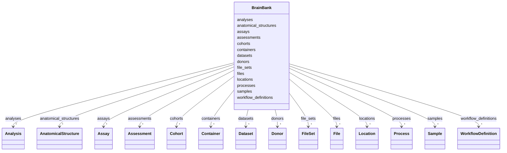

---
search:
  boost: 10.0
---

# Class: BrainBank 


_Top-level ingest container for a brain bank record set. Collects all entity collections (donors, samples, processes, datasets, analyses, assessments, etc.) in a single root object suitable for validation and serialization._


<div data-search-exclude markdown="1">


URI: [brainbank:BrainBank](https://w3id.org/VA-NCPTSDBB/brainbank/BrainBank)





<!-- no inheritance hierarchy -->

## Class Properties

| Property | Value |
| --- | --- |
| Tree Root | Yes |


## Slots

| Name | Cardinality and Range | Description | Inheritance |
| ---  | --- | --- | --- |
| [donors](donors.md) | * <br/> [Donor](Donor.md) | Registered tissue donors | direct |
| [samples](samples.md) | * <br/> [Sample](Sample.md) | All tissue and fluid samples in this record set | direct |
| [processes](processes.md) | * <br/> [Process](Process.md) | Specimen-processing and transformation events | direct |
| [containers](containers.md) | * <br/> [Container](Container.md) | Physical storage containers (vials, boxes, freezers, etc | direct |
| [locations](locations.md) | * <br/> [Location](Location.md) | Physical storage locations (rooms, buildings, sites) | direct |
| [cohorts](cohorts.md) | * <br/> [Cohort](Cohort.md) | Study cohorts referenced by donors | direct |
| [anatomical_structures](anatomical_structures.md) | * <br/> [AnatomicalStructure](AnatomicalStructure.md) | Curated anatomy terms referenced by samples (reference data for now) | direct |
| [datasets](datasets.md) | * <br/> [Dataset](Dataset.md) | Scientific data artifacts (expression matrices, VCFs, images, etc | direct |
| [assays](assays.md) | * <br/> [Assay](Assay.md) | Assay process nodes linking samples to datasets | direct |
| [files](files.md) | * <br/> [File](File.md) | Individual data files backing datasets | direct |
| [file_sets](file_sets.md) | * <br/> [FileSet](FileSet.md) | Named file bundles (e | direct |
| [workflow_definitions](workflow_definitions.md) | * <br/> [WorkflowDefinition](WorkflowDefinition.md) | Reusable pipeline definitions (recipes) referenced by workflow runs | direct |
| [analyses](analyses.md) | * <br/> [Analysis](Analysis.md) | Computational analyses, including engine-driven WorkflowRun executions | direct |
| [assessments](assessments.md) | * <br/> [Assessment](Assessment.md) | Pathology assessments (measurements, diagnoses) for donors and samples | direct |


## Identifier and Mapping Information


### Schema Source


* from schema: https://w3id.org/VA-NCPTSDBB/brainbank/brainbank


## Mappings

| Mapping Type | Mapped Value |
| ---  | ---  |
| self | brainbank:BrainBank |
| native | brainbank:BrainBank |


## LinkML Source

<!-- TODO: investigate https://stackoverflow.com/questions/37606292/how-to-create-tabbed-code-blocks-in-mkdocs-or-sphinx -->

### Direct

<details>
```yaml
name: BrainBank
description: Top-level ingest container for a brain bank record set. Collects all
  entity collections (donors, samples, processes, datasets, analyses, assessments,
  etc.) in a single root object suitable for validation and serialization.
from_schema: https://w3id.org/VA-NCPTSDBB/brainbank/brainbank
attributes:
  donors:
    name: donors
    description: Registered tissue donors.
    from_schema: https://w3id.org/VA-NCPTSDBB/brainbank/brainbank
    rank: 1000
    domain_of:
    - BrainBank
    range: Donor
    multivalued: true
    inlined_as_list: true
  samples:
    name: samples
    description: All tissue and fluid samples in this record set.
    from_schema: https://w3id.org/VA-NCPTSDBB/brainbank/brainbank
    rank: 1000
    domain_of:
    - BrainBank
    range: Sample
    multivalued: true
    inlined_as_list: true
  processes:
    name: processes
    description: Specimen-processing and transformation events.
    from_schema: https://w3id.org/VA-NCPTSDBB/brainbank/brainbank
    rank: 1000
    domain_of:
    - BrainBank
    range: Process
    multivalued: true
    inlined_as_list: true
  containers:
    name: containers
    description: Physical storage containers (vials, boxes, freezers, etc.).
    from_schema: https://w3id.org/VA-NCPTSDBB/brainbank/brainbank
    rank: 1000
    domain_of:
    - BrainBank
    range: Container
    multivalued: true
    inlined_as_list: true
  locations:
    name: locations
    description: Physical storage locations (rooms, buildings, sites).
    from_schema: https://w3id.org/VA-NCPTSDBB/brainbank/brainbank
    rank: 1000
    domain_of:
    - BrainBank
    range: Location
    multivalued: true
    inlined_as_list: true
  cohorts:
    name: cohorts
    description: Study cohorts referenced by donors.
    from_schema: https://w3id.org/VA-NCPTSDBB/brainbank/brainbank
    rank: 1000
    domain_of:
    - BrainBank
    range: Cohort
    multivalued: true
    inlined_as_list: true
  anatomical_structures:
    name: anatomical_structures
    description: Curated anatomy terms referenced by samples (reference data for now).
    from_schema: https://w3id.org/VA-NCPTSDBB/brainbank/brainbank
    rank: 1000
    domain_of:
    - BrainBank
    range: AnatomicalStructure
    multivalued: true
    inlined_as_list: true
  datasets:
    name: datasets
    description: Scientific data artifacts (expression matrices, VCFs, images, etc.).
    from_schema: https://w3id.org/VA-NCPTSDBB/brainbank/brainbank
    rank: 1000
    domain_of:
    - BrainBank
    range: Dataset
    multivalued: true
    inlined_as_list: true
  assays:
    name: assays
    description: Assay process nodes linking samples to datasets.
    from_schema: https://w3id.org/VA-NCPTSDBB/brainbank/brainbank
    rank: 1000
    domain_of:
    - BrainBank
    range: Assay
    multivalued: true
    inlined_as_list: true
  files:
    name: files
    description: Individual data files backing datasets.
    from_schema: https://w3id.org/VA-NCPTSDBB/brainbank/brainbank
    rank: 1000
    domain_of:
    - BrainBank
    - Dataset
    - FileSet
    range: File
    multivalued: true
    inlined_as_list: true
  file_sets:
    name: file_sets
    description: Named file bundles (e.g. paired-end FASTQ pairs).
    from_schema: https://w3id.org/VA-NCPTSDBB/brainbank/brainbank
    rank: 1000
    domain_of:
    - BrainBank
    - Dataset
    range: FileSet
    multivalued: true
    inlined_as_list: true
  workflow_definitions:
    name: workflow_definitions
    description: Reusable pipeline definitions (recipes) referenced by workflow runs.
    from_schema: https://w3id.org/VA-NCPTSDBB/brainbank/brainbank
    rank: 1000
    domain_of:
    - BrainBank
    range: WorkflowDefinition
    multivalued: true
    inlined_as_list: true
  analyses:
    name: analyses
    description: Computational analyses, including engine-driven WorkflowRun executions.
    from_schema: https://w3id.org/VA-NCPTSDBB/brainbank/brainbank
    rank: 1000
    domain_of:
    - BrainBank
    range: Analysis
    multivalued: true
    inlined_as_list: true
  assessments:
    name: assessments
    description: Pathology assessments (measurements, diagnoses) for donors and samples.
    from_schema: https://w3id.org/VA-NCPTSDBB/brainbank/brainbank
    rank: 1000
    domain_of:
    - BrainBank
    range: Assessment
    multivalued: true
    inlined_as_list: true
tree_root: true

```
</details>

### Induced

<details>
```yaml
name: BrainBank
description: Top-level ingest container for a brain bank record set. Collects all
  entity collections (donors, samples, processes, datasets, analyses, assessments,
  etc.) in a single root object suitable for validation and serialization.
from_schema: https://w3id.org/VA-NCPTSDBB/brainbank/brainbank
attributes:
  donors:
    name: donors
    description: Registered tissue donors.
    from_schema: https://w3id.org/VA-NCPTSDBB/brainbank/brainbank
    rank: 1000
    owner: BrainBank
    domain_of:
    - BrainBank
    range: Donor
    multivalued: true
    inlined: true
    inlined_as_list: true
  samples:
    name: samples
    description: All tissue and fluid samples in this record set.
    from_schema: https://w3id.org/VA-NCPTSDBB/brainbank/brainbank
    rank: 1000
    owner: BrainBank
    domain_of:
    - BrainBank
    range: Sample
    multivalued: true
    inlined: true
    inlined_as_list: true
  processes:
    name: processes
    description: Specimen-processing and transformation events.
    from_schema: https://w3id.org/VA-NCPTSDBB/brainbank/brainbank
    rank: 1000
    owner: BrainBank
    domain_of:
    - BrainBank
    range: Process
    multivalued: true
    inlined: true
    inlined_as_list: true
  containers:
    name: containers
    description: Physical storage containers (vials, boxes, freezers, etc.).
    from_schema: https://w3id.org/VA-NCPTSDBB/brainbank/brainbank
    rank: 1000
    owner: BrainBank
    domain_of:
    - BrainBank
    range: Container
    multivalued: true
    inlined: true
    inlined_as_list: true
  locations:
    name: locations
    description: Physical storage locations (rooms, buildings, sites).
    from_schema: https://w3id.org/VA-NCPTSDBB/brainbank/brainbank
    rank: 1000
    owner: BrainBank
    domain_of:
    - BrainBank
    range: Location
    multivalued: true
    inlined: true
    inlined_as_list: true
  cohorts:
    name: cohorts
    description: Study cohorts referenced by donors.
    from_schema: https://w3id.org/VA-NCPTSDBB/brainbank/brainbank
    rank: 1000
    owner: BrainBank
    domain_of:
    - BrainBank
    range: Cohort
    multivalued: true
    inlined: true
    inlined_as_list: true
  anatomical_structures:
    name: anatomical_structures
    description: Curated anatomy terms referenced by samples (reference data for now).
    from_schema: https://w3id.org/VA-NCPTSDBB/brainbank/brainbank
    rank: 1000
    owner: BrainBank
    domain_of:
    - BrainBank
    range: AnatomicalStructure
    multivalued: true
    inlined: true
    inlined_as_list: true
  datasets:
    name: datasets
    description: Scientific data artifacts (expression matrices, VCFs, images, etc.).
    from_schema: https://w3id.org/VA-NCPTSDBB/brainbank/brainbank
    rank: 1000
    owner: BrainBank
    domain_of:
    - BrainBank
    range: Dataset
    multivalued: true
    inlined: true
    inlined_as_list: true
  assays:
    name: assays
    description: Assay process nodes linking samples to datasets.
    from_schema: https://w3id.org/VA-NCPTSDBB/brainbank/brainbank
    rank: 1000
    owner: BrainBank
    domain_of:
    - BrainBank
    range: Assay
    multivalued: true
    inlined: true
    inlined_as_list: true
  files:
    name: files
    description: Individual data files backing datasets.
    from_schema: https://w3id.org/VA-NCPTSDBB/brainbank/brainbank
    rank: 1000
    owner: BrainBank
    domain_of:
    - BrainBank
    - Dataset
    - FileSet
    range: File
    multivalued: true
    inlined: true
    inlined_as_list: true
  file_sets:
    name: file_sets
    description: Named file bundles (e.g. paired-end FASTQ pairs).
    from_schema: https://w3id.org/VA-NCPTSDBB/brainbank/brainbank
    rank: 1000
    owner: BrainBank
    domain_of:
    - BrainBank
    - Dataset
    range: FileSet
    multivalued: true
    inlined: true
    inlined_as_list: true
  workflow_definitions:
    name: workflow_definitions
    description: Reusable pipeline definitions (recipes) referenced by workflow runs.
    from_schema: https://w3id.org/VA-NCPTSDBB/brainbank/brainbank
    rank: 1000
    owner: BrainBank
    domain_of:
    - BrainBank
    range: WorkflowDefinition
    multivalued: true
    inlined: true
    inlined_as_list: true
  analyses:
    name: analyses
    description: Computational analyses, including engine-driven WorkflowRun executions.
    from_schema: https://w3id.org/VA-NCPTSDBB/brainbank/brainbank
    rank: 1000
    owner: BrainBank
    domain_of:
    - BrainBank
    range: Analysis
    multivalued: true
    inlined: true
    inlined_as_list: true
  assessments:
    name: assessments
    description: Pathology assessments (measurements, diagnoses) for donors and samples.
    from_schema: https://w3id.org/VA-NCPTSDBB/brainbank/brainbank
    rank: 1000
    owner: BrainBank
    domain_of:
    - BrainBank
    range: Assessment
    multivalued: true
    inlined: true
    inlined_as_list: true
tree_root: true

```
</details></div>