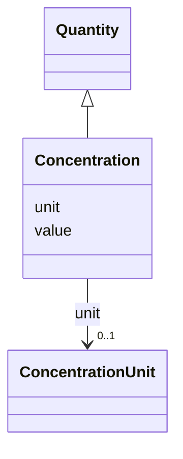

---
search:
  boost: 10.0
---

# Class: Concentration 


_A concentration measurement (e.g. RNA/DNA concentration in ng/µL)._


<div data-search-exclude markdown="1">


URI: [brainbank:Concentration](https://w3id.org/VA-NCPTSDBB/brainbank/Concentration)





## Inheritance
* [Quantity](Quantity.md)
    * **Concentration**


## Slots

| Name | Cardinality and Range | Description | Inheritance |
| ---  | --- | --- | --- |
| [unit](unit.md) | 0..1 <br/> [ConcentrationUnit](ConcentrationUnit.md) | Unit of concentration for this measurement | direct |
| [value](value.md) | 0..1 <br/> [Float](Float.md) | Numeric magnitude of the measurement | [Quantity](Quantity.md) |


## Usages

| used by | used in | type | used |
| ---  | --- | --- | --- |
| [RNA](RNA.md) | [concentration](concentration.md) | range | [Concentration](Concentration.md) |
| [DNA](DNA.md) | [concentration](concentration.md) | range | [Concentration](Concentration.md) |


## Identifier and Mapping Information


### Schema Source


* from schema: https://w3id.org/VA-NCPTSDBB/brainbank/brainbank


## Mappings

| Mapping Type | Mapped Value |
| ---  | ---  |
| self | brainbank:Concentration |
| native | brainbank:Concentration |


## LinkML Source

<!-- TODO: investigate https://stackoverflow.com/questions/37606292/how-to-create-tabbed-code-blocks-in-mkdocs-or-sphinx -->

### Direct

<details>
```yaml
name: Concentration
description: A concentration measurement (e.g. RNA/DNA concentration in ng/µL).
from_schema: https://w3id.org/VA-NCPTSDBB/brainbank/brainbank
is_a: Quantity
attributes:
  unit:
    name: unit
    description: Unit of concentration for this measurement.
    from_schema: https://w3id.org/VA-NCPTSDBB/brainbank/core
    domain_of:
    - Mass
    - Volume
    - Concentration
    range: ConcentrationUnit

```
</details>

### Induced

<details>
```yaml
name: Concentration
description: A concentration measurement (e.g. RNA/DNA concentration in ng/µL).
from_schema: https://w3id.org/VA-NCPTSDBB/brainbank/brainbank
is_a: Quantity
attributes:
  unit:
    name: unit
    description: Unit of concentration for this measurement.
    from_schema: https://w3id.org/VA-NCPTSDBB/brainbank/core
    owner: Concentration
    domain_of:
    - Mass
    - Volume
    - Concentration
    range: ConcentrationUnit
  value:
    name: value
    description: Numeric magnitude of the measurement.
    from_schema: https://w3id.org/VA-NCPTSDBB/brainbank/core
    rank: 1000
    owner: Concentration
    domain_of:
    - Quantity
    - Parameter
    range: float

```
</details></div>