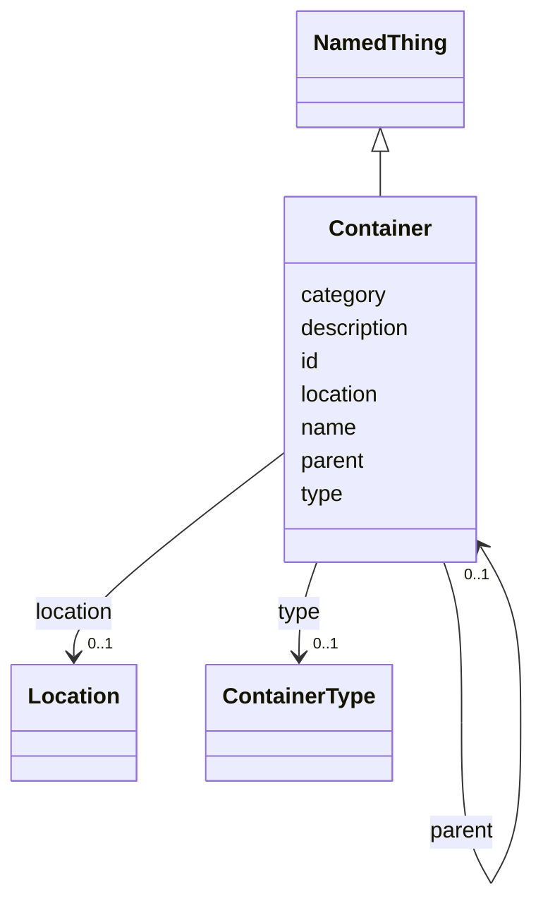

---
search:
  boost: 10.0
---

# Class: Container 


_A physical storage container (tube, box, freezer, etc.) that holds one or more samples._


<div data-search-exclude markdown="1">


URI: [brainbank:Container](https://w3id.org/VA-NCPTSDBB/brainbank/Container)





## Inheritance
* [NamedThing](NamedThing.md)
    * **Container**


## Slots

| Name | Cardinality and Range | Description | Inheritance |
| ---  | --- | --- | --- |
| [type](type.md) | 0..1 <br/> [ContainerType](ContainerType.md) | Type of storage container (e | direct |
| [location](location.md) | 0..1 <br/> [Location](Location.md) | Physical location where this container is stored | direct |
| [parent](parent.md) | 0..1 <br/> [Container](Container.md) | Parent container this container is nested within (e | direct |
| [id](id.md) | 1 <br/> [Uriorcurie](Uriorcurie.md) | Technical identifier (UUID/CURIE); becomes hippo-managed later | [NamedThing](NamedThing.md) |
| [name](name.md) | 1 <br/> [String](String.md) | Human-readable label for the entity | [NamedThing](NamedThing.md) |
| [description](description.md) | 0..1 <br/> [String](String.md) | Free-text narrative description of the entity | [NamedThing](NamedThing.md) |
| [category](category.md) | 0..1 <br/> [String](String.md) | Names the concrete class of this instance | [NamedThing](NamedThing.md) |


## Usages

| used by | used in | type | used |
| ---  | --- | --- | --- |
| [BrainBank](BrainBank.md) | [containers](containers.md) | range | [Container](Container.md) |
| [CNSSection](CNSSection.md) | [container](container.md) | range | [Container](Container.md) |
| [Cerebellum](Cerebellum.md) | [container](container.md) | range | [Container](Container.md) |
| [Cerebrum](Cerebrum.md) | [container](container.md) | range | [Container](Container.md) |
| [Hemisphere](Hemisphere.md) | [container](container.md) | range | [Container](Container.md) |
| [Medulla](Medulla.md) | [container](container.md) | range | [Container](Container.md) |
| [OlfactoryBulb](OlfactoryBulb.md) | [container](container.md) | range | [Container](Container.md) |
| [PinealGland](PinealGland.md) | [container](container.md) | range | [Container](Container.md) |
| [Pons](Pons.md) | [container](container.md) | range | [Container](Container.md) |
| [SubstantiaNigra](SubstantiaNigra.md) | [container](container.md) | range | [Container](Container.md) |
| [ChoroidPlexus](ChoroidPlexus.md) | [container](container.md) | range | [Container](Container.md) |
| [Pituitary](Pituitary.md) | [container](container.md) | range | [Container](Container.md) |
| [SpinalCord](SpinalCord.md) | [container](container.md) | range | [Container](Container.md) |
| [SpinalCordBlock](SpinalCordBlock.md) | [container](container.md) | range | [Container](Container.md) |
| [Brain](Brain.md) | [container](container.md) | range | [Container](Container.md) |
| [Dura](Dura.md) | [container](container.md) | range | [Container](Container.md) |
| [DuraBlock](DuraBlock.md) | [container](container.md) | range | [Container](Container.md) |
| [Skin](Skin.md) | [container](container.md) | range | [Container](Container.md) |
| [Muscle](Muscle.md) | [container](container.md) | range | [Container](Container.md) |
| [MuscleBlock](MuscleBlock.md) | [container](container.md) | range | [Container](Container.md) |
| [BloodVessel](BloodVessel.md) | [container](container.md) | range | [Container](Container.md) |
| [CSFPellet](CSFPellet.md) | [container](container.md) | range | [Container](Container.md) |
| [SpinalCordSlide](SpinalCordSlide.md) | [container](container.md) | range | [Container](Container.md) |
| [Section](Section.md) | [container](container.md) | range | [Container](Container.md) |
| [HorizontalSection](HorizontalSection.md) | [container](container.md) | range | [Container](Container.md) |
| [SagittalSection](SagittalSection.md) | [container](container.md) | range | [Container](Container.md) |
| [CoronalSection](CoronalSection.md) | [container](container.md) | range | [Container](Container.md) |
| [CSF](CSF.md) | [container](container.md) | range | [Container](Container.md) |
| [Blood](Blood.md) | [container](container.md) | range | [Container](Container.md) |
| [Cells](Cells.md) | [container](container.md) | range | [Container](Container.md) |
| [RNA](RNA.md) | [container](container.md) | range | [Container](Container.md) |
| [DNA](DNA.md) | [container](container.md) | range | [Container](Container.md) |
| [Sample](Sample.md) | [container](container.md) | range | [Container](Container.md) |
| [SolidSample](SolidSample.md) | [container](container.md) | range | [Container](Container.md) |
| [LiquidSample](LiquidSample.md) | [container](container.md) | range | [Container](Container.md) |
| [Container](Container.md) | [parent](parent.md) | range | [Container](Container.md) |


## Identifier and Mapping Information


### Schema Source


* from schema: https://w3id.org/VA-NCPTSDBB/brainbank/brainbank


## Mappings

| Mapping Type | Mapped Value |
| ---  | ---  |
| self | brainbank:Container |
| native | brainbank:Container |


## LinkML Source

<!-- TODO: investigate https://stackoverflow.com/questions/37606292/how-to-create-tabbed-code-blocks-in-mkdocs-or-sphinx -->

### Direct

<details>
```yaml
name: Container
description: A physical storage container (tube, box, freezer, etc.) that holds one
  or more samples.
from_schema: https://w3id.org/VA-NCPTSDBB/brainbank/brainbank
is_a: NamedThing
attributes:
  type:
    name: type
    description: Type of storage container (e.g. Cryovial, Box, Freezer).
    from_schema: https://w3id.org/VA-NCPTSDBB/brainbank/tissue
    rank: 1000
    domain_of:
    - Container
    range: ContainerType
  location:
    name: location
    description: Physical location where this container is stored.
    from_schema: https://w3id.org/VA-NCPTSDBB/brainbank/tissue
    rank: 1000
    domain_of:
    - Container
    range: Location
  parent:
    name: parent
    description: Parent container this container is nested within (e.g. box within
      freezer).
    from_schema: https://w3id.org/VA-NCPTSDBB/brainbank/tissue
    rank: 1000
    domain_of:
    - Container
    range: Container

```
</details>

### Induced

<details>
```yaml
name: Container
description: A physical storage container (tube, box, freezer, etc.) that holds one
  or more samples.
from_schema: https://w3id.org/VA-NCPTSDBB/brainbank/brainbank
is_a: NamedThing
attributes:
  type:
    name: type
    description: Type of storage container (e.g. Cryovial, Box, Freezer).
    from_schema: https://w3id.org/VA-NCPTSDBB/brainbank/tissue
    rank: 1000
    owner: Container
    domain_of:
    - Container
    range: ContainerType
  location:
    name: location
    description: Physical location where this container is stored.
    from_schema: https://w3id.org/VA-NCPTSDBB/brainbank/tissue
    rank: 1000
    owner: Container
    domain_of:
    - Container
    range: Location
  parent:
    name: parent
    description: Parent container this container is nested within (e.g. box within
      freezer).
    from_schema: https://w3id.org/VA-NCPTSDBB/brainbank/tissue
    rank: 1000
    owner: Container
    domain_of:
    - Container
    range: Container
  id:
    name: id
    description: Technical identifier (UUID/CURIE); becomes hippo-managed later.
    from_schema: https://w3id.org/VA-NCPTSDBB/brainbank/core
    rank: 1000
    identifier: true
    owner: Container
    domain_of:
    - NamedThing
    range: uriorcurie
    required: true
  name:
    name: name
    description: Human-readable label for the entity.
    from_schema: https://w3id.org/VA-NCPTSDBB/brainbank/core
    rank: 1000
    owner: Container
    domain_of:
    - NamedThing
    range: string
    required: true
  description:
    name: description
    description: Free-text narrative description of the entity.
    from_schema: https://w3id.org/VA-NCPTSDBB/brainbank/core
    rank: 1000
    owner: Container
    domain_of:
    - NamedThing
    range: string
  category:
    name: category
    description: Names the concrete class of this instance. Lets polymorphic inlined
      collections (e.g. a `samples` list holding SolidSample/LiquidSample) instantiate
      the right subclass.
    from_schema: https://w3id.org/VA-NCPTSDBB/brainbank/core
    rank: 1000
    designates_type: true
    owner: Container
    domain_of:
    - NamedThing
    range: string

```
</details></div>