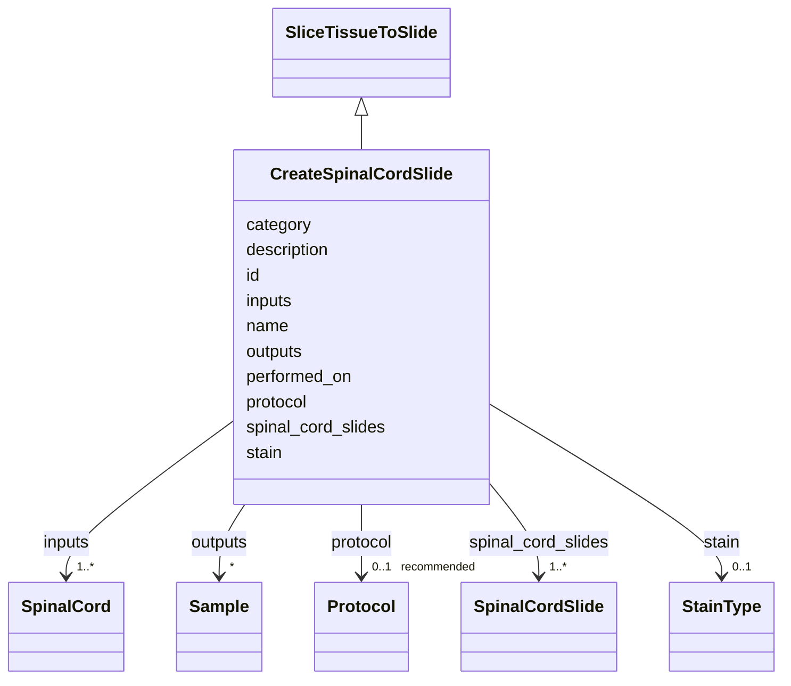

---
search:
  boost: 10.0
---

# Class: CreateSpinalCordSlide 


_Cut spinal cord tissue and mount on a slide with an IHC stain applied._


<div data-search-exclude markdown="1">


URI: [brainbank:CreateSpinalCordSlide](https://w3id.org/VA-NCPTSDBB/brainbank/CreateSpinalCordSlide)





## Inheritance
* [NamedThing](NamedThing.md)
    * [Activity](Activity.md)
        * [Process](Process.md)
            * [SliceTissueToSlide](SliceTissueToSlide.md)
                * **CreateSpinalCordSlide**


## Slots

| Name | Cardinality and Range | Description | Inheritance |
| ---  | --- | --- | --- |
| [spinal_cord_slides](spinal_cord_slides.md) | 1..* <br/> [SpinalCordSlide](SpinalCordSlide.md) | Stained spinal cord slides produced by this process | direct |
| [stain](stain.md) | 0..1 <br/> [StainType](StainType.md) | IHC stain applied to the tissue section on the slide | [SliceTissueToSlide](SliceTissueToSlide.md) |
| [inputs](inputs.md) | 1..* <br/> [SpinalCord](SpinalCord.md) | Input specimens consumed or transformed by this process | [Process](Process.md) |
| [outputs](outputs.md) | * <br/> [Sample](Sample.md) | Specimens produced as output of this process | [Process](Process.md) |
| [protocol](protocol.md) | 0..1 _recommended_ <br/> [Protocol](Protocol.md) | The SOP/method this activity followed | [Activity](Activity.md) |
| [performed_on](performed_on.md) | 0..1 <br/> [Date](Date.md) | Date the activity was carried out | [Activity](Activity.md) |
| [id](id.md) | 1 <br/> [Uriorcurie](Uriorcurie.md) | Technical identifier (UUID/CURIE); becomes hippo-managed later | [NamedThing](NamedThing.md) |
| [name](name.md) | 1 <br/> [String](String.md) | Human-readable label for the entity | [NamedThing](NamedThing.md) |
| [description](description.md) | 0..1 <br/> [String](String.md) | Free-text narrative description of the entity | [NamedThing](NamedThing.md) |
| [category](category.md) | 0..1 <br/> [String](String.md) | Names the concrete class of this instance | [NamedThing](NamedThing.md) |


## Identifier and Mapping Information


### Schema Source


* from schema: https://w3id.org/VA-NCPTSDBB/brainbank/brainbank


## Mappings

| Mapping Type | Mapped Value |
| ---  | ---  |
| self | brainbank:CreateSpinalCordSlide |
| native | brainbank:CreateSpinalCordSlide |


## LinkML Source

<!-- TODO: investigate https://stackoverflow.com/questions/37606292/how-to-create-tabbed-code-blocks-in-mkdocs-or-sphinx -->

### Direct

<details>
```yaml
name: CreateSpinalCordSlide
description: Cut spinal cord tissue and mount on a slide with an IHC stain applied.
from_schema: https://w3id.org/VA-NCPTSDBB/brainbank/brainbank
is_a: SliceTissueToSlide
slot_usage:
  inputs:
    name: inputs
    range: SpinalCord
    required: true
attributes:
  spinal_cord_slides:
    name: spinal_cord_slides
    description: Stained spinal cord slides produced by this process.
    from_schema: https://w3id.org/VA-NCPTSDBB/brainbank/brainbank
    rank: 1000
    domain_of:
    - CreateSpinalCordSlide
    range: SpinalCordSlide
    required: true
    multivalued: true

```
</details>

### Induced

<details>
```yaml
name: CreateSpinalCordSlide
description: Cut spinal cord tissue and mount on a slide with an IHC stain applied.
from_schema: https://w3id.org/VA-NCPTSDBB/brainbank/brainbank
is_a: SliceTissueToSlide
slot_usage:
  inputs:
    name: inputs
    range: SpinalCord
    required: true
attributes:
  spinal_cord_slides:
    name: spinal_cord_slides
    description: Stained spinal cord slides produced by this process.
    from_schema: https://w3id.org/VA-NCPTSDBB/brainbank/brainbank
    rank: 1000
    owner: CreateSpinalCordSlide
    domain_of:
    - CreateSpinalCordSlide
    range: SpinalCordSlide
    required: true
    multivalued: true
  stain:
    name: stain
    description: IHC stain applied to the tissue section on the slide.
    from_schema: https://w3id.org/VA-NCPTSDBB/brainbank/brainbank
    rank: 1000
    owner: CreateSpinalCordSlide
    domain_of:
    - SliceTissueToSlide
    - ImageDataset
    - ImagingAssay
    range: StainType
  inputs:
    name: inputs
    description: Input specimens consumed or transformed by this process.
    from_schema: https://w3id.org/VA-NCPTSDBB/brainbank/tissue
    rank: 1000
    owner: CreateSpinalCordSlide
    domain_of:
    - Process
    - Assay
    range: SpinalCord
    required: true
    multivalued: true
  outputs:
    name: outputs
    description: Specimens produced as output of this process.
    from_schema: https://w3id.org/VA-NCPTSDBB/brainbank/tissue
    rank: 1000
    owner: CreateSpinalCordSlide
    domain_of:
    - Process
    range: Sample
    multivalued: true
  protocol:
    name: protocol
    description: The SOP/method this activity followed.
    from_schema: https://w3id.org/VA-NCPTSDBB/brainbank/core
    rank: 1000
    owner: CreateSpinalCordSlide
    domain_of:
    - Activity
    range: Protocol
    recommended: true
  performed_on:
    name: performed_on
    description: Date the activity was carried out.
    from_schema: https://w3id.org/VA-NCPTSDBB/brainbank/core
    rank: 1000
    owner: CreateSpinalCordSlide
    domain_of:
    - Activity
    range: date
  id:
    name: id
    description: Technical identifier (UUID/CURIE); becomes hippo-managed later.
    from_schema: https://w3id.org/VA-NCPTSDBB/brainbank/core
    rank: 1000
    identifier: true
    owner: CreateSpinalCordSlide
    domain_of:
    - NamedThing
    range: uriorcurie
    required: true
  name:
    name: name
    description: Human-readable label for the entity.
    from_schema: https://w3id.org/VA-NCPTSDBB/brainbank/core
    rank: 1000
    owner: CreateSpinalCordSlide
    domain_of:
    - NamedThing
    range: string
    required: true
  description:
    name: description
    description: Free-text narrative description of the entity.
    from_schema: https://w3id.org/VA-NCPTSDBB/brainbank/core
    rank: 1000
    owner: CreateSpinalCordSlide
    domain_of:
    - NamedThing
    range: string
  category:
    name: category
    description: Names the concrete class of this instance. Lets polymorphic inlined
      collections (e.g. a `samples` list holding SolidSample/LiquidSample) instantiate
      the right subclass.
    from_schema: https://w3id.org/VA-NCPTSDBB/brainbank/core
    rank: 1000
    designates_type: true
    owner: CreateSpinalCordSlide
    domain_of:
    - NamedThing
    range: string

```
</details></div>