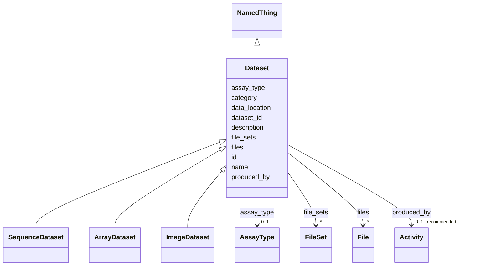

---
search:
  boost: 10.0
---

# Class: Dataset 


_A data artifact (scientific unit). Its physical bytes live in File/FileSet objects; its provenance is produced_by -> Activity (an Assay for raw data, or an Analysis/Workflow for derived data). A Dataset has no derived_from-sample slot; source samples are reached via produced_by -> Assay -> inputs._


<div data-search-exclude markdown="1">


URI: [brainbank:Dataset](https://w3id.org/VA-NCPTSDBB/brainbank/Dataset)





## Inheritance
* [NamedThing](NamedThing.md)
    * **Dataset**
        * [SequenceDataset](SequenceDataset.md)
        * [ArrayDataset](ArrayDataset.md)
        * [ImageDataset](ImageDataset.md)


## Slots

| Name | Cardinality and Range | Description | Inheritance |
| ---  | --- | --- | --- |
| [dataset_id](dataset_id.md) | 1 <br/> [String](String.md) | Business identifier for this dataset (human-facing ID or accession) | direct |
| [assay_type](assay_type.md) | 0..1 <br/> [AssayType](AssayType.md) | OBI assay type that generated this dataset | direct |
| [data_location](data_location.md) | 0..1 <br/> [Uriorcurie](Uriorcurie.md) | Optional convenience pointer to the dataset root (e | direct |
| [files](files.md) | * <br/> [File](File.md) | The individual files that make up this dataset | direct |
| [file_sets](file_sets.md) | * <br/> [FileSet](FileSet.md) | Named groupings of files (e | direct |
| [produced_by](produced_by.md) | 0..1 _recommended_ <br/> [Activity](Activity.md) | The activity that produced this dataset — an Assay (raw acquisition) or an An... | direct |
| [id](id.md) | 1 <br/> [Uriorcurie](Uriorcurie.md) | Technical identifier (UUID/CURIE); becomes hippo-managed later | [NamedThing](NamedThing.md) |
| [name](name.md) | 1 <br/> [String](String.md) | Human-readable label for the entity | [NamedThing](NamedThing.md) |
| [description](description.md) | 0..1 <br/> [String](String.md) | Free-text narrative description of the entity | [NamedThing](NamedThing.md) |
| [category](category.md) | 0..1 <br/> [String](String.md) | Names the concrete class of this instance | [NamedThing](NamedThing.md) |


## Usages

| used by | used in | type | used |
| ---  | --- | --- | --- |
| [BrainBank](BrainBank.md) | [datasets](datasets.md) | range | [Dataset](Dataset.md) |
| [Analysis](Analysis.md) | [input_datasets](input_datasets.md) | range | [Dataset](Dataset.md) |
| [Analysis](Analysis.md) | [output_datasets](output_datasets.md) | range | [Dataset](Dataset.md) |
| [WorkflowRun](WorkflowRun.md) | [input_datasets](input_datasets.md) | range | [Dataset](Dataset.md) |
| [WorkflowRun](WorkflowRun.md) | [output_datasets](output_datasets.md) | range | [Dataset](Dataset.md) |


## Identifier and Mapping Information


### Schema Source


* from schema: https://w3id.org/VA-NCPTSDBB/brainbank/brainbank


## Mappings

| Mapping Type | Mapped Value |
| ---  | ---  |
| self | brainbank:Dataset |
| native | brainbank:Dataset |
| exact | prov:Entity |


## LinkML Source

<!-- TODO: investigate https://stackoverflow.com/questions/37606292/how-to-create-tabbed-code-blocks-in-mkdocs-or-sphinx -->

### Direct

<details>
```yaml
name: Dataset
description: A data artifact (scientific unit). Its physical bytes live in File/FileSet
  objects; its provenance is produced_by -> Activity (an Assay for raw data, or an
  Analysis/Workflow for derived data). A Dataset has no derived_from-sample slot;
  source samples are reached via produced_by -> Assay -> inputs.
from_schema: https://w3id.org/VA-NCPTSDBB/brainbank/brainbank
exact_mappings:
- prov:Entity
is_a: NamedThing
attributes:
  dataset_id:
    name: dataset_id
    description: Business identifier for this dataset (human-facing ID or accession).
    from_schema: https://w3id.org/VA-NCPTSDBB/brainbank/dataset
    rank: 1000
    domain_of:
    - Dataset
    required: true
  assay_type:
    name: assay_type
    description: OBI assay type that generated this dataset.
    from_schema: https://w3id.org/VA-NCPTSDBB/brainbank/dataset
    rank: 1000
    domain_of:
    - Dataset
    - Assay
    range: AssayType
  data_location:
    name: data_location
    description: Optional convenience pointer to the dataset root (e.g. a directory
      or DRS bundle URI). Per-file locations/formats live on the File objects in `files`/`file_sets`.
    from_schema: https://w3id.org/VA-NCPTSDBB/brainbank/dataset
    rank: 1000
    domain_of:
    - Dataset
    range: uriorcurie
  files:
    name: files
    description: The individual files that make up this dataset.
    from_schema: https://w3id.org/VA-NCPTSDBB/brainbank/dataset
    domain_of:
    - BrainBank
    - Dataset
    - FileSet
    range: File
    multivalued: true
  file_sets:
    name: file_sets
    description: Named groupings of files (e.g. paired reads, alignment + index).
    from_schema: https://w3id.org/VA-NCPTSDBB/brainbank/dataset
    domain_of:
    - BrainBank
    - Dataset
    range: FileSet
    multivalued: true
  produced_by:
    name: produced_by
    description: The activity that produced this dataset — an Assay (raw acquisition)
      or an Analysis/Workflow (computation). Links the dataset to its inputs.
    from_schema: https://w3id.org/VA-NCPTSDBB/brainbank/dataset
    domain_of:
    - Sample
    - Dataset
    range: Activity
    recommended: true

```
</details>

### Induced

<details>
```yaml
name: Dataset
description: A data artifact (scientific unit). Its physical bytes live in File/FileSet
  objects; its provenance is produced_by -> Activity (an Assay for raw data, or an
  Analysis/Workflow for derived data). A Dataset has no derived_from-sample slot;
  source samples are reached via produced_by -> Assay -> inputs.
from_schema: https://w3id.org/VA-NCPTSDBB/brainbank/brainbank
exact_mappings:
- prov:Entity
is_a: NamedThing
attributes:
  dataset_id:
    name: dataset_id
    description: Business identifier for this dataset (human-facing ID or accession).
    from_schema: https://w3id.org/VA-NCPTSDBB/brainbank/dataset
    rank: 1000
    owner: Dataset
    domain_of:
    - Dataset
    range: string
    required: true
  assay_type:
    name: assay_type
    description: OBI assay type that generated this dataset.
    from_schema: https://w3id.org/VA-NCPTSDBB/brainbank/dataset
    rank: 1000
    owner: Dataset
    domain_of:
    - Dataset
    - Assay
    range: AssayType
  data_location:
    name: data_location
    description: Optional convenience pointer to the dataset root (e.g. a directory
      or DRS bundle URI). Per-file locations/formats live on the File objects in `files`/`file_sets`.
    from_schema: https://w3id.org/VA-NCPTSDBB/brainbank/dataset
    rank: 1000
    owner: Dataset
    domain_of:
    - Dataset
    range: uriorcurie
  files:
    name: files
    description: The individual files that make up this dataset.
    from_schema: https://w3id.org/VA-NCPTSDBB/brainbank/dataset
    owner: Dataset
    domain_of:
    - BrainBank
    - Dataset
    - FileSet
    range: File
    multivalued: true
  file_sets:
    name: file_sets
    description: Named groupings of files (e.g. paired reads, alignment + index).
    from_schema: https://w3id.org/VA-NCPTSDBB/brainbank/dataset
    owner: Dataset
    domain_of:
    - BrainBank
    - Dataset
    range: FileSet
    multivalued: true
  produced_by:
    name: produced_by
    description: The activity that produced this dataset — an Assay (raw acquisition)
      or an Analysis/Workflow (computation). Links the dataset to its inputs.
    from_schema: https://w3id.org/VA-NCPTSDBB/brainbank/dataset
    owner: Dataset
    domain_of:
    - Sample
    - Dataset
    range: Activity
    recommended: true
  id:
    name: id
    description: Technical identifier (UUID/CURIE); becomes hippo-managed later.
    from_schema: https://w3id.org/VA-NCPTSDBB/brainbank/core
    rank: 1000
    identifier: true
    owner: Dataset
    domain_of:
    - NamedThing
    range: uriorcurie
    required: true
  name:
    name: name
    description: Human-readable label for the entity.
    from_schema: https://w3id.org/VA-NCPTSDBB/brainbank/core
    rank: 1000
    owner: Dataset
    domain_of:
    - NamedThing
    range: string
    required: true
  description:
    name: description
    description: Free-text narrative description of the entity.
    from_schema: https://w3id.org/VA-NCPTSDBB/brainbank/core
    rank: 1000
    owner: Dataset
    domain_of:
    - NamedThing
    range: string
  category:
    name: category
    description: Names the concrete class of this instance. Lets polymorphic inlined
      collections (e.g. a `samples` list holding SolidSample/LiquidSample) instantiate
      the right subclass.
    from_schema: https://w3id.org/VA-NCPTSDBB/brainbank/core
    rank: 1000
    designates_type: true
    owner: Dataset
    domain_of:
    - NamedThing
    range: string

```
</details></div>