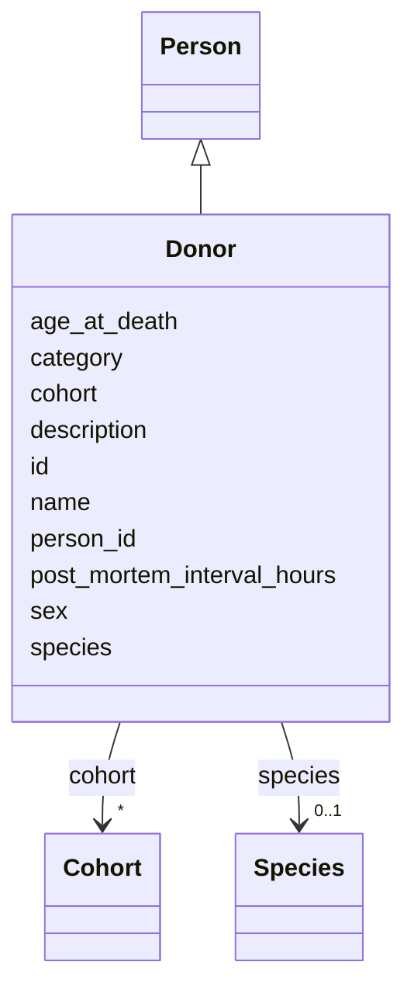

---
search:
  boost: 10.0
---

# Class: Donor 


_A deceased individual who donated tissue to the brain bank._


<div data-search-exclude markdown="1">


URI: [brainbank:Donor](https://w3id.org/VA-NCPTSDBB/brainbank/Donor)





## Inheritance
* [NamedThing](NamedThing.md)
    * [Person](Person.md)
        * **Donor**


## Slots

| Name | Cardinality and Range | Description | Inheritance |
| ---  | --- | --- | --- |
| [age_at_death](age_at_death.md) | 0..1 <br/> [Float](Float.md) | Age of the donor at time of death, in years | direct |
| [post_mortem_interval_hours](post_mortem_interval_hours.md) | 0..1 <br/> [Float](Float.md) | Post-mortem interval (PMI): time elapsed between death and tissue collection,... | direct |
| [person_id](person_id.md) | 1 <br/> [String](String.md) | Business identifier (human-facing person ID) | [Person](Person.md) |
| [species](species.md) | 0..1 <br/> [Species](Species.md) | Species of the individual | [Person](Person.md) |
| [sex](sex.md) | 0..1 <br/> [String](String.md) | Biological sex of the individual (free text; use standard values such as male... | [Person](Person.md) |
| [cohort](cohort.md) | * <br/> [Cohort](Cohort.md) | Study cohort(s) this individual belongs to | [Person](Person.md) |
| [id](id.md) | 1 <br/> [Uriorcurie](Uriorcurie.md) | Technical identifier (UUID/CURIE); becomes hippo-managed later | [NamedThing](NamedThing.md) |
| [name](name.md) | 1 <br/> [String](String.md) | Human-readable label for the entity | [NamedThing](NamedThing.md) |
| [description](description.md) | 0..1 <br/> [String](String.md) | Free-text narrative description of the entity | [NamedThing](NamedThing.md) |
| [category](category.md) | 0..1 <br/> [String](String.md) | Names the concrete class of this instance | [NamedThing](NamedThing.md) |


## Usages

| used by | used in | type | used |
| ---  | --- | --- | --- |
| [BrainBank](BrainBank.md) | [donors](donors.md) | range | [Donor](Donor.md) |
| [CNSSection](CNSSection.md) | [donor](donor.md) | range | [Donor](Donor.md) |
| [Cerebellum](Cerebellum.md) | [donor](donor.md) | range | [Donor](Donor.md) |
| [Cerebrum](Cerebrum.md) | [donor](donor.md) | range | [Donor](Donor.md) |
| [Hemisphere](Hemisphere.md) | [donor](donor.md) | range | [Donor](Donor.md) |
| [Medulla](Medulla.md) | [donor](donor.md) | range | [Donor](Donor.md) |
| [OlfactoryBulb](OlfactoryBulb.md) | [donor](donor.md) | range | [Donor](Donor.md) |
| [PinealGland](PinealGland.md) | [donor](donor.md) | range | [Donor](Donor.md) |
| [Pons](Pons.md) | [donor](donor.md) | range | [Donor](Donor.md) |
| [SubstantiaNigra](SubstantiaNigra.md) | [donor](donor.md) | range | [Donor](Donor.md) |
| [ChoroidPlexus](ChoroidPlexus.md) | [donor](donor.md) | range | [Donor](Donor.md) |
| [Pituitary](Pituitary.md) | [donor](donor.md) | range | [Donor](Donor.md) |
| [SpinalCord](SpinalCord.md) | [donor](donor.md) | range | [Donor](Donor.md) |
| [SpinalCordBlock](SpinalCordBlock.md) | [donor](donor.md) | range | [Donor](Donor.md) |
| [Brain](Brain.md) | [donor](donor.md) | range | [Donor](Donor.md) |
| [Dura](Dura.md) | [donor](donor.md) | range | [Donor](Donor.md) |
| [DuraBlock](DuraBlock.md) | [donor](donor.md) | range | [Donor](Donor.md) |
| [Skin](Skin.md) | [donor](donor.md) | range | [Donor](Donor.md) |
| [Muscle](Muscle.md) | [donor](donor.md) | range | [Donor](Donor.md) |
| [MuscleBlock](MuscleBlock.md) | [donor](donor.md) | range | [Donor](Donor.md) |
| [BloodVessel](BloodVessel.md) | [donor](donor.md) | range | [Donor](Donor.md) |
| [CSFPellet](CSFPellet.md) | [donor](donor.md) | range | [Donor](Donor.md) |
| [SpinalCordSlide](SpinalCordSlide.md) | [donor](donor.md) | range | [Donor](Donor.md) |
| [Section](Section.md) | [donor](donor.md) | range | [Donor](Donor.md) |
| [HorizontalSection](HorizontalSection.md) | [donor](donor.md) | range | [Donor](Donor.md) |
| [SagittalSection](SagittalSection.md) | [donor](donor.md) | range | [Donor](Donor.md) |
| [CoronalSection](CoronalSection.md) | [donor](donor.md) | range | [Donor](Donor.md) |
| [CSF](CSF.md) | [donor](donor.md) | range | [Donor](Donor.md) |
| [Blood](Blood.md) | [donor](donor.md) | range | [Donor](Donor.md) |
| [Cells](Cells.md) | [donor](donor.md) | range | [Donor](Donor.md) |
| [RNA](RNA.md) | [donor](donor.md) | range | [Donor](Donor.md) |
| [DNA](DNA.md) | [donor](donor.md) | range | [Donor](Donor.md) |
| [BankFreshBrain](BankFreshBrain.md) | [donor](donor.md) | range | [Donor](Donor.md) |
| [BankFixedBrain](BankFixedBrain.md) | [donor](donor.md) | range | [Donor](Donor.md) |
| [Sample](Sample.md) | [donor](donor.md) | range | [Donor](Donor.md) |
| [SolidSample](SolidSample.md) | [donor](donor.md) | range | [Donor](Donor.md) |
| [LiquidSample](LiquidSample.md) | [donor](donor.md) | range | [Donor](Donor.md) |


## Identifier and Mapping Information


### Schema Source


* from schema: https://w3id.org/VA-NCPTSDBB/brainbank/brainbank


## Mappings

| Mapping Type | Mapped Value |
| ---  | ---  |
| self | brainbank:Donor |
| native | brainbank:Donor |


## LinkML Source

<!-- TODO: investigate https://stackoverflow.com/questions/37606292/how-to-create-tabbed-code-blocks-in-mkdocs-or-sphinx -->

### Direct

<details>
```yaml
name: Donor
description: A deceased individual who donated tissue to the brain bank.
from_schema: https://w3id.org/VA-NCPTSDBB/brainbank/brainbank
is_a: Person
attributes:
  age_at_death:
    name: age_at_death
    description: Age of the donor at time of death, in years.
    from_schema: https://w3id.org/VA-NCPTSDBB/brainbank/person
    rank: 1000
    domain_of:
    - Donor
    range: float
  post_mortem_interval_hours:
    name: post_mortem_interval_hours
    description: 'Post-mortem interval (PMI): time elapsed between death and tissue
      collection, in hours. Shorter PMI is generally associated with better tissue
      quality for molecular assays.'
    from_schema: https://w3id.org/VA-NCPTSDBB/brainbank/person
    rank: 1000
    domain_of:
    - Donor
    range: float

```
</details>

### Induced

<details>
```yaml
name: Donor
description: A deceased individual who donated tissue to the brain bank.
from_schema: https://w3id.org/VA-NCPTSDBB/brainbank/brainbank
is_a: Person
attributes:
  age_at_death:
    name: age_at_death
    description: Age of the donor at time of death, in years.
    from_schema: https://w3id.org/VA-NCPTSDBB/brainbank/person
    rank: 1000
    owner: Donor
    domain_of:
    - Donor
    range: float
  post_mortem_interval_hours:
    name: post_mortem_interval_hours
    description: 'Post-mortem interval (PMI): time elapsed between death and tissue
      collection, in hours. Shorter PMI is generally associated with better tissue
      quality for molecular assays.'
    from_schema: https://w3id.org/VA-NCPTSDBB/brainbank/person
    rank: 1000
    owner: Donor
    domain_of:
    - Donor
    range: float
  person_id:
    name: person_id
    description: Business identifier (human-facing person ID). Gets hippo_index later.
    from_schema: https://w3id.org/VA-NCPTSDBB/brainbank/person
    rank: 1000
    owner: Donor
    domain_of:
    - Person
    range: string
    required: true
  species:
    name: species
    description: Species of the individual. Defaults conceptually to Homo sapiens
      (NCBITaxon:9606); an ifabsent default is omitted because Species is a dynamic
      (reachable_from) enum with no static permissible value for gen-pydantic to materialize.
    from_schema: https://w3id.org/VA-NCPTSDBB/brainbank/person
    rank: 1000
    owner: Donor
    domain_of:
    - Person
    range: Species
  sex:
    name: sex
    description: Biological sex of the individual (free text; use standard values
      such as male/female/unknown).
    from_schema: https://w3id.org/VA-NCPTSDBB/brainbank/person
    rank: 1000
    owner: Donor
    domain_of:
    - Person
    range: string
  cohort:
    name: cohort
    description: Study cohort(s) this individual belongs to.
    from_schema: https://w3id.org/VA-NCPTSDBB/brainbank/person
    rank: 1000
    owner: Donor
    domain_of:
    - Person
    range: Cohort
    multivalued: true
  id:
    name: id
    description: Technical identifier (UUID/CURIE); becomes hippo-managed later.
    from_schema: https://w3id.org/VA-NCPTSDBB/brainbank/core
    rank: 1000
    identifier: true
    owner: Donor
    domain_of:
    - NamedThing
    range: uriorcurie
    required: true
  name:
    name: name
    description: Human-readable label for the entity.
    from_schema: https://w3id.org/VA-NCPTSDBB/brainbank/core
    rank: 1000
    owner: Donor
    domain_of:
    - NamedThing
    range: string
    required: true
  description:
    name: description
    description: Free-text narrative description of the entity.
    from_schema: https://w3id.org/VA-NCPTSDBB/brainbank/core
    rank: 1000
    owner: Donor
    domain_of:
    - NamedThing
    range: string
  category:
    name: category
    description: Names the concrete class of this instance. Lets polymorphic inlined
      collections (e.g. a `samples` list holding SolidSample/LiquidSample) instantiate
      the right subclass.
    from_schema: https://w3id.org/VA-NCPTSDBB/brainbank/core
    rank: 1000
    designates_type: true
    owner: Donor
    domain_of:
    - NamedThing
    range: string

```
</details></div>