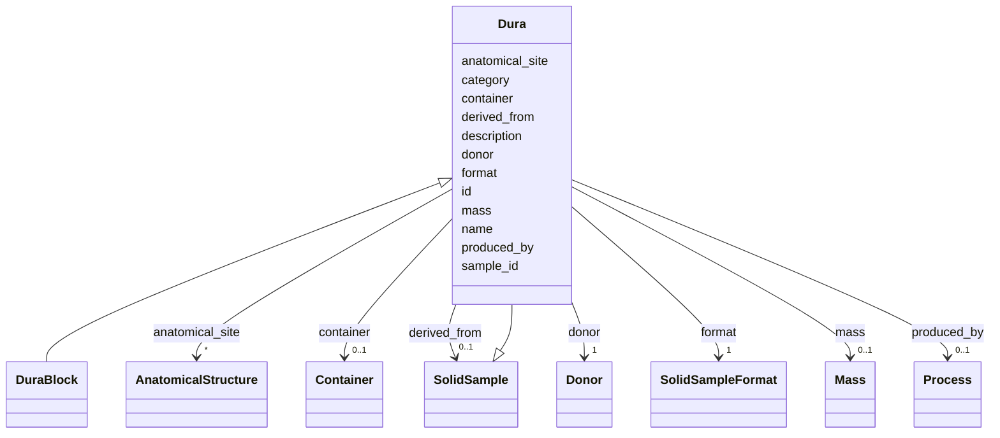

---
search:
  boost: 10.0
---

# Class: Dura 


_Dura mater specimen (outermost meningeal layer surrounding the brain and spinal cord)._


<div data-search-exclude markdown="1">


URI: [brainbank:Dura](https://w3id.org/VA-NCPTSDBB/brainbank/Dura)





## Inheritance
* [NamedThing](NamedThing.md)
    * [Sample](Sample.md)
        * [SolidSample](SolidSample.md)
            * **Dura**
                * [DuraBlock](DuraBlock.md)


## Slots

| Name | Cardinality and Range | Description | Inheritance |
| ---  | --- | --- | --- |
| [format](format.md) | 1 <br/> [SolidSampleFormat](SolidSampleFormat.md) | Physical format of this solid specimen (e | [SolidSample](SolidSample.md) |
| [mass](mass.md) | 0..1 <br/> [Mass](Mass.md) | Mass of the specimen | [SolidSample](SolidSample.md) |
| [sample_id](sample_id.md) | 1 <br/> [String](String.md) | Business identifier (human-facing sample/specimen ID) | [Sample](Sample.md) |
| [donor](donor.md) | 1 <br/> [Donor](Donor.md) | The deceased donor this sample was taken from | [Sample](Sample.md) |
| [anatomical_site](anatomical_site.md) | * <br/> [AnatomicalStructure](AnatomicalStructure.md) | Anatomical region(s) from which this sample was collected | [Sample](Sample.md) |
| [container](container.md) | 0..1 <br/> [Container](Container.md) | The storage container currently holding this sample | [Sample](Sample.md) |
| [derived_from](derived_from.md) | 0..1 <br/> [SolidSample](SolidSample.md) | Parent specimen this sample was produced from | [Sample](Sample.md) |
| [produced_by](produced_by.md) | 0..1 <br/> [Process](Process.md) | The processing event that created this sample | [Sample](Sample.md) |
| [id](id.md) | 1 <br/> [Uriorcurie](Uriorcurie.md) | Technical identifier (UUID/CURIE); becomes hippo-managed later | [NamedThing](NamedThing.md) |
| [name](name.md) | 1 <br/> [String](String.md) | Human-readable label for the entity | [NamedThing](NamedThing.md) |
| [description](description.md) | 0..1 <br/> [String](String.md) | Free-text narrative description of the entity | [NamedThing](NamedThing.md) |
| [category](category.md) | 0..1 <br/> [String](String.md) | Names the concrete class of this instance | [NamedThing](NamedThing.md) |


## Usages

| used by | used in | type | used |
| ---  | --- | --- | --- |
| [BankDura](BankDura.md) | [fixed_dura](fixed_dura.md) | range | [Dura](Dura.md) |
| [BankDura](BankDura.md) | [frozen_dura](frozen_dura.md) | range | [Dura](Dura.md) |
| [BankDura](BankDura.md) | [media_dura](media_dura.md) | range | [Dura](Dura.md) |
| [BankDura](BankDura.md) | [remainder](remainder.md) | range | [Dura](Dura.md) |
| [BlockDura](BlockDura.md) | [inputs](inputs.md) | range | [Dura](Dura.md) |
| [CultureDura](CultureDura.md) | [inputs](inputs.md) | range | [Dura](Dura.md) |


## Identifier and Mapping Information


### Schema Source


* from schema: https://w3id.org/VA-NCPTSDBB/brainbank/brainbank


## Mappings

| Mapping Type | Mapped Value |
| ---  | ---  |
| self | brainbank:Dura |
| native | brainbank:Dura |


## LinkML Source

<!-- TODO: investigate https://stackoverflow.com/questions/37606292/how-to-create-tabbed-code-blocks-in-mkdocs-or-sphinx -->

### Direct

<details>
```yaml
name: Dura
description: Dura mater specimen (outermost meningeal layer surrounding the brain
  and spinal cord).
from_schema: https://w3id.org/VA-NCPTSDBB/brainbank/brainbank
is_a: SolidSample

```
</details>

### Induced

<details>
```yaml
name: Dura
description: Dura mater specimen (outermost meningeal layer surrounding the brain
  and spinal cord).
from_schema: https://w3id.org/VA-NCPTSDBB/brainbank/brainbank
is_a: SolidSample
attributes:
  format:
    name: format
    description: Physical format of this solid specimen (e.g. Slab, Block, Section).
    from_schema: https://w3id.org/VA-NCPTSDBB/brainbank/tissue
    rank: 1000
    owner: Dura
    domain_of:
    - SolidSample
    - LiquidSample
    range: SolidSampleFormat
    required: true
  mass:
    name: mass
    description: Mass of the specimen.
    from_schema: https://w3id.org/VA-NCPTSDBB/brainbank/tissue
    rank: 1000
    owner: Dura
    domain_of:
    - SolidSample
    range: Mass
  sample_id:
    name: sample_id
    description: Business identifier (human-facing sample/specimen ID).
    from_schema: https://w3id.org/VA-NCPTSDBB/brainbank/tissue
    rank: 1000
    owner: Dura
    domain_of:
    - Sample
    range: string
    required: true
  donor:
    name: donor
    description: The deceased donor this sample was taken from.
    from_schema: https://w3id.org/VA-NCPTSDBB/brainbank/tissue
    owner: Dura
    domain_of:
    - BankFreshBrain
    - BankFixedBrain
    - Sample
    range: Donor
    required: true
  anatomical_site:
    name: anatomical_site
    description: Anatomical region(s) from which this sample was collected.
    from_schema: https://w3id.org/VA-NCPTSDBB/brainbank/tissue
    rank: 1000
    owner: Dura
    domain_of:
    - Sample
    range: AnatomicalStructure
    multivalued: true
  container:
    name: container
    description: The storage container currently holding this sample.
    from_schema: https://w3id.org/VA-NCPTSDBB/brainbank/tissue
    rank: 1000
    owner: Dura
    domain_of:
    - Sample
    range: Container
  derived_from:
    name: derived_from
    description: Parent specimen this sample was produced from.
    from_schema: https://w3id.org/VA-NCPTSDBB/brainbank/tissue
    rank: 1000
    owner: Dura
    domain_of:
    - Sample
    range: SolidSample
  produced_by:
    name: produced_by
    description: The processing event that created this sample.
    from_schema: https://w3id.org/VA-NCPTSDBB/brainbank/tissue
    rank: 1000
    owner: Dura
    domain_of:
    - Sample
    - Dataset
    range: Process
  id:
    name: id
    description: Technical identifier (UUID/CURIE); becomes hippo-managed later.
    from_schema: https://w3id.org/VA-NCPTSDBB/brainbank/core
    rank: 1000
    identifier: true
    owner: Dura
    domain_of:
    - NamedThing
    range: uriorcurie
    required: true
  name:
    name: name
    description: Human-readable label for the entity.
    from_schema: https://w3id.org/VA-NCPTSDBB/brainbank/core
    rank: 1000
    owner: Dura
    domain_of:
    - NamedThing
    range: string
    required: true
  description:
    name: description
    description: Free-text narrative description of the entity.
    from_schema: https://w3id.org/VA-NCPTSDBB/brainbank/core
    rank: 1000
    owner: Dura
    domain_of:
    - NamedThing
    range: string
  category:
    name: category
    description: Names the concrete class of this instance. Lets polymorphic inlined
      collections (e.g. a `samples` list holding SolidSample/LiquidSample) instantiate
      the right subclass.
    from_schema: https://w3id.org/VA-NCPTSDBB/brainbank/core
    rank: 1000
    designates_type: true
    owner: Dura
    domain_of:
    - NamedThing
    range: string

```
</details></div>