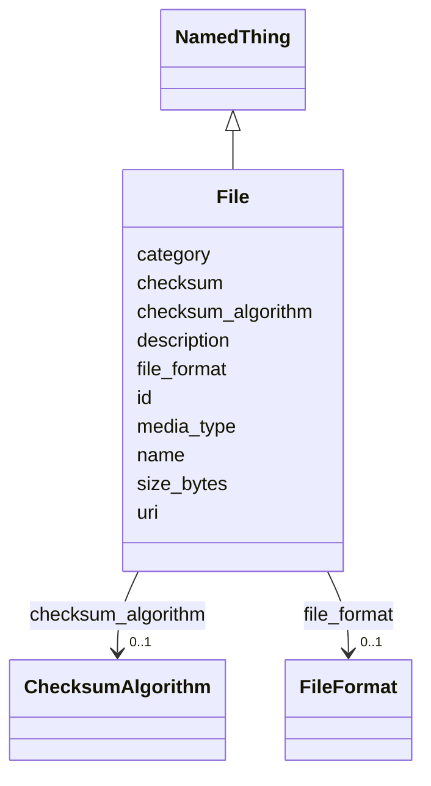

---
search:
  boost: 10.0
---

# Class: File 


_A single physical data file. The atomic unit beneath a Dataset._


<div data-search-exclude markdown="1">


URI: [brainbank:File](https://w3id.org/VA-NCPTSDBB/brainbank/File)





## Inheritance
* [NamedThing](NamedThing.md)
    * **File**


## Slots

| Name | Cardinality and Range | Description | Inheritance |
| ---  | --- | --- | --- |
| [uri](uri.md) | 1 <br/> [Uriorcurie](Uriorcurie.md) | Location of the file (path, URL, or DRS id) | direct |
| [file_format](file_format.md) | 0..1 <br/> [FileFormat](FileFormat.md) | Bioinformatics format of the file | direct |
| [media_type](media_type.md) | 0..1 <br/> [String](String.md) | IANA media (MIME) type, e | direct |
| [size_bytes](size_bytes.md) | 0..1 <br/> [Integer](Integer.md) | Size of the file in bytes | direct |
| [checksum](checksum.md) | 0..1 <br/> [String](String.md) | Checksum value for file integrity and identity verification | direct |
| [checksum_algorithm](checksum_algorithm.md) | 0..1 <br/> [ChecksumAlgorithm](ChecksumAlgorithm.md) | Algorithm used to compute the checksum (e | direct |
| [id](id.md) | 1 <br/> [Uriorcurie](Uriorcurie.md) | Technical identifier (UUID/CURIE); becomes hippo-managed later | [NamedThing](NamedThing.md) |
| [name](name.md) | 1 <br/> [String](String.md) | Human-readable label for the entity | [NamedThing](NamedThing.md) |
| [description](description.md) | 0..1 <br/> [String](String.md) | Free-text narrative description of the entity | [NamedThing](NamedThing.md) |
| [category](category.md) | 0..1 <br/> [String](String.md) | Names the concrete class of this instance | [NamedThing](NamedThing.md) |


## Usages

| used by | used in | type | used |
| ---  | --- | --- | --- |
| [BrainBank](BrainBank.md) | [files](files.md) | range | [File](File.md) |
| [Dataset](Dataset.md) | [files](files.md) | range | [File](File.md) |
| [SequenceDataset](SequenceDataset.md) | [files](files.md) | range | [File](File.md) |
| [RNASeqDataset](RNASeqDataset.md) | [files](files.md) | range | [File](File.md) |
| [GenomeVariantDataset](GenomeVariantDataset.md) | [files](files.md) | range | [File](File.md) |
| [ATACSeqDataset](ATACSeqDataset.md) | [files](files.md) | range | [File](File.md) |
| [ArrayDataset](ArrayDataset.md) | [files](files.md) | range | [File](File.md) |
| [GenotypingDataset](GenotypingDataset.md) | [files](files.md) | range | [File](File.md) |
| [MethylationDataset](MethylationDataset.md) | [files](files.md) | range | [File](File.md) |
| [ImageDataset](ImageDataset.md) | [files](files.md) | range | [File](File.md) |
| [FileSet](FileSet.md) | [files](files.md) | range | [File](File.md) |


## Identifier and Mapping Information


### Schema Source


* from schema: https://w3id.org/VA-NCPTSDBB/brainbank/brainbank


## Mappings

| Mapping Type | Mapped Value |
| ---  | ---  |
| self | brainbank:File |
| native | brainbank:File |
| exact | prov:Entity |


## LinkML Source

<!-- TODO: investigate https://stackoverflow.com/questions/37606292/how-to-create-tabbed-code-blocks-in-mkdocs-or-sphinx -->

### Direct

<details>
```yaml
name: File
description: A single physical data file. The atomic unit beneath a Dataset.
from_schema: https://w3id.org/VA-NCPTSDBB/brainbank/brainbank
exact_mappings:
- prov:Entity
is_a: NamedThing
attributes:
  uri:
    name: uri
    description: Location of the file (path, URL, or DRS id).
    from_schema: https://w3id.org/VA-NCPTSDBB/brainbank/dataset
    rank: 1000
    domain_of:
    - File
    range: uriorcurie
    required: true
  file_format:
    name: file_format
    description: Bioinformatics format of the file.
    from_schema: https://w3id.org/VA-NCPTSDBB/brainbank/dataset
    rank: 1000
    domain_of:
    - File
    range: FileFormat
  media_type:
    name: media_type
    description: IANA media (MIME) type, e.g. application/gzip.
    from_schema: https://w3id.org/VA-NCPTSDBB/brainbank/dataset
    rank: 1000
    domain_of:
    - File
  size_bytes:
    name: size_bytes
    description: Size of the file in bytes.
    from_schema: https://w3id.org/VA-NCPTSDBB/brainbank/dataset
    rank: 1000
    domain_of:
    - File
    range: integer
  checksum:
    name: checksum
    description: Checksum value for file integrity and identity verification.
    from_schema: https://w3id.org/VA-NCPTSDBB/brainbank/dataset
    rank: 1000
    domain_of:
    - File
  checksum_algorithm:
    name: checksum_algorithm
    description: Algorithm used to compute the checksum (e.g. md5, sha256).
    from_schema: https://w3id.org/VA-NCPTSDBB/brainbank/dataset
    rank: 1000
    domain_of:
    - File
    range: ChecksumAlgorithm

```
</details>

### Induced

<details>
```yaml
name: File
description: A single physical data file. The atomic unit beneath a Dataset.
from_schema: https://w3id.org/VA-NCPTSDBB/brainbank/brainbank
exact_mappings:
- prov:Entity
is_a: NamedThing
attributes:
  uri:
    name: uri
    description: Location of the file (path, URL, or DRS id).
    from_schema: https://w3id.org/VA-NCPTSDBB/brainbank/dataset
    rank: 1000
    owner: File
    domain_of:
    - File
    range: uriorcurie
    required: true
  file_format:
    name: file_format
    description: Bioinformatics format of the file.
    from_schema: https://w3id.org/VA-NCPTSDBB/brainbank/dataset
    rank: 1000
    owner: File
    domain_of:
    - File
    range: FileFormat
  media_type:
    name: media_type
    description: IANA media (MIME) type, e.g. application/gzip.
    from_schema: https://w3id.org/VA-NCPTSDBB/brainbank/dataset
    rank: 1000
    owner: File
    domain_of:
    - File
    range: string
  size_bytes:
    name: size_bytes
    description: Size of the file in bytes.
    from_schema: https://w3id.org/VA-NCPTSDBB/brainbank/dataset
    rank: 1000
    owner: File
    domain_of:
    - File
    range: integer
  checksum:
    name: checksum
    description: Checksum value for file integrity and identity verification.
    from_schema: https://w3id.org/VA-NCPTSDBB/brainbank/dataset
    rank: 1000
    owner: File
    domain_of:
    - File
    range: string
  checksum_algorithm:
    name: checksum_algorithm
    description: Algorithm used to compute the checksum (e.g. md5, sha256).
    from_schema: https://w3id.org/VA-NCPTSDBB/brainbank/dataset
    rank: 1000
    owner: File
    domain_of:
    - File
    range: ChecksumAlgorithm
  id:
    name: id
    description: Technical identifier (UUID/CURIE); becomes hippo-managed later.
    from_schema: https://w3id.org/VA-NCPTSDBB/brainbank/core
    rank: 1000
    identifier: true
    owner: File
    domain_of:
    - NamedThing
    range: uriorcurie
    required: true
  name:
    name: name
    description: Human-readable label for the entity.
    from_schema: https://w3id.org/VA-NCPTSDBB/brainbank/core
    rank: 1000
    owner: File
    domain_of:
    - NamedThing
    range: string
    required: true
  description:
    name: description
    description: Free-text narrative description of the entity.
    from_schema: https://w3id.org/VA-NCPTSDBB/brainbank/core
    rank: 1000
    owner: File
    domain_of:
    - NamedThing
    range: string
  category:
    name: category
    description: Names the concrete class of this instance. Lets polymorphic inlined
      collections (e.g. a `samples` list holding SolidSample/LiquidSample) instantiate
      the right subclass.
    from_schema: https://w3id.org/VA-NCPTSDBB/brainbank/core
    rank: 1000
    designates_type: true
    owner: File
    domain_of:
    - NamedThing
    range: string

```
</details></div>