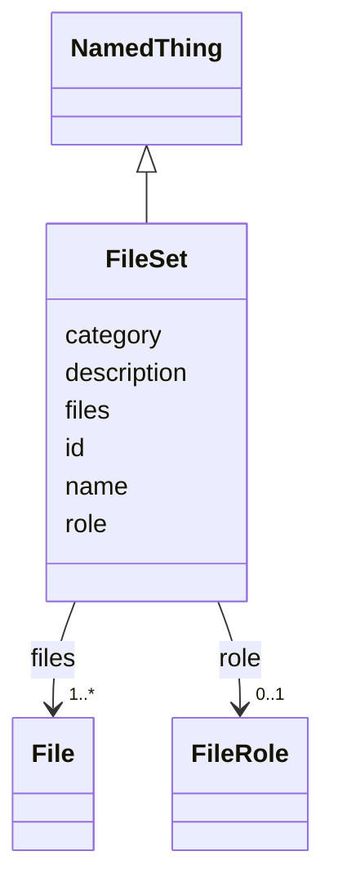

---
search:
  boost: 10.0
---

# Class: FileSet 


_A named bundle of files that belong together (e.g. R1/R2 FASTQs, a BAM + its index, a directory of per-sample VCFs). Optional grouping layer between Dataset and File._


<div data-search-exclude markdown="1">


URI: [brainbank:FileSet](https://w3id.org/VA-NCPTSDBB/brainbank/FileSet)





## Inheritance
* [NamedThing](NamedThing.md)
    * **FileSet**


## Slots

| Name | Cardinality and Range | Description | Inheritance |
| ---  | --- | --- | --- |
| [files](files.md) | 1..* <br/> [File](File.md) | The files that make up this set | direct |
| [role](role.md) | 0..1 <br/> [FileRole](FileRole.md) | What this set of files represents within the dataset | direct |
| [id](id.md) | 1 <br/> [Uriorcurie](Uriorcurie.md) | Technical identifier (UUID/CURIE); becomes hippo-managed later | [NamedThing](NamedThing.md) |
| [name](name.md) | 1 <br/> [String](String.md) | Human-readable label for the entity | [NamedThing](NamedThing.md) |
| [description](description.md) | 0..1 <br/> [String](String.md) | Free-text narrative description of the entity | [NamedThing](NamedThing.md) |
| [category](category.md) | 0..1 <br/> [String](String.md) | Names the concrete class of this instance | [NamedThing](NamedThing.md) |


## Usages

| used by | used in | type | used |
| ---  | --- | --- | --- |
| [BrainBank](BrainBank.md) | [file_sets](file_sets.md) | range | [FileSet](FileSet.md) |
| [Dataset](Dataset.md) | [file_sets](file_sets.md) | range | [FileSet](FileSet.md) |
| [SequenceDataset](SequenceDataset.md) | [file_sets](file_sets.md) | range | [FileSet](FileSet.md) |
| [RNASeqDataset](RNASeqDataset.md) | [file_sets](file_sets.md) | range | [FileSet](FileSet.md) |
| [GenomeVariantDataset](GenomeVariantDataset.md) | [file_sets](file_sets.md) | range | [FileSet](FileSet.md) |
| [ATACSeqDataset](ATACSeqDataset.md) | [file_sets](file_sets.md) | range | [FileSet](FileSet.md) |
| [ArrayDataset](ArrayDataset.md) | [file_sets](file_sets.md) | range | [FileSet](FileSet.md) |
| [GenotypingDataset](GenotypingDataset.md) | [file_sets](file_sets.md) | range | [FileSet](FileSet.md) |
| [MethylationDataset](MethylationDataset.md) | [file_sets](file_sets.md) | range | [FileSet](FileSet.md) |
| [ImageDataset](ImageDataset.md) | [file_sets](file_sets.md) | range | [FileSet](FileSet.md) |


## Identifier and Mapping Information


### Schema Source


* from schema: https://w3id.org/VA-NCPTSDBB/brainbank/brainbank


## Mappings

| Mapping Type | Mapped Value |
| ---  | ---  |
| self | brainbank:FileSet |
| native | brainbank:FileSet |
| exact | prov:Entity |


## LinkML Source

<!-- TODO: investigate https://stackoverflow.com/questions/37606292/how-to-create-tabbed-code-blocks-in-mkdocs-or-sphinx -->

### Direct

<details>
```yaml
name: FileSet
description: A named bundle of files that belong together (e.g. R1/R2 FASTQs, a BAM
  + its index, a directory of per-sample VCFs). Optional grouping layer between Dataset
  and File.
from_schema: https://w3id.org/VA-NCPTSDBB/brainbank/brainbank
exact_mappings:
- prov:Entity
is_a: NamedThing
attributes:
  files:
    name: files
    description: The files that make up this set.
    from_schema: https://w3id.org/VA-NCPTSDBB/brainbank/dataset
    domain_of:
    - BrainBank
    - Dataset
    - FileSet
    range: File
    required: true
    multivalued: true
  role:
    name: role
    description: What this set of files represents within the dataset.
    from_schema: https://w3id.org/VA-NCPTSDBB/brainbank/dataset
    rank: 1000
    domain_of:
    - FileSet
    range: FileRole

```
</details>

### Induced

<details>
```yaml
name: FileSet
description: A named bundle of files that belong together (e.g. R1/R2 FASTQs, a BAM
  + its index, a directory of per-sample VCFs). Optional grouping layer between Dataset
  and File.
from_schema: https://w3id.org/VA-NCPTSDBB/brainbank/brainbank
exact_mappings:
- prov:Entity
is_a: NamedThing
attributes:
  files:
    name: files
    description: The files that make up this set.
    from_schema: https://w3id.org/VA-NCPTSDBB/brainbank/dataset
    owner: FileSet
    domain_of:
    - BrainBank
    - Dataset
    - FileSet
    range: File
    required: true
    multivalued: true
  role:
    name: role
    description: What this set of files represents within the dataset.
    from_schema: https://w3id.org/VA-NCPTSDBB/brainbank/dataset
    rank: 1000
    owner: FileSet
    domain_of:
    - FileSet
    range: FileRole
  id:
    name: id
    description: Technical identifier (UUID/CURIE); becomes hippo-managed later.
    from_schema: https://w3id.org/VA-NCPTSDBB/brainbank/core
    rank: 1000
    identifier: true
    owner: FileSet
    domain_of:
    - NamedThing
    range: uriorcurie
    required: true
  name:
    name: name
    description: Human-readable label for the entity.
    from_schema: https://w3id.org/VA-NCPTSDBB/brainbank/core
    rank: 1000
    owner: FileSet
    domain_of:
    - NamedThing
    range: string
    required: true
  description:
    name: description
    description: Free-text narrative description of the entity.
    from_schema: https://w3id.org/VA-NCPTSDBB/brainbank/core
    rank: 1000
    owner: FileSet
    domain_of:
    - NamedThing
    range: string
  category:
    name: category
    description: Names the concrete class of this instance. Lets polymorphic inlined
      collections (e.g. a `samples` list holding SolidSample/LiquidSample) instantiate
      the right subclass.
    from_schema: https://w3id.org/VA-NCPTSDBB/brainbank/core
    rank: 1000
    designates_type: true
    owner: FileSet
    domain_of:
    - NamedThing
    range: string

```
</details></div>