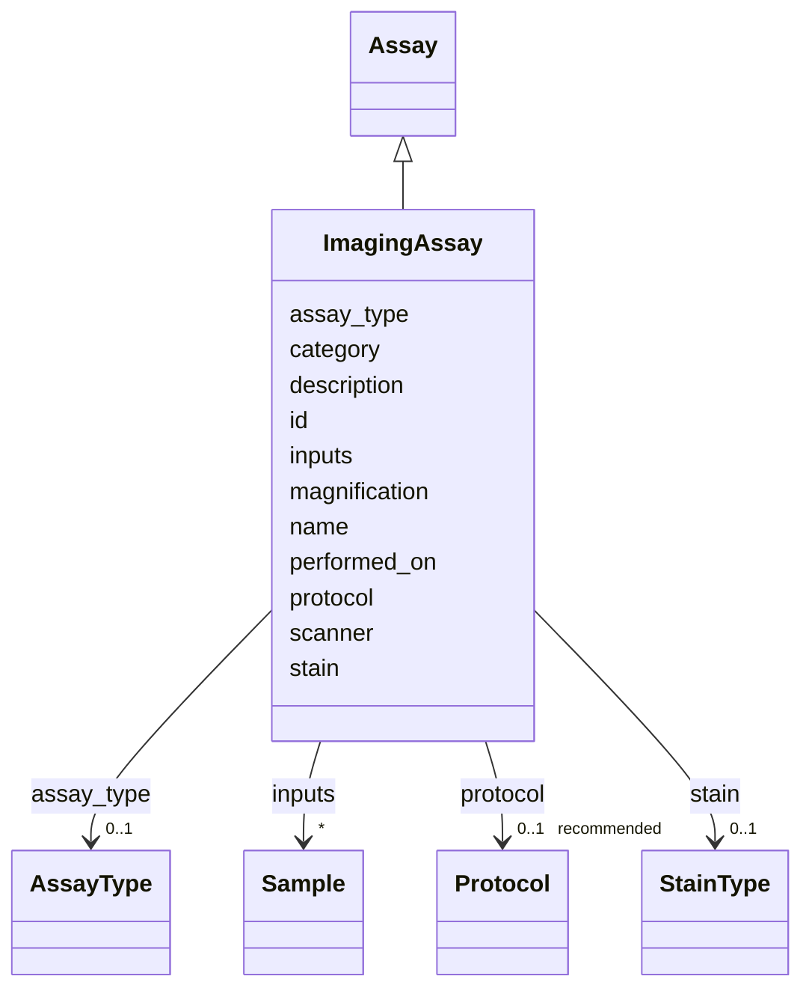

---
search:
  boost: 10.0
---

# Class: ImagingAssay 


_A histology or IHC imaging assay that digitizes stained tissue sections._


<div data-search-exclude markdown="1">


URI: [brainbank:ImagingAssay](https://w3id.org/VA-NCPTSDBB/brainbank/ImagingAssay)





## Inheritance
* [NamedThing](NamedThing.md)
    * [Activity](Activity.md)
        * [Assay](Assay.md)
            * **ImagingAssay**


## Slots

| Name | Cardinality and Range | Description | Inheritance |
| ---  | --- | --- | --- |
| [stain](stain.md) | 0..1 <br/> [StainType](StainType.md) | IHC stain applied to the section | direct |
| [magnification](magnification.md) | 0..1 <br/> [Float](Float.md) | Objective magnification used during scanning | direct |
| [scanner](scanner.md) | 0..1 <br/> [String](String.md) | Scanner model used for slide digitization (e | direct |
| [assay_type](assay_type.md) | 0..1 <br/> [AssayType](AssayType.md) | OBI-controlled type of assay performed | [Assay](Assay.md) |
| [inputs](inputs.md) | * <br/> [Sample](Sample.md) | Source samples consumed by this assay | [Assay](Assay.md) |
| [protocol](protocol.md) | 0..1 _recommended_ <br/> [Protocol](Protocol.md) | The SOP/method this activity followed | [Activity](Activity.md) |
| [performed_on](performed_on.md) | 0..1 <br/> [Date](Date.md) | Date the activity was carried out | [Activity](Activity.md) |
| [id](id.md) | 1 <br/> [Uriorcurie](Uriorcurie.md) | Technical identifier (UUID/CURIE); becomes hippo-managed later | [NamedThing](NamedThing.md) |
| [name](name.md) | 1 <br/> [String](String.md) | Human-readable label for the entity | [NamedThing](NamedThing.md) |
| [description](description.md) | 0..1 <br/> [String](String.md) | Free-text narrative description of the entity | [NamedThing](NamedThing.md) |
| [category](category.md) | 0..1 <br/> [String](String.md) | Names the concrete class of this instance | [NamedThing](NamedThing.md) |


## Identifier and Mapping Information


### Schema Source


* from schema: https://w3id.org/VA-NCPTSDBB/brainbank/brainbank


## Mappings

| Mapping Type | Mapped Value |
| ---  | ---  |
| self | brainbank:ImagingAssay |
| native | brainbank:ImagingAssay |


## LinkML Source

<!-- TODO: investigate https://stackoverflow.com/questions/37606292/how-to-create-tabbed-code-blocks-in-mkdocs-or-sphinx -->

### Direct

<details>
```yaml
name: ImagingAssay
description: A histology or IHC imaging assay that digitizes stained tissue sections.
from_schema: https://w3id.org/VA-NCPTSDBB/brainbank/brainbank
is_a: Assay
attributes:
  stain:
    name: stain
    description: IHC stain applied to the section.
    from_schema: https://w3id.org/VA-NCPTSDBB/brainbank/dataset
    domain_of:
    - SliceTissueToSlide
    - ImageDataset
    - ImagingAssay
    range: StainType
  magnification:
    name: magnification
    description: Objective magnification used during scanning.
    from_schema: https://w3id.org/VA-NCPTSDBB/brainbank/dataset
    domain_of:
    - ImageDataset
    - ImagingAssay
    range: float
  scanner:
    name: scanner
    description: Scanner model used for slide digitization (e.g. Aperio GT450).
    from_schema: https://w3id.org/VA-NCPTSDBB/brainbank/dataset
    rank: 1000
    domain_of:
    - ImagingAssay

```
</details>

### Induced

<details>
```yaml
name: ImagingAssay
description: A histology or IHC imaging assay that digitizes stained tissue sections.
from_schema: https://w3id.org/VA-NCPTSDBB/brainbank/brainbank
is_a: Assay
attributes:
  stain:
    name: stain
    description: IHC stain applied to the section.
    from_schema: https://w3id.org/VA-NCPTSDBB/brainbank/dataset
    owner: ImagingAssay
    domain_of:
    - SliceTissueToSlide
    - ImageDataset
    - ImagingAssay
    range: StainType
  magnification:
    name: magnification
    description: Objective magnification used during scanning.
    from_schema: https://w3id.org/VA-NCPTSDBB/brainbank/dataset
    owner: ImagingAssay
    domain_of:
    - ImageDataset
    - ImagingAssay
    range: float
  scanner:
    name: scanner
    description: Scanner model used for slide digitization (e.g. Aperio GT450).
    from_schema: https://w3id.org/VA-NCPTSDBB/brainbank/dataset
    rank: 1000
    owner: ImagingAssay
    domain_of:
    - ImagingAssay
    range: string
  assay_type:
    name: assay_type
    description: OBI-controlled type of assay performed.
    from_schema: https://w3id.org/VA-NCPTSDBB/brainbank/dataset
    owner: ImagingAssay
    domain_of:
    - Dataset
    - Assay
    range: AssayType
  inputs:
    name: inputs
    description: Source samples consumed by this assay.
    from_schema: https://w3id.org/VA-NCPTSDBB/brainbank/dataset
    owner: ImagingAssay
    domain_of:
    - Process
    - Assay
    range: Sample
    multivalued: true
  protocol:
    name: protocol
    description: The SOP/method this activity followed.
    from_schema: https://w3id.org/VA-NCPTSDBB/brainbank/core
    rank: 1000
    owner: ImagingAssay
    domain_of:
    - Activity
    range: Protocol
    recommended: true
  performed_on:
    name: performed_on
    description: Date the activity was carried out.
    from_schema: https://w3id.org/VA-NCPTSDBB/brainbank/core
    rank: 1000
    owner: ImagingAssay
    domain_of:
    - Activity
    range: date
  id:
    name: id
    description: Technical identifier (UUID/CURIE); becomes hippo-managed later.
    from_schema: https://w3id.org/VA-NCPTSDBB/brainbank/core
    rank: 1000
    identifier: true
    owner: ImagingAssay
    domain_of:
    - NamedThing
    range: uriorcurie
    required: true
  name:
    name: name
    description: Human-readable label for the entity.
    from_schema: https://w3id.org/VA-NCPTSDBB/brainbank/core
    rank: 1000
    owner: ImagingAssay
    domain_of:
    - NamedThing
    range: string
    required: true
  description:
    name: description
    description: Free-text narrative description of the entity.
    from_schema: https://w3id.org/VA-NCPTSDBB/brainbank/core
    rank: 1000
    owner: ImagingAssay
    domain_of:
    - NamedThing
    range: string
  category:
    name: category
    description: Names the concrete class of this instance. Lets polymorphic inlined
      collections (e.g. a `samples` list holding SolidSample/LiquidSample) instantiate
      the right subclass.
    from_schema: https://w3id.org/VA-NCPTSDBB/brainbank/core
    rank: 1000
    designates_type: true
    owner: ImagingAssay
    domain_of:
    - NamedThing
    range: string

```
</details></div>