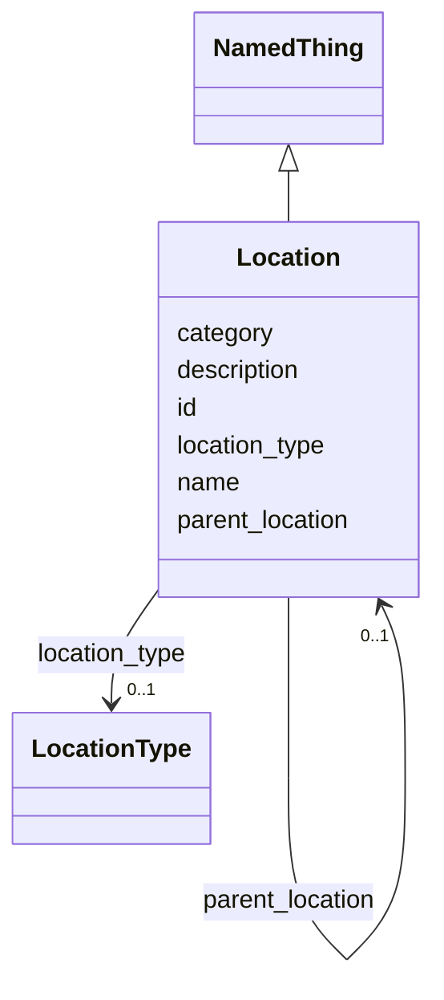

---
search:
  boost: 10.0
---

# Class: Location 


_A physical storage location (room, freezer unit, building, site)._


<div data-search-exclude markdown="1">


URI: [brainbank:Location](https://w3id.org/VA-NCPTSDBB/brainbank/Location)





## Inheritance
* [NamedThing](NamedThing.md)
    * **Location**


## Slots

| Name | Cardinality and Range | Description | Inheritance |
| ---  | --- | --- | --- |
| [location_type](location_type.md) | 0..1 <br/> [LocationType](LocationType.md) | Type of location (Site, Building, or Room) | direct |
| [parent_location](parent_location.md) | 0..1 <br/> [Location](Location.md) | The parent location this location belongs to (e | direct |
| [id](id.md) | 1 <br/> [Uriorcurie](Uriorcurie.md) | Technical identifier (UUID/CURIE); becomes hippo-managed later | [NamedThing](NamedThing.md) |
| [name](name.md) | 1 <br/> [String](String.md) | Human-readable label for the entity | [NamedThing](NamedThing.md) |
| [description](description.md) | 0..1 <br/> [String](String.md) | Free-text narrative description of the entity | [NamedThing](NamedThing.md) |
| [category](category.md) | 0..1 <br/> [String](String.md) | Names the concrete class of this instance | [NamedThing](NamedThing.md) |


## Usages

| used by | used in | type | used |
| ---  | --- | --- | --- |
| [BrainBank](BrainBank.md) | [locations](locations.md) | range | [Location](Location.md) |
| [Container](Container.md) | [location](location.md) | range | [Location](Location.md) |
| [Location](Location.md) | [parent_location](parent_location.md) | range | [Location](Location.md) |


## Identifier and Mapping Information


### Schema Source


* from schema: https://w3id.org/VA-NCPTSDBB/brainbank/brainbank


## Mappings

| Mapping Type | Mapped Value |
| ---  | ---  |
| self | brainbank:Location |
| native | brainbank:Location |


## LinkML Source

<!-- TODO: investigate https://stackoverflow.com/questions/37606292/how-to-create-tabbed-code-blocks-in-mkdocs-or-sphinx -->

### Direct

<details>
```yaml
name: Location
description: A physical storage location (room, freezer unit, building, site).
from_schema: https://w3id.org/VA-NCPTSDBB/brainbank/brainbank
is_a: NamedThing
attributes:
  location_type:
    name: location_type
    description: Type of location (Site, Building, or Room).
    from_schema: https://w3id.org/VA-NCPTSDBB/brainbank/tissue
    rank: 1000
    domain_of:
    - Location
    range: LocationType
  parent_location:
    name: parent_location
    description: The parent location this location belongs to (e.g. room within building).
    from_schema: https://w3id.org/VA-NCPTSDBB/brainbank/tissue
    rank: 1000
    domain_of:
    - Location
    range: Location

```
</details>

### Induced

<details>
```yaml
name: Location
description: A physical storage location (room, freezer unit, building, site).
from_schema: https://w3id.org/VA-NCPTSDBB/brainbank/brainbank
is_a: NamedThing
attributes:
  location_type:
    name: location_type
    description: Type of location (Site, Building, or Room).
    from_schema: https://w3id.org/VA-NCPTSDBB/brainbank/tissue
    rank: 1000
    owner: Location
    domain_of:
    - Location
    range: LocationType
  parent_location:
    name: parent_location
    description: The parent location this location belongs to (e.g. room within building).
    from_schema: https://w3id.org/VA-NCPTSDBB/brainbank/tissue
    rank: 1000
    owner: Location
    domain_of:
    - Location
    range: Location
  id:
    name: id
    description: Technical identifier (UUID/CURIE); becomes hippo-managed later.
    from_schema: https://w3id.org/VA-NCPTSDBB/brainbank/core
    rank: 1000
    identifier: true
    owner: Location
    domain_of:
    - NamedThing
    range: uriorcurie
    required: true
  name:
    name: name
    description: Human-readable label for the entity.
    from_schema: https://w3id.org/VA-NCPTSDBB/brainbank/core
    rank: 1000
    owner: Location
    domain_of:
    - NamedThing
    range: string
    required: true
  description:
    name: description
    description: Free-text narrative description of the entity.
    from_schema: https://w3id.org/VA-NCPTSDBB/brainbank/core
    rank: 1000
    owner: Location
    domain_of:
    - NamedThing
    range: string
  category:
    name: category
    description: Names the concrete class of this instance. Lets polymorphic inlined
      collections (e.g. a `samples` list holding SolidSample/LiquidSample) instantiate
      the right subclass.
    from_schema: https://w3id.org/VA-NCPTSDBB/brainbank/core
    rank: 1000
    designates_type: true
    owner: Location
    domain_of:
    - NamedThing
    range: string

```
</details></div>