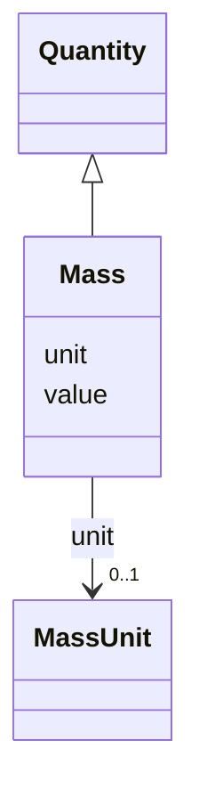

---
search:
  boost: 10.0
---

# Class: Mass 


_A mass measurement (e.g. tissue weight)._


<div data-search-exclude markdown="1">


URI: [brainbank:Mass](https://w3id.org/VA-NCPTSDBB/brainbank/Mass)





## Inheritance
* [Quantity](Quantity.md)
    * **Mass**


## Slots

| Name | Cardinality and Range | Description | Inheritance |
| ---  | --- | --- | --- |
| [unit](unit.md) | 0..1 <br/> [MassUnit](MassUnit.md) | Unit of mass for this measurement | direct |
| [value](value.md) | 0..1 <br/> [Float](Float.md) | Numeric magnitude of the measurement | [Quantity](Quantity.md) |


## Usages

| used by | used in | type | used |
| ---  | --- | --- | --- |
| [CNSSection](CNSSection.md) | [mass](mass.md) | range | [Mass](Mass.md) |
| [Cerebellum](Cerebellum.md) | [mass](mass.md) | range | [Mass](Mass.md) |
| [Cerebrum](Cerebrum.md) | [mass](mass.md) | range | [Mass](Mass.md) |
| [Hemisphere](Hemisphere.md) | [mass](mass.md) | range | [Mass](Mass.md) |
| [Medulla](Medulla.md) | [mass](mass.md) | range | [Mass](Mass.md) |
| [OlfactoryBulb](OlfactoryBulb.md) | [mass](mass.md) | range | [Mass](Mass.md) |
| [PinealGland](PinealGland.md) | [mass](mass.md) | range | [Mass](Mass.md) |
| [Pons](Pons.md) | [mass](mass.md) | range | [Mass](Mass.md) |
| [SubstantiaNigra](SubstantiaNigra.md) | [mass](mass.md) | range | [Mass](Mass.md) |
| [ChoroidPlexus](ChoroidPlexus.md) | [mass](mass.md) | range | [Mass](Mass.md) |
| [Pituitary](Pituitary.md) | [mass](mass.md) | range | [Mass](Mass.md) |
| [SpinalCord](SpinalCord.md) | [mass](mass.md) | range | [Mass](Mass.md) |
| [SpinalCordBlock](SpinalCordBlock.md) | [mass](mass.md) | range | [Mass](Mass.md) |
| [Brain](Brain.md) | [mass](mass.md) | range | [Mass](Mass.md) |
| [Dura](Dura.md) | [mass](mass.md) | range | [Mass](Mass.md) |
| [DuraBlock](DuraBlock.md) | [mass](mass.md) | range | [Mass](Mass.md) |
| [Skin](Skin.md) | [mass](mass.md) | range | [Mass](Mass.md) |
| [Muscle](Muscle.md) | [mass](mass.md) | range | [Mass](Mass.md) |
| [MuscleBlock](MuscleBlock.md) | [mass](mass.md) | range | [Mass](Mass.md) |
| [BloodVessel](BloodVessel.md) | [mass](mass.md) | range | [Mass](Mass.md) |
| [CSFPellet](CSFPellet.md) | [mass](mass.md) | range | [Mass](Mass.md) |
| [SpinalCordSlide](SpinalCordSlide.md) | [mass](mass.md) | range | [Mass](Mass.md) |
| [Section](Section.md) | [mass](mass.md) | range | [Mass](Mass.md) |
| [HorizontalSection](HorizontalSection.md) | [mass](mass.md) | range | [Mass](Mass.md) |
| [SagittalSection](SagittalSection.md) | [mass](mass.md) | range | [Mass](Mass.md) |
| [CoronalSection](CoronalSection.md) | [mass](mass.md) | range | [Mass](Mass.md) |
| [SolidSample](SolidSample.md) | [mass](mass.md) | range | [Mass](Mass.md) |


## Identifier and Mapping Information


### Schema Source


* from schema: https://w3id.org/VA-NCPTSDBB/brainbank/brainbank


## Mappings

| Mapping Type | Mapped Value |
| ---  | ---  |
| self | brainbank:Mass |
| native | brainbank:Mass |


## LinkML Source

<!-- TODO: investigate https://stackoverflow.com/questions/37606292/how-to-create-tabbed-code-blocks-in-mkdocs-or-sphinx -->

### Direct

<details>
```yaml
name: Mass
description: A mass measurement (e.g. tissue weight).
from_schema: https://w3id.org/VA-NCPTSDBB/brainbank/brainbank
is_a: Quantity
attributes:
  unit:
    name: unit
    description: Unit of mass for this measurement.
    from_schema: https://w3id.org/VA-NCPTSDBB/brainbank/core
    rank: 1000
    domain_of:
    - Mass
    - Volume
    - Concentration
    range: MassUnit

```
</details>

### Induced

<details>
```yaml
name: Mass
description: A mass measurement (e.g. tissue weight).
from_schema: https://w3id.org/VA-NCPTSDBB/brainbank/brainbank
is_a: Quantity
attributes:
  unit:
    name: unit
    description: Unit of mass for this measurement.
    from_schema: https://w3id.org/VA-NCPTSDBB/brainbank/core
    rank: 1000
    owner: Mass
    domain_of:
    - Mass
    - Volume
    - Concentration
    range: MassUnit
  value:
    name: value
    description: Numeric magnitude of the measurement.
    from_schema: https://w3id.org/VA-NCPTSDBB/brainbank/core
    rank: 1000
    owner: Mass
    domain_of:
    - Quantity
    - Parameter
    range: float

```
</details></div>