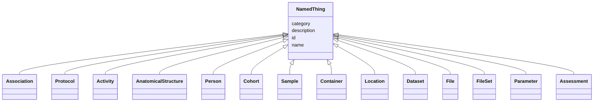

---
search:
  boost: 10.0
---

# Class: NamedThing 


_Local base for all entities. TEMPORARY: stands in for hippo's runtime-provided Entity (see DESIGN.md section 7). When we adopt hippo, classes switch to `is_a: Entity` and id/name/description here are surrendered to the runtime._


<div data-search-exclude markdown="1">


* __NOTE__: this is an abstract class and should not be instantiated directly


URI: [brainbank:NamedThing](https://w3id.org/VA-NCPTSDBB/brainbank/NamedThing)





## Inheritance
* **NamedThing**
    * [Association](Association.md)
    * [Protocol](Protocol.md)
    * [Activity](Activity.md)
    * [AnatomicalStructure](AnatomicalStructure.md)
    * [Person](Person.md)
    * [Cohort](Cohort.md)
    * [Sample](Sample.md)
    * [Container](Container.md)
    * [Location](Location.md)
    * [Dataset](Dataset.md)
    * [File](File.md)
    * [FileSet](FileSet.md)
    * [Parameter](Parameter.md)
    * [Assessment](Assessment.md)


## Slots

| Name | Cardinality and Range | Description | Inheritance |
| ---  | --- | --- | --- |
| [id](id.md) | 1 <br/> [Uriorcurie](Uriorcurie.md) | Technical identifier (UUID/CURIE); becomes hippo-managed later | direct |
| [name](name.md) | 1 <br/> [String](String.md) | Human-readable label for the entity | direct |
| [description](description.md) | 0..1 <br/> [String](String.md) | Free-text narrative description of the entity | direct |
| [category](category.md) | 0..1 <br/> [String](String.md) | Names the concrete class of this instance | direct |


## Usages

| used by | used in | type | used |
| ---  | --- | --- | --- |
| [Association](Association.md) | [subject](subject.md) | range | [NamedThing](NamedThing.md) |
| [Association](Association.md) | [object](object.md) | range | [NamedThing](NamedThing.md) |


## Identifier and Mapping Information


### Schema Source


* from schema: https://w3id.org/VA-NCPTSDBB/brainbank/brainbank


## Mappings

| Mapping Type | Mapped Value |
| ---  | ---  |
| self | brainbank:NamedThing |
| native | brainbank:NamedThing |


## LinkML Source

<!-- TODO: investigate https://stackoverflow.com/questions/37606292/how-to-create-tabbed-code-blocks-in-mkdocs-or-sphinx -->

### Direct

<details>
```yaml
name: NamedThing
description: 'Local base for all entities. TEMPORARY: stands in for hippo''s runtime-provided
  Entity (see DESIGN.md section 7). When we adopt hippo, classes switch to `is_a:
  Entity` and id/name/description here are surrendered to the runtime.'
from_schema: https://w3id.org/VA-NCPTSDBB/brainbank/brainbank
abstract: true
attributes:
  id:
    name: id
    description: Technical identifier (UUID/CURIE); becomes hippo-managed later.
    from_schema: https://w3id.org/VA-NCPTSDBB/brainbank/core
    rank: 1000
    identifier: true
    domain_of:
    - NamedThing
    range: uriorcurie
  name:
    name: name
    description: Human-readable label for the entity.
    from_schema: https://w3id.org/VA-NCPTSDBB/brainbank/core
    rank: 1000
    domain_of:
    - NamedThing
    required: true
  description:
    name: description
    description: Free-text narrative description of the entity.
    from_schema: https://w3id.org/VA-NCPTSDBB/brainbank/core
    rank: 1000
    domain_of:
    - NamedThing
  category:
    name: category
    description: Names the concrete class of this instance. Lets polymorphic inlined
      collections (e.g. a `samples` list holding SolidSample/LiquidSample) instantiate
      the right subclass.
    from_schema: https://w3id.org/VA-NCPTSDBB/brainbank/core
    rank: 1000
    designates_type: true
    domain_of:
    - NamedThing
    range: string

```
</details>

### Induced

<details>
```yaml
name: NamedThing
description: 'Local base for all entities. TEMPORARY: stands in for hippo''s runtime-provided
  Entity (see DESIGN.md section 7). When we adopt hippo, classes switch to `is_a:
  Entity` and id/name/description here are surrendered to the runtime.'
from_schema: https://w3id.org/VA-NCPTSDBB/brainbank/brainbank
abstract: true
attributes:
  id:
    name: id
    description: Technical identifier (UUID/CURIE); becomes hippo-managed later.
    from_schema: https://w3id.org/VA-NCPTSDBB/brainbank/core
    rank: 1000
    identifier: true
    owner: NamedThing
    domain_of:
    - NamedThing
    range: uriorcurie
    required: true
  name:
    name: name
    description: Human-readable label for the entity.
    from_schema: https://w3id.org/VA-NCPTSDBB/brainbank/core
    rank: 1000
    owner: NamedThing
    domain_of:
    - NamedThing
    range: string
    required: true
  description:
    name: description
    description: Free-text narrative description of the entity.
    from_schema: https://w3id.org/VA-NCPTSDBB/brainbank/core
    rank: 1000
    owner: NamedThing
    domain_of:
    - NamedThing
    range: string
  category:
    name: category
    description: Names the concrete class of this instance. Lets polymorphic inlined
      collections (e.g. a `samples` list holding SolidSample/LiquidSample) instantiate
      the right subclass.
    from_schema: https://w3id.org/VA-NCPTSDBB/brainbank/core
    rank: 1000
    designates_type: true
    owner: NamedThing
    domain_of:
    - NamedThing
    range: string

```
</details></div>