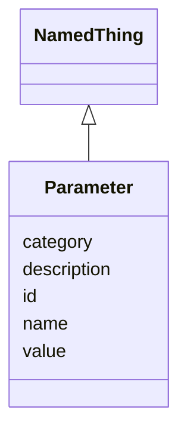

---
search:
  boost: 10.0
---

# Class: Parameter 


_A single named parameter/setting supplied to an analysis run._


<div data-search-exclude markdown="1">


URI: [brainbank:Parameter](https://w3id.org/VA-NCPTSDBB/brainbank/Parameter)





## Inheritance
* [NamedThing](NamedThing.md)
    * **Parameter**


## Slots

| Name | Cardinality and Range | Description | Inheritance |
| ---  | --- | --- | --- |
| [value](value.md) | 0..1 <br/> [String](String.md) | Parameter value, serialized as text in the prototype | direct |
| [id](id.md) | 1 <br/> [Uriorcurie](Uriorcurie.md) | Technical identifier (UUID/CURIE); becomes hippo-managed later | [NamedThing](NamedThing.md) |
| [name](name.md) | 1 <br/> [String](String.md) | Parameter name (key) | [NamedThing](NamedThing.md) |
| [description](description.md) | 0..1 <br/> [String](String.md) | Free-text narrative description of the entity | [NamedThing](NamedThing.md) |
| [category](category.md) | 0..1 <br/> [String](String.md) | Names the concrete class of this instance | [NamedThing](NamedThing.md) |


## Usages

| used by | used in | type | used |
| ---  | --- | --- | --- |
| [Analysis](Analysis.md) | [parameters](parameters.md) | range | [Parameter](Parameter.md) |
| [WorkflowRun](WorkflowRun.md) | [parameters](parameters.md) | range | [Parameter](Parameter.md) |


## Identifier and Mapping Information


### Schema Source


* from schema: https://w3id.org/VA-NCPTSDBB/brainbank/brainbank


## Mappings

| Mapping Type | Mapped Value |
| ---  | ---  |
| self | brainbank:Parameter |
| native | brainbank:Parameter |


## LinkML Source

<!-- TODO: investigate https://stackoverflow.com/questions/37606292/how-to-create-tabbed-code-blocks-in-mkdocs-or-sphinx -->

### Direct

<details>
```yaml
name: Parameter
description: A single named parameter/setting supplied to an analysis run.
from_schema: https://w3id.org/VA-NCPTSDBB/brainbank/brainbank
is_a: NamedThing
slot_usage:
  name:
    name: name
    description: Parameter name (key).
attributes:
  value:
    name: value
    description: Parameter value, serialized as text in the prototype.
    from_schema: https://w3id.org/VA-NCPTSDBB/brainbank/analysis
    domain_of:
    - Quantity
    - Parameter

```
</details>

### Induced

<details>
```yaml
name: Parameter
description: A single named parameter/setting supplied to an analysis run.
from_schema: https://w3id.org/VA-NCPTSDBB/brainbank/brainbank
is_a: NamedThing
slot_usage:
  name:
    name: name
    description: Parameter name (key).
attributes:
  value:
    name: value
    description: Parameter value, serialized as text in the prototype.
    from_schema: https://w3id.org/VA-NCPTSDBB/brainbank/analysis
    owner: Parameter
    domain_of:
    - Quantity
    - Parameter
    range: string
  id:
    name: id
    description: Technical identifier (UUID/CURIE); becomes hippo-managed later.
    from_schema: https://w3id.org/VA-NCPTSDBB/brainbank/core
    rank: 1000
    identifier: true
    owner: Parameter
    domain_of:
    - NamedThing
    range: uriorcurie
    required: true
  name:
    name: name
    description: Parameter name (key).
    from_schema: https://w3id.org/VA-NCPTSDBB/brainbank/core
    rank: 1000
    owner: Parameter
    domain_of:
    - NamedThing
    range: string
    required: true
  description:
    name: description
    description: Free-text narrative description of the entity.
    from_schema: https://w3id.org/VA-NCPTSDBB/brainbank/core
    rank: 1000
    owner: Parameter
    domain_of:
    - NamedThing
    range: string
  category:
    name: category
    description: Names the concrete class of this instance. Lets polymorphic inlined
      collections (e.g. a `samples` list holding SolidSample/LiquidSample) instantiate
      the right subclass.
    from_schema: https://w3id.org/VA-NCPTSDBB/brainbank/core
    rank: 1000
    designates_type: true
    owner: Parameter
    domain_of:
    - NamedThing
    range: string

```
</details></div>