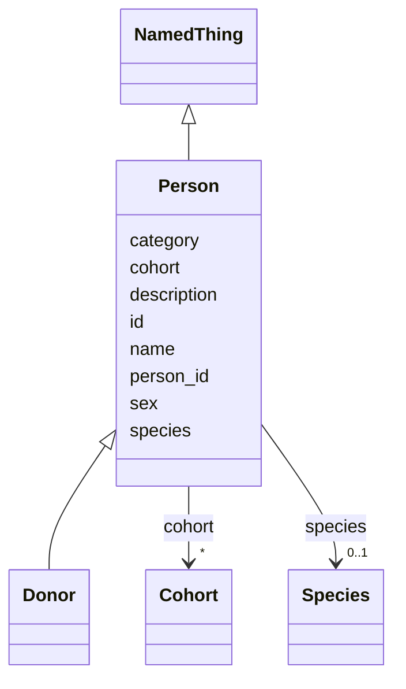

---
search:
  boost: 10.0
---

# Class: Person 


_A human individual (was tissue_db:Case / draft "Subject")._


<div data-search-exclude markdown="1">


URI: [brainbank:Person](https://w3id.org/VA-NCPTSDBB/brainbank/Person)





## Inheritance
* [NamedThing](NamedThing.md)
    * **Person**
        * [Donor](Donor.md)


## Slots

| Name | Cardinality and Range | Description | Inheritance |
| ---  | --- | --- | --- |
| [person_id](person_id.md) | 1 <br/> [String](String.md) | Business identifier (human-facing person ID) | direct |
| [species](species.md) | 0..1 <br/> [Species](Species.md) | Species of the individual | direct |
| [sex](sex.md) | 0..1 <br/> [String](String.md) | Biological sex of the individual (free text; use standard values such as male... | direct |
| [cohort](cohort.md) | * <br/> [Cohort](Cohort.md) | Study cohort(s) this individual belongs to | direct |
| [id](id.md) | 1 <br/> [Uriorcurie](Uriorcurie.md) | Technical identifier (UUID/CURIE); becomes hippo-managed later | [NamedThing](NamedThing.md) |
| [name](name.md) | 1 <br/> [String](String.md) | Human-readable label for the entity | [NamedThing](NamedThing.md) |
| [description](description.md) | 0..1 <br/> [String](String.md) | Free-text narrative description of the entity | [NamedThing](NamedThing.md) |
| [category](category.md) | 0..1 <br/> [String](String.md) | Names the concrete class of this instance | [NamedThing](NamedThing.md) |


## Usages

| used by | used in | type | used |
| ---  | --- | --- | --- |
| [Assessment](Assessment.md) | [person](person.md) | range | [Person](Person.md) |
| [Measurement](Measurement.md) | [person](person.md) | range | [Person](Person.md) |
| [Diagnosis](Diagnosis.md) | [person](person.md) | range | [Person](Person.md) |


## Identifier and Mapping Information


### Schema Source


* from schema: https://w3id.org/VA-NCPTSDBB/brainbank/brainbank


## Mappings

| Mapping Type | Mapped Value |
| ---  | ---  |
| self | brainbank:Person |
| native | brainbank:Person |


## LinkML Source

<!-- TODO: investigate https://stackoverflow.com/questions/37606292/how-to-create-tabbed-code-blocks-in-mkdocs-or-sphinx -->

### Direct

<details>
```yaml
name: Person
description: A human individual (was tissue_db:Case / draft "Subject").
from_schema: https://w3id.org/VA-NCPTSDBB/brainbank/brainbank
is_a: NamedThing
attributes:
  person_id:
    name: person_id
    description: Business identifier (human-facing person ID). Gets hippo_index later.
    from_schema: https://w3id.org/VA-NCPTSDBB/brainbank/person
    rank: 1000
    domain_of:
    - Person
    required: true
  species:
    name: species
    description: Species of the individual. Defaults conceptually to Homo sapiens
      (NCBITaxon:9606); an ifabsent default is omitted because Species is a dynamic
      (reachable_from) enum with no static permissible value for gen-pydantic to materialize.
    from_schema: https://w3id.org/VA-NCPTSDBB/brainbank/person
    rank: 1000
    domain_of:
    - Person
    range: Species
  sex:
    name: sex
    description: Biological sex of the individual (free text; use standard values
      such as male/female/unknown).
    from_schema: https://w3id.org/VA-NCPTSDBB/brainbank/person
    rank: 1000
    domain_of:
    - Person
  cohort:
    name: cohort
    description: Study cohort(s) this individual belongs to.
    from_schema: https://w3id.org/VA-NCPTSDBB/brainbank/person
    rank: 1000
    domain_of:
    - Person
    range: Cohort
    multivalued: true

```
</details>

### Induced

<details>
```yaml
name: Person
description: A human individual (was tissue_db:Case / draft "Subject").
from_schema: https://w3id.org/VA-NCPTSDBB/brainbank/brainbank
is_a: NamedThing
attributes:
  person_id:
    name: person_id
    description: Business identifier (human-facing person ID). Gets hippo_index later.
    from_schema: https://w3id.org/VA-NCPTSDBB/brainbank/person
    rank: 1000
    owner: Person
    domain_of:
    - Person
    range: string
    required: true
  species:
    name: species
    description: Species of the individual. Defaults conceptually to Homo sapiens
      (NCBITaxon:9606); an ifabsent default is omitted because Species is a dynamic
      (reachable_from) enum with no static permissible value for gen-pydantic to materialize.
    from_schema: https://w3id.org/VA-NCPTSDBB/brainbank/person
    rank: 1000
    owner: Person
    domain_of:
    - Person
    range: Species
  sex:
    name: sex
    description: Biological sex of the individual (free text; use standard values
      such as male/female/unknown).
    from_schema: https://w3id.org/VA-NCPTSDBB/brainbank/person
    rank: 1000
    owner: Person
    domain_of:
    - Person
    range: string
  cohort:
    name: cohort
    description: Study cohort(s) this individual belongs to.
    from_schema: https://w3id.org/VA-NCPTSDBB/brainbank/person
    rank: 1000
    owner: Person
    domain_of:
    - Person
    range: Cohort
    multivalued: true
  id:
    name: id
    description: Technical identifier (UUID/CURIE); becomes hippo-managed later.
    from_schema: https://w3id.org/VA-NCPTSDBB/brainbank/core
    rank: 1000
    identifier: true
    owner: Person
    domain_of:
    - NamedThing
    range: uriorcurie
    required: true
  name:
    name: name
    description: Human-readable label for the entity.
    from_schema: https://w3id.org/VA-NCPTSDBB/brainbank/core
    rank: 1000
    owner: Person
    domain_of:
    - NamedThing
    range: string
    required: true
  description:
    name: description
    description: Free-text narrative description of the entity.
    from_schema: https://w3id.org/VA-NCPTSDBB/brainbank/core
    rank: 1000
    owner: Person
    domain_of:
    - NamedThing
    range: string
  category:
    name: category
    description: Names the concrete class of this instance. Lets polymorphic inlined
      collections (e.g. a `samples` list holding SolidSample/LiquidSample) instantiate
      the right subclass.
    from_schema: https://w3id.org/VA-NCPTSDBB/brainbank/core
    rank: 1000
    designates_type: true
    owner: Person
    domain_of:
    - NamedThing
    range: string

```
</details></div>