---
search:
  boost: 10.0
---

# Class: Process 


_A specimen-processing/transformation event (generalizes tissue_db:Transaction). Concrete brain-bank workflows subclass this in the brainbank extension layer. protocol/performed_on are inherited from core.Activity._


<div data-search-exclude markdown="1">


URI: [brainbank:Process](https://w3id.org/VA-NCPTSDBB/brainbank/Process)

```mermaid
 classDiagram
    class Process
    click Process href "../Process/"
      Activity <|-- Process
        click Activity href "../Activity/"
      

      Process <|-- BankFreshBrain
        click BankFreshBrain href "../BankFreshBrain/"
      Process <|-- BankFixedBrain
        click BankFixedBrain href "../BankFixedBrain/"
      Process <|-- BankDura
        click BankDura href "../BankDura/"
      Process <|-- BankCSF
        click BankCSF href "../BankCSF/"
      Process <|-- BankBlood
        click BankBlood href "../BankBlood/"
      Process <|-- BankSkin
        click BankSkin href "../BankSkin/"
      Process <|-- BankMuscle
        click BankMuscle href "../BankMuscle/"
      Process <|-- BankVessels
        click BankVessels href "../BankVessels/"
      Process <|-- BankSpinalCord
        click BankSpinalCord href "../BankSpinalCord/"
      Process <|-- BlockDura
        click BlockDura href "../BlockDura/"
      Process <|-- BlockMuscle
        click BlockMuscle href "../BlockMuscle/"
      Process <|-- BlockSpinalCord
        click BlockSpinalCord href "../BlockSpinalCord/"
      Process <|-- BlockFrozenBrain
        click BlockFrozenBrain href "../BlockFrozenBrain/"
      Process <|-- BlockFixedBrain
        click BlockFixedBrain href "../BlockFixedBrain/"
      Process <|-- BlockFixedHemisphere
        click BlockFixedHemisphere href "../BlockFixedHemisphere/"
      Process <|-- SectionFixedBrain
        click SectionFixedBrain href "../SectionFixedBrain/"
      Process <|-- DissectFrozenBrain
        click DissectFrozenBrain href "../DissectFrozenBrain/"
      Process <|-- DissectFixedBrain
        click DissectFixedBrain href "../DissectFixedBrain/"
      Process <|-- CultureTissue
        click CultureTissue href "../CultureTissue/"
      Process <|-- SliceTissueToSlide
        click SliceTissueToSlide href "../SliceTissueToSlide/"
      

      Process : category
        
      Process : description
        
      Process : id
        
      Process : inputs
        
          
    
        
        
        Process --> "*" Sample : inputs
        click Sample href "../Sample/"
    

        
      Process : name
        
      Process : outputs
        
          
    
        
        
        Process --> "*" Sample : outputs
        click Sample href "../Sample/"
    

        
      Process : performed_on
        
      Process : protocol
        
          
    
        
        
        Process --> "0..1 _recommended_" Protocol : protocol
        click Protocol href "../Protocol/"
    

        
      
```





## Inheritance
* [NamedThing](NamedThing.md)
    * [Activity](Activity.md)
        * **Process**
            * [BankFreshBrain](BankFreshBrain.md)
            * [BankFixedBrain](BankFixedBrain.md)
            * [BankDura](BankDura.md)
            * [BankCSF](BankCSF.md)
            * [BankBlood](BankBlood.md)
            * [BankSkin](BankSkin.md)
            * [BankMuscle](BankMuscle.md)
            * [BankVessels](BankVessels.md)
            * [BankSpinalCord](BankSpinalCord.md)
            * [BlockDura](BlockDura.md)
            * [BlockMuscle](BlockMuscle.md)
            * [BlockSpinalCord](BlockSpinalCord.md)
            * [BlockFrozenBrain](BlockFrozenBrain.md)
            * [BlockFixedBrain](BlockFixedBrain.md)
            * [BlockFixedHemisphere](BlockFixedHemisphere.md)
            * [SectionFixedBrain](SectionFixedBrain.md)
            * [DissectFrozenBrain](DissectFrozenBrain.md)
            * [DissectFixedBrain](DissectFixedBrain.md)
            * [CultureTissue](CultureTissue.md)
            * [SliceTissueToSlide](SliceTissueToSlide.md)


## Slots

| Name | Cardinality and Range | Description | Inheritance |
| ---  | --- | --- | --- |
| [inputs](inputs.md) | * <br/> [Sample](Sample.md) | Input specimens consumed or transformed by this process | direct |
| [outputs](outputs.md) | * <br/> [Sample](Sample.md) | Specimens produced as output of this process | direct |
| [protocol](protocol.md) | 0..1 _recommended_ <br/> [Protocol](Protocol.md) | The SOP/method this activity followed | [Activity](Activity.md) |
| [performed_on](performed_on.md) | 0..1 <br/> [Date](Date.md) | Date the activity was carried out | [Activity](Activity.md) |
| [id](id.md) | 1 <br/> [Uriorcurie](Uriorcurie.md) | Technical identifier (UUID/CURIE); becomes hippo-managed later | [NamedThing](NamedThing.md) |
| [name](name.md) | 1 <br/> [String](String.md) | Human-readable label for the entity | [NamedThing](NamedThing.md) |
| [description](description.md) | 0..1 <br/> [String](String.md) | Free-text narrative description of the entity | [NamedThing](NamedThing.md) |
| [category](category.md) | 0..1 <br/> [String](String.md) | Names the concrete class of this instance | [NamedThing](NamedThing.md) |


## Usages

| used by | used in | type | used |
| ---  | --- | --- | --- |
| [BrainBank](BrainBank.md) | [processes](processes.md) | range | [Process](Process.md) |
| [CNSSection](CNSSection.md) | [produced_by](produced_by.md) | range | [Process](Process.md) |
| [Cerebellum](Cerebellum.md) | [produced_by](produced_by.md) | range | [Process](Process.md) |
| [Cerebrum](Cerebrum.md) | [produced_by](produced_by.md) | range | [Process](Process.md) |
| [Hemisphere](Hemisphere.md) | [produced_by](produced_by.md) | range | [Process](Process.md) |
| [Medulla](Medulla.md) | [produced_by](produced_by.md) | range | [Process](Process.md) |
| [OlfactoryBulb](OlfactoryBulb.md) | [produced_by](produced_by.md) | range | [Process](Process.md) |
| [PinealGland](PinealGland.md) | [produced_by](produced_by.md) | range | [Process](Process.md) |
| [Pons](Pons.md) | [produced_by](produced_by.md) | range | [Process](Process.md) |
| [SubstantiaNigra](SubstantiaNigra.md) | [produced_by](produced_by.md) | range | [Process](Process.md) |
| [ChoroidPlexus](ChoroidPlexus.md) | [produced_by](produced_by.md) | range | [Process](Process.md) |
| [Pituitary](Pituitary.md) | [produced_by](produced_by.md) | range | [Process](Process.md) |
| [SpinalCord](SpinalCord.md) | [produced_by](produced_by.md) | range | [Process](Process.md) |
| [SpinalCordBlock](SpinalCordBlock.md) | [produced_by](produced_by.md) | range | [Process](Process.md) |
| [Brain](Brain.md) | [produced_by](produced_by.md) | range | [Process](Process.md) |
| [Dura](Dura.md) | [produced_by](produced_by.md) | range | [Process](Process.md) |
| [DuraBlock](DuraBlock.md) | [produced_by](produced_by.md) | range | [Process](Process.md) |
| [Skin](Skin.md) | [produced_by](produced_by.md) | range | [Process](Process.md) |
| [Muscle](Muscle.md) | [produced_by](produced_by.md) | range | [Process](Process.md) |
| [MuscleBlock](MuscleBlock.md) | [produced_by](produced_by.md) | range | [Process](Process.md) |
| [BloodVessel](BloodVessel.md) | [produced_by](produced_by.md) | range | [Process](Process.md) |
| [CSFPellet](CSFPellet.md) | [produced_by](produced_by.md) | range | [Process](Process.md) |
| [SpinalCordSlide](SpinalCordSlide.md) | [produced_by](produced_by.md) | range | [Process](Process.md) |
| [Section](Section.md) | [produced_by](produced_by.md) | range | [Process](Process.md) |
| [HorizontalSection](HorizontalSection.md) | [produced_by](produced_by.md) | range | [Process](Process.md) |
| [SagittalSection](SagittalSection.md) | [produced_by](produced_by.md) | range | [Process](Process.md) |
| [CoronalSection](CoronalSection.md) | [produced_by](produced_by.md) | range | [Process](Process.md) |
| [CSF](CSF.md) | [produced_by](produced_by.md) | range | [Process](Process.md) |
| [Blood](Blood.md) | [produced_by](produced_by.md) | range | [Process](Process.md) |
| [Cells](Cells.md) | [produced_by](produced_by.md) | range | [Process](Process.md) |
| [RNA](RNA.md) | [produced_by](produced_by.md) | range | [Process](Process.md) |
| [DNA](DNA.md) | [produced_by](produced_by.md) | range | [Process](Process.md) |
| [Sample](Sample.md) | [produced_by](produced_by.md) | range | [Process](Process.md) |
| [SolidSample](SolidSample.md) | [produced_by](produced_by.md) | range | [Process](Process.md) |
| [LiquidSample](LiquidSample.md) | [produced_by](produced_by.md) | range | [Process](Process.md) |


## Identifier and Mapping Information


### Schema Source


* from schema: https://w3id.org/VA-NCPTSDBB/brainbank/brainbank


## Mappings

| Mapping Type | Mapped Value |
| ---  | ---  |
| self | brainbank:Process |
| native | brainbank:Process |


## LinkML Source

<!-- TODO: investigate https://stackoverflow.com/questions/37606292/how-to-create-tabbed-code-blocks-in-mkdocs-or-sphinx -->

### Direct

<details>
```yaml
name: Process
description: A specimen-processing/transformation event (generalizes tissue_db:Transaction).
  Concrete brain-bank workflows subclass this in the brainbank extension layer. protocol/performed_on
  are inherited from core.Activity.
from_schema: https://w3id.org/VA-NCPTSDBB/brainbank/brainbank
is_a: Activity
attributes:
  inputs:
    name: inputs
    description: Input specimens consumed or transformed by this process.
    from_schema: https://w3id.org/VA-NCPTSDBB/brainbank/tissue
    rank: 1000
    domain_of:
    - Process
    - Assay
    range: Sample
    multivalued: true
  outputs:
    name: outputs
    description: Specimens produced as output of this process.
    from_schema: https://w3id.org/VA-NCPTSDBB/brainbank/tissue
    rank: 1000
    domain_of:
    - Process
    range: Sample
    multivalued: true

```
</details>

### Induced

<details>
```yaml
name: Process
description: A specimen-processing/transformation event (generalizes tissue_db:Transaction).
  Concrete brain-bank workflows subclass this in the brainbank extension layer. protocol/performed_on
  are inherited from core.Activity.
from_schema: https://w3id.org/VA-NCPTSDBB/brainbank/brainbank
is_a: Activity
attributes:
  inputs:
    name: inputs
    description: Input specimens consumed or transformed by this process.
    from_schema: https://w3id.org/VA-NCPTSDBB/brainbank/tissue
    rank: 1000
    owner: Process
    domain_of:
    - Process
    - Assay
    range: Sample
    multivalued: true
  outputs:
    name: outputs
    description: Specimens produced as output of this process.
    from_schema: https://w3id.org/VA-NCPTSDBB/brainbank/tissue
    rank: 1000
    owner: Process
    domain_of:
    - Process
    range: Sample
    multivalued: true
  protocol:
    name: protocol
    description: The SOP/method this activity followed.
    from_schema: https://w3id.org/VA-NCPTSDBB/brainbank/core
    rank: 1000
    owner: Process
    domain_of:
    - Activity
    range: Protocol
    recommended: true
  performed_on:
    name: performed_on
    description: Date the activity was carried out.
    from_schema: https://w3id.org/VA-NCPTSDBB/brainbank/core
    rank: 1000
    owner: Process
    domain_of:
    - Activity
    range: date
  id:
    name: id
    description: Technical identifier (UUID/CURIE); becomes hippo-managed later.
    from_schema: https://w3id.org/VA-NCPTSDBB/brainbank/core
    rank: 1000
    identifier: true
    owner: Process
    domain_of:
    - NamedThing
    range: uriorcurie
    required: true
  name:
    name: name
    description: Human-readable label for the entity.
    from_schema: https://w3id.org/VA-NCPTSDBB/brainbank/core
    rank: 1000
    owner: Process
    domain_of:
    - NamedThing
    range: string
    required: true
  description:
    name: description
    description: Free-text narrative description of the entity.
    from_schema: https://w3id.org/VA-NCPTSDBB/brainbank/core
    rank: 1000
    owner: Process
    domain_of:
    - NamedThing
    range: string
  category:
    name: category
    description: Names the concrete class of this instance. Lets polymorphic inlined
      collections (e.g. a `samples` list holding SolidSample/LiquidSample) instantiate
      the right subclass.
    from_schema: https://w3id.org/VA-NCPTSDBB/brainbank/core
    rank: 1000
    designates_type: true
    owner: Process
    domain_of:
    - NamedThing
    range: string

```
</details></div>