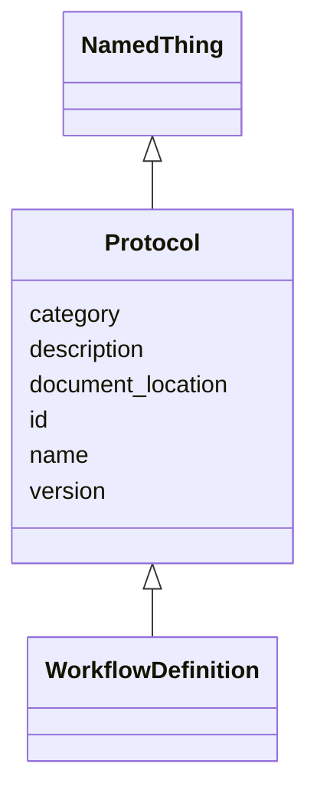

---
search:
  boost: 10.0
---

# Class: Protocol 


_An SOP or method document (was tissue_db:SOP)._


<div data-search-exclude markdown="1">


URI: [brainbank:Protocol](https://w3id.org/VA-NCPTSDBB/brainbank/Protocol)





## Inheritance
* [NamedThing](NamedThing.md)
    * **Protocol**
        * [WorkflowDefinition](WorkflowDefinition.md)


## Slots

| Name | Cardinality and Range | Description | Inheritance |
| ---  | --- | --- | --- |
| [document_location](document_location.md) | 1 <br/> [String](String.md) | URL, directory, or other location where the SOP can be found | direct |
| [version](version.md) | 1 <br/> [String](String.md) | Version string for this SOP or method document | direct |
| [id](id.md) | 1 <br/> [Uriorcurie](Uriorcurie.md) | Technical identifier (UUID/CURIE); becomes hippo-managed later | [NamedThing](NamedThing.md) |
| [name](name.md) | 1 <br/> [String](String.md) | Human-readable label for the entity | [NamedThing](NamedThing.md) |
| [description](description.md) | 0..1 <br/> [String](String.md) | Free-text narrative description of the entity | [NamedThing](NamedThing.md) |
| [category](category.md) | 0..1 <br/> [String](String.md) | Names the concrete class of this instance | [NamedThing](NamedThing.md) |


## Usages

| used by | used in | type | used |
| ---  | --- | --- | --- |
| [BankFreshBrain](BankFreshBrain.md) | [protocol](protocol.md) | range | [Protocol](Protocol.md) |
| [BankFixedBrain](BankFixedBrain.md) | [protocol](protocol.md) | range | [Protocol](Protocol.md) |
| [BankDura](BankDura.md) | [protocol](protocol.md) | range | [Protocol](Protocol.md) |
| [BankCSF](BankCSF.md) | [protocol](protocol.md) | range | [Protocol](Protocol.md) |
| [BankBlood](BankBlood.md) | [protocol](protocol.md) | range | [Protocol](Protocol.md) |
| [BankSkin](BankSkin.md) | [protocol](protocol.md) | range | [Protocol](Protocol.md) |
| [BankMuscle](BankMuscle.md) | [protocol](protocol.md) | range | [Protocol](Protocol.md) |
| [BankVessels](BankVessels.md) | [protocol](protocol.md) | range | [Protocol](Protocol.md) |
| [BankSpinalCord](BankSpinalCord.md) | [protocol](protocol.md) | range | [Protocol](Protocol.md) |
| [BlockDura](BlockDura.md) | [protocol](protocol.md) | range | [Protocol](Protocol.md) |
| [BlockMuscle](BlockMuscle.md) | [protocol](protocol.md) | range | [Protocol](Protocol.md) |
| [BlockSpinalCord](BlockSpinalCord.md) | [protocol](protocol.md) | range | [Protocol](Protocol.md) |
| [BlockFrozenBrain](BlockFrozenBrain.md) | [protocol](protocol.md) | range | [Protocol](Protocol.md) |
| [BlockFixedBrain](BlockFixedBrain.md) | [protocol](protocol.md) | range | [Protocol](Protocol.md) |
| [BlockFixedHemisphere](BlockFixedHemisphere.md) | [protocol](protocol.md) | range | [Protocol](Protocol.md) |
| [SectionFixedBrain](SectionFixedBrain.md) | [protocol](protocol.md) | range | [Protocol](Protocol.md) |
| [DissectFrozenBrain](DissectFrozenBrain.md) | [protocol](protocol.md) | range | [Protocol](Protocol.md) |
| [DissectFixedBrain](DissectFixedBrain.md) | [protocol](protocol.md) | range | [Protocol](Protocol.md) |
| [CultureTissue](CultureTissue.md) | [protocol](protocol.md) | range | [Protocol](Protocol.md) |
| [CultureDura](CultureDura.md) | [protocol](protocol.md) | range | [Protocol](Protocol.md) |
| [CultureSkin](CultureSkin.md) | [protocol](protocol.md) | range | [Protocol](Protocol.md) |
| [SliceTissueToSlide](SliceTissueToSlide.md) | [protocol](protocol.md) | range | [Protocol](Protocol.md) |
| [CreateBrainSlide](CreateBrainSlide.md) | [protocol](protocol.md) | range | [Protocol](Protocol.md) |
| [CreateSpinalCordSlide](CreateSpinalCordSlide.md) | [protocol](protocol.md) | range | [Protocol](Protocol.md) |
| [Activity](Activity.md) | [protocol](protocol.md) | range | [Protocol](Protocol.md) |
| [Process](Process.md) | [protocol](protocol.md) | range | [Protocol](Protocol.md) |
| [Assay](Assay.md) | [protocol](protocol.md) | range | [Protocol](Protocol.md) |
| [SequencingAssay](SequencingAssay.md) | [protocol](protocol.md) | range | [Protocol](Protocol.md) |
| [RNASeqAssay](RNASeqAssay.md) | [protocol](protocol.md) | range | [Protocol](Protocol.md) |
| [GenomeSequencingAssay](GenomeSequencingAssay.md) | [protocol](protocol.md) | range | [Protocol](Protocol.md) |
| [ATACSeqAssay](ATACSeqAssay.md) | [protocol](protocol.md) | range | [Protocol](Protocol.md) |
| [ArrayAssay](ArrayAssay.md) | [protocol](protocol.md) | range | [Protocol](Protocol.md) |
| [GenotypingAssay](GenotypingAssay.md) | [protocol](protocol.md) | range | [Protocol](Protocol.md) |
| [MethylationArrayAssay](MethylationArrayAssay.md) | [protocol](protocol.md) | range | [Protocol](Protocol.md) |
| [ImagingAssay](ImagingAssay.md) | [protocol](protocol.md) | range | [Protocol](Protocol.md) |
| [Analysis](Analysis.md) | [protocol](protocol.md) | range | [Protocol](Protocol.md) |


## Identifier and Mapping Information


### Schema Source


* from schema: https://w3id.org/VA-NCPTSDBB/brainbank/brainbank


## Mappings

| Mapping Type | Mapped Value |
| ---  | ---  |
| self | brainbank:Protocol |
| native | brainbank:Protocol |


## LinkML Source

<!-- TODO: investigate https://stackoverflow.com/questions/37606292/how-to-create-tabbed-code-blocks-in-mkdocs-or-sphinx -->

### Direct

<details>
```yaml
name: Protocol
description: An SOP or method document (was tissue_db:SOP).
from_schema: https://w3id.org/VA-NCPTSDBB/brainbank/brainbank
is_a: NamedThing
attributes:
  document_location:
    name: document_location
    description: URL, directory, or other location where the SOP can be found.
    from_schema: https://w3id.org/VA-NCPTSDBB/brainbank/core
    rank: 1000
    domain_of:
    - Protocol
    required: true
  version:
    name: version
    description: Version string for this SOP or method document.
    from_schema: https://w3id.org/VA-NCPTSDBB/brainbank/core
    rank: 1000
    domain_of:
    - Protocol
    required: true

```
</details>

### Induced

<details>
```yaml
name: Protocol
description: An SOP or method document (was tissue_db:SOP).
from_schema: https://w3id.org/VA-NCPTSDBB/brainbank/brainbank
is_a: NamedThing
attributes:
  document_location:
    name: document_location
    description: URL, directory, or other location where the SOP can be found.
    from_schema: https://w3id.org/VA-NCPTSDBB/brainbank/core
    rank: 1000
    owner: Protocol
    domain_of:
    - Protocol
    range: string
    required: true
  version:
    name: version
    description: Version string for this SOP or method document.
    from_schema: https://w3id.org/VA-NCPTSDBB/brainbank/core
    rank: 1000
    owner: Protocol
    domain_of:
    - Protocol
    range: string
    required: true
  id:
    name: id
    description: Technical identifier (UUID/CURIE); becomes hippo-managed later.
    from_schema: https://w3id.org/VA-NCPTSDBB/brainbank/core
    rank: 1000
    identifier: true
    owner: Protocol
    domain_of:
    - NamedThing
    range: uriorcurie
    required: true
  name:
    name: name
    description: Human-readable label for the entity.
    from_schema: https://w3id.org/VA-NCPTSDBB/brainbank/core
    rank: 1000
    owner: Protocol
    domain_of:
    - NamedThing
    range: string
    required: true
  description:
    name: description
    description: Free-text narrative description of the entity.
    from_schema: https://w3id.org/VA-NCPTSDBB/brainbank/core
    rank: 1000
    owner: Protocol
    domain_of:
    - NamedThing
    range: string
  category:
    name: category
    description: Names the concrete class of this instance. Lets polymorphic inlined
      collections (e.g. a `samples` list holding SolidSample/LiquidSample) instantiate
      the right subclass.
    from_schema: https://w3id.org/VA-NCPTSDBB/brainbank/core
    rank: 1000
    designates_type: true
    owner: Protocol
    domain_of:
    - NamedThing
    range: string

```
</details></div>