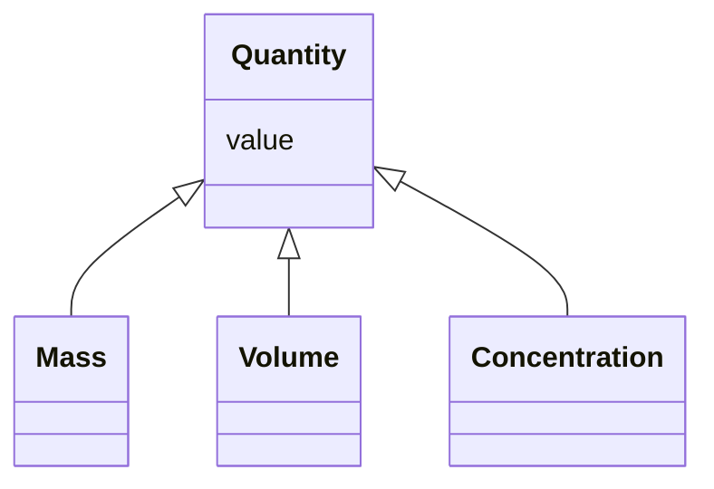

---
search:
  boost: 10.0
---

# Class: Quantity 


_Abstract base for a numeric measurement paired with a unit._


<div data-search-exclude markdown="1">


* __NOTE__: this is an abstract class and should not be instantiated directly


URI: [brainbank:Quantity](https://w3id.org/VA-NCPTSDBB/brainbank/Quantity)





## Inheritance
* **Quantity**
    * [Mass](Mass.md)
    * [Volume](Volume.md)
    * [Concentration](Concentration.md)


## Slots

| Name | Cardinality and Range | Description | Inheritance |
| ---  | --- | --- | --- |
| [value](value.md) | 0..1 <br/> [Float](Float.md) | Numeric magnitude of the measurement | direct |


## Identifier and Mapping Information


### Schema Source


* from schema: https://w3id.org/VA-NCPTSDBB/brainbank/brainbank


## Mappings

| Mapping Type | Mapped Value |
| ---  | ---  |
| self | brainbank:Quantity |
| native | brainbank:Quantity |


## LinkML Source

<!-- TODO: investigate https://stackoverflow.com/questions/37606292/how-to-create-tabbed-code-blocks-in-mkdocs-or-sphinx -->

### Direct

<details>
```yaml
name: Quantity
description: Abstract base for a numeric measurement paired with a unit.
from_schema: https://w3id.org/VA-NCPTSDBB/brainbank/brainbank
abstract: true
attributes:
  value:
    name: value
    description: Numeric magnitude of the measurement.
    from_schema: https://w3id.org/VA-NCPTSDBB/brainbank/core
    rank: 1000
    domain_of:
    - Quantity
    - Parameter
    range: float

```
</details>

### Induced

<details>
```yaml
name: Quantity
description: Abstract base for a numeric measurement paired with a unit.
from_schema: https://w3id.org/VA-NCPTSDBB/brainbank/brainbank
abstract: true
attributes:
  value:
    name: value
    description: Numeric magnitude of the measurement.
    from_schema: https://w3id.org/VA-NCPTSDBB/brainbank/core
    rank: 1000
    owner: Quantity
    domain_of:
    - Quantity
    - Parameter
    range: float

```
</details></div>