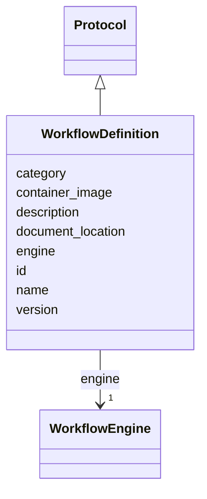

---
search:
  boost: 10.0
---

# Class: WorkflowDefinition 


_A reusable, versioned executable pipeline DEFINITION (e.g. nf-core/rnaseq 3.14.0) — the recipe, independent of any single execution. is_a Protocol: the inherited (required) document_location is the pipeline source/registry URL and version is the pipeline release, so a run follows this definition just as a Process follows an SOP. Shared across many runs._


<div data-search-exclude markdown="1">


URI: [brainbank:WorkflowDefinition](https://w3id.org/VA-NCPTSDBB/brainbank/WorkflowDefinition)





## Inheritance
* [NamedThing](NamedThing.md)
    * [Protocol](Protocol.md)
        * **WorkflowDefinition**


## Slots

| Name | Cardinality and Range | Description | Inheritance |
| ---  | --- | --- | --- |
| [engine](engine.md) | 1 <br/> [WorkflowEngine](WorkflowEngine.md) | Workflow engine the pipeline is written for | direct |
| [container_image](container_image.md) | 0..1 <br/> [String](String.md) | Default/declared container image or digest for the pipeline, if any | direct |
| [document_location](document_location.md) | 1 <br/> [String](String.md) | URL, directory, or other location where the SOP can be found | [Protocol](Protocol.md) |
| [version](version.md) | 1 <br/> [String](String.md) | Version string for this SOP or method document | [Protocol](Protocol.md) |
| [id](id.md) | 1 <br/> [Uriorcurie](Uriorcurie.md) | Technical identifier (UUID/CURIE); becomes hippo-managed later | [NamedThing](NamedThing.md) |
| [name](name.md) | 1 <br/> [String](String.md) | Human-readable label for the entity | [NamedThing](NamedThing.md) |
| [description](description.md) | 0..1 <br/> [String](String.md) | Free-text narrative description of the entity | [NamedThing](NamedThing.md) |
| [category](category.md) | 0..1 <br/> [String](String.md) | Names the concrete class of this instance | [NamedThing](NamedThing.md) |


## Usages

| used by | used in | type | used |
| ---  | --- | --- | --- |
| [BrainBank](BrainBank.md) | [workflow_definitions](workflow_definitions.md) | range | [WorkflowDefinition](WorkflowDefinition.md) |
| [WorkflowRun](WorkflowRun.md) | [protocol](protocol.md) | range | [WorkflowDefinition](WorkflowDefinition.md) |


## Identifier and Mapping Information


### Schema Source


* from schema: https://w3id.org/VA-NCPTSDBB/brainbank/brainbank


## Mappings

| Mapping Type | Mapped Value |
| ---  | ---  |
| self | brainbank:WorkflowDefinition |
| native | brainbank:WorkflowDefinition |
| exact | bioschemas:ComputationalWorkflow |


## LinkML Source

<!-- TODO: investigate https://stackoverflow.com/questions/37606292/how-to-create-tabbed-code-blocks-in-mkdocs-or-sphinx -->

### Direct

<details>
```yaml
name: WorkflowDefinition
description: 'A reusable, versioned executable pipeline DEFINITION (e.g. nf-core/rnaseq
  3.14.0) — the recipe, independent of any single execution. is_a Protocol: the inherited
  (required) document_location is the pipeline source/registry URL and version is
  the pipeline release, so a run follows this definition just as a Process follows
  an SOP. Shared across many runs.'
from_schema: https://w3id.org/VA-NCPTSDBB/brainbank/brainbank
exact_mappings:
- bioschemas:ComputationalWorkflow
is_a: Protocol
attributes:
  engine:
    name: engine
    description: Workflow engine the pipeline is written for.
    from_schema: https://w3id.org/VA-NCPTSDBB/brainbank/analysis
    rank: 1000
    domain_of:
    - WorkflowDefinition
    range: WorkflowEngine
    required: true
  container_image:
    name: container_image
    description: Default/declared container image or digest for the pipeline, if any.
    from_schema: https://w3id.org/VA-NCPTSDBB/brainbank/analysis
    rank: 1000
    domain_of:
    - WorkflowDefinition

```
</details>

### Induced

<details>
```yaml
name: WorkflowDefinition
description: 'A reusable, versioned executable pipeline DEFINITION (e.g. nf-core/rnaseq
  3.14.0) — the recipe, independent of any single execution. is_a Protocol: the inherited
  (required) document_location is the pipeline source/registry URL and version is
  the pipeline release, so a run follows this definition just as a Process follows
  an SOP. Shared across many runs.'
from_schema: https://w3id.org/VA-NCPTSDBB/brainbank/brainbank
exact_mappings:
- bioschemas:ComputationalWorkflow
is_a: Protocol
attributes:
  engine:
    name: engine
    description: Workflow engine the pipeline is written for.
    from_schema: https://w3id.org/VA-NCPTSDBB/brainbank/analysis
    rank: 1000
    owner: WorkflowDefinition
    domain_of:
    - WorkflowDefinition
    range: WorkflowEngine
    required: true
  container_image:
    name: container_image
    description: Default/declared container image or digest for the pipeline, if any.
    from_schema: https://w3id.org/VA-NCPTSDBB/brainbank/analysis
    rank: 1000
    owner: WorkflowDefinition
    domain_of:
    - WorkflowDefinition
    range: string
  document_location:
    name: document_location
    description: URL, directory, or other location where the SOP can be found.
    from_schema: https://w3id.org/VA-NCPTSDBB/brainbank/core
    rank: 1000
    owner: WorkflowDefinition
    domain_of:
    - Protocol
    range: string
    required: true
  version:
    name: version
    description: Version string for this SOP or method document.
    from_schema: https://w3id.org/VA-NCPTSDBB/brainbank/core
    rank: 1000
    owner: WorkflowDefinition
    domain_of:
    - Protocol
    range: string
    required: true
  id:
    name: id
    description: Technical identifier (UUID/CURIE); becomes hippo-managed later.
    from_schema: https://w3id.org/VA-NCPTSDBB/brainbank/core
    rank: 1000
    identifier: true
    owner: WorkflowDefinition
    domain_of:
    - NamedThing
    range: uriorcurie
    required: true
  name:
    name: name
    description: Human-readable label for the entity.
    from_schema: https://w3id.org/VA-NCPTSDBB/brainbank/core
    rank: 1000
    owner: WorkflowDefinition
    domain_of:
    - NamedThing
    range: string
    required: true
  description:
    name: description
    description: Free-text narrative description of the entity.
    from_schema: https://w3id.org/VA-NCPTSDBB/brainbank/core
    rank: 1000
    owner: WorkflowDefinition
    domain_of:
    - NamedThing
    range: string
  category:
    name: category
    description: Names the concrete class of this instance. Lets polymorphic inlined
      collections (e.g. a `samples` list holding SolidSample/LiquidSample) instantiate
      the right subclass.
    from_schema: https://w3id.org/VA-NCPTSDBB/brainbank/core
    rank: 1000
    designates_type: true
    owner: WorkflowDefinition
    domain_of:
    - NamedThing
    range: string

```
</details></div>