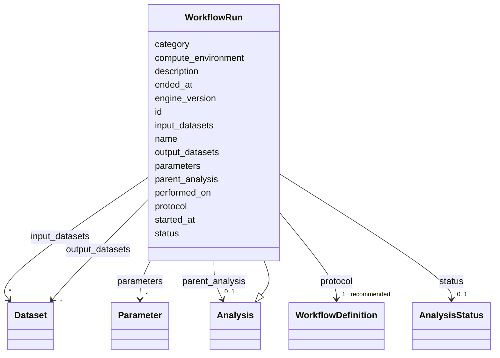

---
search:
  boost: 10.0
---

# Class: WorkflowRun 


_A single execution of a WorkflowDefinition by a workflow engine (e.g. one nf-core/rnaseq run). The run's identity-of-recipe lives on the linked WorkflowDefinition (via the inherited protocol slot, narrowed below); this class adds only execution-specific detail._


<div data-search-exclude markdown="1">


URI: [brainbank:WorkflowRun](https://w3id.org/VA-NCPTSDBB/brainbank/WorkflowRun)





## Inheritance
* [NamedThing](NamedThing.md)
    * [Activity](Activity.md)
        * [Analysis](Analysis.md)
            * **WorkflowRun**


## Slots

| Name | Cardinality and Range | Description | Inheritance |
| ---  | --- | --- | --- |
| [engine_version](engine_version.md) | 0..1 <br/> [String](String.md) | Version of the workflow engine used for THIS run (e | direct |
| [input_datasets](input_datasets.md) | * <br/> [Dataset](Dataset.md) | Datasets consumed by this analysis | [Analysis](Analysis.md) |
| [output_datasets](output_datasets.md) | * <br/> [Dataset](Dataset.md) | Datasets produced by this analysis | [Analysis](Analysis.md) |
| [parameters](parameters.md) | * <br/> [Parameter](Parameter.md) | Parameters/settings supplied to the run | [Analysis](Analysis.md) |
| [started_at](started_at.md) | 0..1 <br/> [Datetime](Datetime.md) | Date-time when this analysis run started execution | [Analysis](Analysis.md) |
| [ended_at](ended_at.md) | 0..1 <br/> [Datetime](Datetime.md) | Date-time when this analysis run finished (successfully or with failure) | [Analysis](Analysis.md) |
| [status](status.md) | 0..1 <br/> [AnalysisStatus](AnalysisStatus.md) | Execution status of this analysis run | [Analysis](Analysis.md) |
| [compute_environment](compute_environment.md) | 0..1 <br/> [String](String.md) | Free-text description of where/how it ran (cluster, cloud, profile) | [Analysis](Analysis.md) |
| [parent_analysis](parent_analysis.md) | 0..1 <br/> [Analysis](Analysis.md) | Enclosing analysis, if this is a sub-step | [Analysis](Analysis.md) |
| [protocol](protocol.md) | 1 _recommended_ <br/> [WorkflowDefinition](WorkflowDefinition.md) | The workflow definition (recipe) this run executed | [Activity](Activity.md) |
| [performed_on](performed_on.md) | 0..1 <br/> [Date](Date.md) | Date the activity was carried out | [Activity](Activity.md) |
| [id](id.md) | 1 <br/> [Uriorcurie](Uriorcurie.md) | Technical identifier (UUID/CURIE); becomes hippo-managed later | [NamedThing](NamedThing.md) |
| [name](name.md) | 1 <br/> [String](String.md) | Human-readable label for the entity | [NamedThing](NamedThing.md) |
| [description](description.md) | 0..1 <br/> [String](String.md) | Free-text narrative description of the entity | [NamedThing](NamedThing.md) |
| [category](category.md) | 0..1 <br/> [String](String.md) | Names the concrete class of this instance | [NamedThing](NamedThing.md) |


## Identifier and Mapping Information


### Schema Source


* from schema: https://w3id.org/VA-NCPTSDBB/brainbank/brainbank


## Mappings

| Mapping Type | Mapped Value |
| ---  | ---  |
| self | brainbank:WorkflowRun |
| native | brainbank:WorkflowRun |
| exact | bioschemas:ComputationalWorkflow |


## LinkML Source

<!-- TODO: investigate https://stackoverflow.com/questions/37606292/how-to-create-tabbed-code-blocks-in-mkdocs-or-sphinx -->

### Direct

<details>
```yaml
name: WorkflowRun
description: A single execution of a WorkflowDefinition by a workflow engine (e.g.
  one nf-core/rnaseq run). The run's identity-of-recipe lives on the linked WorkflowDefinition
  (via the inherited protocol slot, narrowed below); this class adds only execution-specific
  detail.
from_schema: https://w3id.org/VA-NCPTSDBB/brainbank/brainbank
exact_mappings:
- bioschemas:ComputationalWorkflow
is_a: Analysis
slot_usage:
  protocol:
    name: protocol
    description: The workflow definition (recipe) this run executed.
    range: WorkflowDefinition
    required: true
attributes:
  engine_version:
    name: engine_version
    description: Version of the workflow engine used for THIS run (e.g. Nextflow 23.10.1).
    from_schema: https://w3id.org/VA-NCPTSDBB/brainbank/analysis
    rank: 1000
    domain_of:
    - WorkflowRun

```
</details>

### Induced

<details>
```yaml
name: WorkflowRun
description: A single execution of a WorkflowDefinition by a workflow engine (e.g.
  one nf-core/rnaseq run). The run's identity-of-recipe lives on the linked WorkflowDefinition
  (via the inherited protocol slot, narrowed below); this class adds only execution-specific
  detail.
from_schema: https://w3id.org/VA-NCPTSDBB/brainbank/brainbank
exact_mappings:
- bioschemas:ComputationalWorkflow
is_a: Analysis
slot_usage:
  protocol:
    name: protocol
    description: The workflow definition (recipe) this run executed.
    range: WorkflowDefinition
    required: true
attributes:
  engine_version:
    name: engine_version
    description: Version of the workflow engine used for THIS run (e.g. Nextflow 23.10.1).
    from_schema: https://w3id.org/VA-NCPTSDBB/brainbank/analysis
    rank: 1000
    owner: WorkflowRun
    domain_of:
    - WorkflowRun
    range: string
  input_datasets:
    name: input_datasets
    description: Datasets consumed by this analysis.
    from_schema: https://w3id.org/VA-NCPTSDBB/brainbank/analysis
    rank: 1000
    owner: WorkflowRun
    domain_of:
    - Analysis
    range: Dataset
    multivalued: true
  output_datasets:
    name: output_datasets
    description: Datasets produced by this analysis. Each such Dataset should also
      point back via produced_by -> this Analysis.
    from_schema: https://w3id.org/VA-NCPTSDBB/brainbank/analysis
    rank: 1000
    owner: WorkflowRun
    domain_of:
    - Analysis
    range: Dataset
    multivalued: true
  parameters:
    name: parameters
    description: Parameters/settings supplied to the run.
    from_schema: https://w3id.org/VA-NCPTSDBB/brainbank/analysis
    rank: 1000
    owner: WorkflowRun
    domain_of:
    - Analysis
    range: Parameter
    multivalued: true
    inlined: true
    inlined_as_list: true
  started_at:
    name: started_at
    description: Date-time when this analysis run started execution.
    from_schema: https://w3id.org/VA-NCPTSDBB/brainbank/analysis
    rank: 1000
    owner: WorkflowRun
    domain_of:
    - Analysis
    range: datetime
  ended_at:
    name: ended_at
    description: Date-time when this analysis run finished (successfully or with failure).
    from_schema: https://w3id.org/VA-NCPTSDBB/brainbank/analysis
    rank: 1000
    owner: WorkflowRun
    domain_of:
    - Analysis
    range: datetime
  status:
    name: status
    description: Execution status of this analysis run.
    from_schema: https://w3id.org/VA-NCPTSDBB/brainbank/analysis
    rank: 1000
    owner: WorkflowRun
    domain_of:
    - Analysis
    range: AnalysisStatus
  compute_environment:
    name: compute_environment
    description: Free-text description of where/how it ran (cluster, cloud, profile).
    from_schema: https://w3id.org/VA-NCPTSDBB/brainbank/analysis
    rank: 1000
    owner: WorkflowRun
    domain_of:
    - Analysis
    range: string
  parent_analysis:
    name: parent_analysis
    description: Enclosing analysis, if this is a sub-step. SEAM for future fine-grained
      provenance (a nextflow process / snakemake rule); not built out in the prototype.
    from_schema: https://w3id.org/VA-NCPTSDBB/brainbank/analysis
    rank: 1000
    owner: WorkflowRun
    domain_of:
    - Analysis
    range: Analysis
  protocol:
    name: protocol
    description: The workflow definition (recipe) this run executed.
    from_schema: https://w3id.org/VA-NCPTSDBB/brainbank/core
    rank: 1000
    owner: WorkflowRun
    domain_of:
    - Activity
    range: WorkflowDefinition
    required: true
    recommended: true
  performed_on:
    name: performed_on
    description: Date the activity was carried out.
    from_schema: https://w3id.org/VA-NCPTSDBB/brainbank/core
    rank: 1000
    owner: WorkflowRun
    domain_of:
    - Activity
    range: date
  id:
    name: id
    description: Technical identifier (UUID/CURIE); becomes hippo-managed later.
    from_schema: https://w3id.org/VA-NCPTSDBB/brainbank/core
    rank: 1000
    identifier: true
    owner: WorkflowRun
    domain_of:
    - NamedThing
    range: uriorcurie
    required: true
  name:
    name: name
    description: Human-readable label for the entity.
    from_schema: https://w3id.org/VA-NCPTSDBB/brainbank/core
    rank: 1000
    owner: WorkflowRun
    domain_of:
    - NamedThing
    range: string
    required: true
  description:
    name: description
    description: Free-text narrative description of the entity.
    from_schema: https://w3id.org/VA-NCPTSDBB/brainbank/core
    rank: 1000
    owner: WorkflowRun
    domain_of:
    - NamedThing
    range: string
  category:
    name: category
    description: Names the concrete class of this instance. Lets polymorphic inlined
      collections (e.g. a `samples` list holding SolidSample/LiquidSample) instantiate
      the right subclass.
    from_schema: https://w3id.org/VA-NCPTSDBB/brainbank/core
    rank: 1000
    designates_type: true
    owner: WorkflowRun
    domain_of:
    - NamedThing
    range: string

```
</details></div>